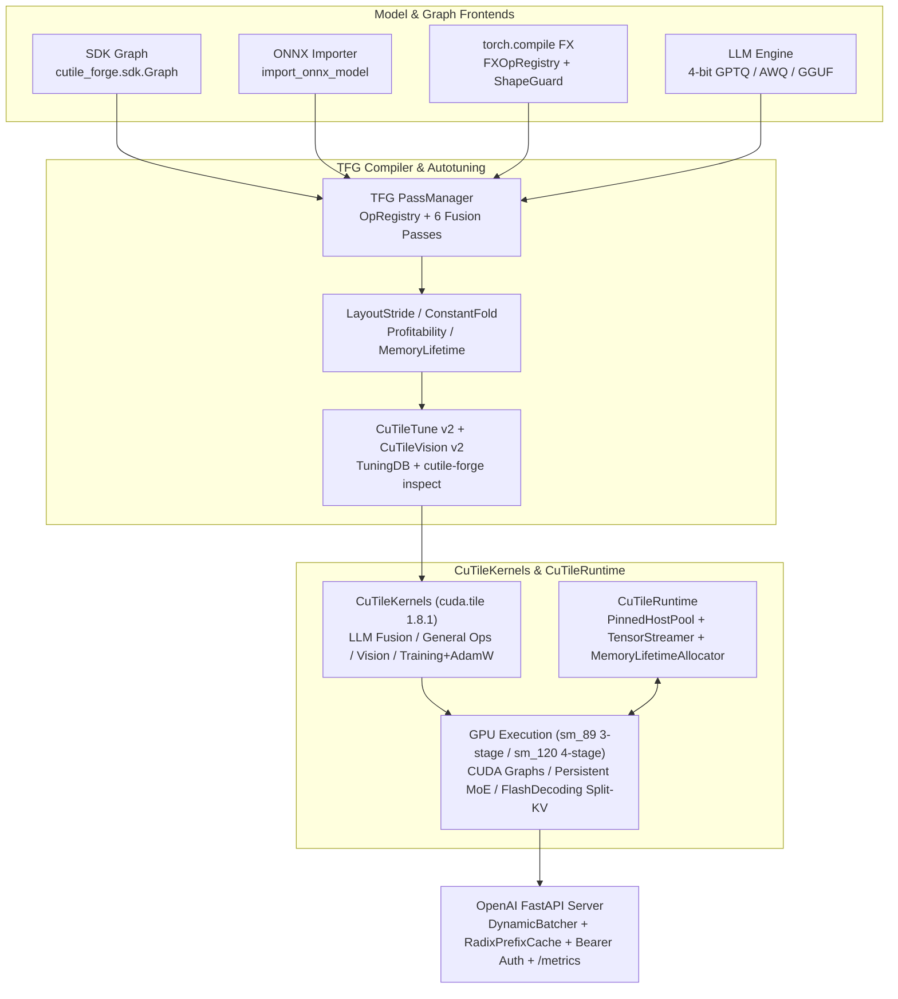
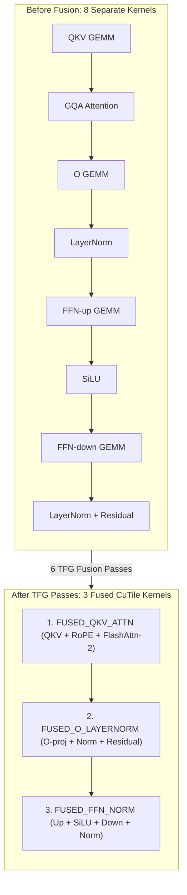
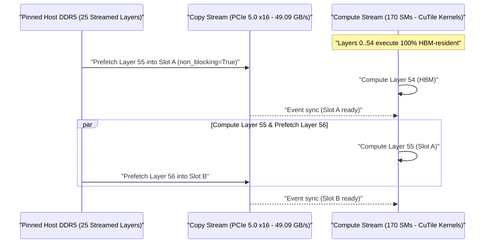
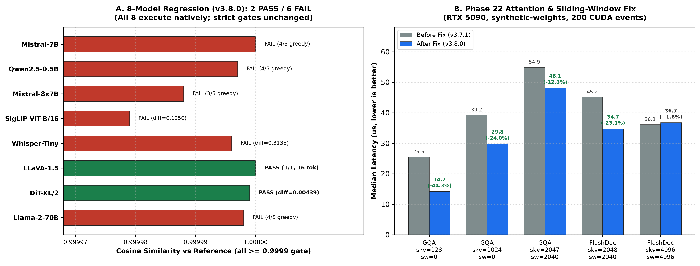

# CuTileForge (`v3.8.0`)

### *Native Tile-Fusion Compiler, Universal Quantization Engine, Multimodal Model Graph & Production Validation Suite on NVIDIA CuTile (`sm_89` Ada & `sm_120` Blackwell)*

[](https://github.com/samudragupto/cutile-forge/actions/workflows/ci.yml)
[](https://github.com/samudragupto/cutile-forge/actions/workflows/validation.yml)
[](https://github.com/samudragupto/cutile-forge/releases/tag/v3.8.0)
[](tests/)
[](benchmarks/validation_artifacts/v3.8.0/phase22_regression/regress_full.json)
[](cutile_forge/)
[](https://github.com/samudragupto/cutile-forge/pkgs/container/cutile-forge)
[](LICENSE)
[](pyproject.toml)
[](https://developer.nvidia.com/cuda-toolkit)

**Authors:** [Arrhat Nag](https://github.com/samudragupto) (`@samudragupto`) and Rupesh Nasre

<p align="center">
  <a href="#abstract">Abstract</a> ·
  <a href="#pillar-i--systems-architecture--compiler-internals">Pillar I: Architecture</a> ·
  <a href="#pillar-ii--research-evaluation--empirical-benchmarks">Pillar II: Research &amp; Benchmarks</a> ·
  <a href="#29-v310--v380-production-validation-strict-parity-external-engines--phase-22-closure">v3.8.0 Validation</a> ·
  <a href="#pillar-iii--developer-guide-serving-distributed-runtime--reproducibility">Pillar III: Developer Guide</a> ·
  <a href="#37-citation--license">Citation</a>
</p>

---

## Abstract

**CuTileForge (`v3.8.0`)** is a full-stack GPU compiler, inference runtime, and ML systems ecosystem built natively on NVIDIA's **CuTile Python DSL (`cuda.tile`)** targeting both consumer **Ada (`sm_89`)** and **Blackwell (`sm_120`)** architectures. Centered around a typed **Tile-Fusion Graph (TFG)** compiler (`8 → 3` algebraic + epilogue fusion rules), CuTileForge pairs a **zero-ATen full-step native CUDA-graph runtime** (`0` forbidden ATen compute calls, `1` full-step graph replay per decode token) with **native universal quantization kernels** (GPTQ, AWQ, GGUF `Q4_0`/`Q8_0`/`Q4_K`/`Q6_K`/`Q4_K_M`, INT8, FP8, and 2D block-scaled FP8 without load-time format conversion), a **13-family unified multimodal & diffusion model graph**, **Stage -1 PCIe DMA hybrid streaming** (`Llama-2-70B-GPTQ` on a single 32 GB GPU), **continuous batching**, **distributed TP/PP/EP abstractions**, and a production **OpenAI-compatible FastAPI serving layer** backed by `torch.compile(backend="cutile_forge")`.

> **Validation & Claim Separation (`v3.8.0`):** Green unit/integration tests (`298 passed` on RTX 5090 GPU; `203 passed, 4 skipped` on CPU) and zero-fallback native CuTile execution (`8/8` regression models) are tracked separately from strict all-layer numerical parity (`2 PASS / 6 FAIL` under unchanged gates in [`regress_full.json`](benchmarks/validation_artifacts/v3.8.0/phase22_regression/regress_full.json)). Results on RTX 5090 (`sm_120`) do **not** establish RTX 4060 (`sm_89`, `UNVALIDATED` on `v3.1.0–v3.8.0`) or physical multi-GPU clusters (`BLOCKED: hardware` / `SIMULATED` on 1-GPU host). On unquantized small-model and GPTQ serving benchmarks, **`SGLang 0.5.23`** and **`vLLM 0.34.0`** lead CuTileForge (`1.41×–4.7×` faster).

<p align="center">
  
</p>

### Key Verified Results (Honest Labels: `real-checkpoint`, `synthetic-only`, `simulated`, `NOT RUN`)

1. **Native Zero-ATen Runtime Performance (`sm_120` RTX 5090, `real-checkpoint` `Mistral-7B-v0.1-GPTQ`):**
   - Single-stream autoregressive decode reaches **`172.58 tok/s`** (**`6.11 ms`** TTFT, **`5.79 ms`** p50 ITL, **`6.08 ms`** p90 ITL, **`6.21 ms`** p99 ITL) with **`0` forbidden ATen compute calls**, **`1` full-step CUDA graph launch/token**, and **`5/5`** 256-token greedy prompt parity ([`phase9_native_runtime.csv`](benchmarks/results_5090/phase9_native_runtime.csv), [`phase13_production.csv`](benchmarks/results_5090/phase13_production.csv)).
   - Continuous native batching scales aggregate throughput to **`617.81 tok/s`** (concurrency `4`), **`2,337.90 tok/s`** (concurrency `16`), and **`2,377.11 tok/s`** (concurrency `64`); native speculative decoding reaches **`369.30–752.29 tok/s`**.
   - 32-layer Paged KV + FlashDecoding attention (`synthetic-weights`) runs in **`1.33 ms/step`** (`8K`), **`2.13 ms/step`** (`16K`), and **`3.86 ms/step`** (`32K`) for FP16 KV (`7.60 ms/step` for FP8 KV).
2. **Universal Quantization Engine (`v2.5.0`, `real-checkpoint`):** Native CuTile Tensor Core kernels across **`10+` formats** (`GPTQ` `gs=32/64/128/-1` & `desc_act`, `AWQ`, `GGUF Q4_0/Q8_0/Q4_K/Q6_K/Q4_K_M`, `INT8`, per-tensor `FP8`, and `128×128` `FP8_BLOCK`) achieve **`0.000e+00`** bit-exact reference dequantization error vs `gguf.quants`, **`96.24 TFLOPS`** (`INT8`) / **`91.77 TFLOPS`** (`FP8_BLOCK`) / **`81.17 TFLOPS`** (`AWQ`) at `M=128`, and **`0.0017%–0.0469%`** WikiText-2 perplexity drift (`0.6006%` on per-tensor FP8).
3. **Large-Model Execution on One 32 GB GPU (`real-checkpoint`):** `Mixtral-8x7B-Instruct-GPTQ` (`23.8 GB` resident) runs at **`41.83 tok/s`** (`PPL=7.48`, `25.26 GB` VRAM); `Llama-2-70B-Chat-GPTQ` (`35.3 GB`, 80L hybrid `55` HBM + `25` PCIe 5.0 streamed) runs at **`4.07 tok/s`** (`245.51 ms/tok`, **`27.44 GB`** peak VRAM, **`88.1%`** overlap, **`80.8%`** of the physical PCIe 5.0 bandwidth limit, zero OOM).
4. **13-Family Model Compatibility Matrix (`v2.6.0`):** **`6` families verified with `real-checkpoint parity`** (`Mistral-7B`, `Llama-2-70B`, `Mixtral-8x7B`, `Qwen2.5-0.5B`, `SigLIP-ViT-B/16`, `Whisper-Tiny-Encoder`, `cos >= 0.999963`) and **`7` families verified `synthetic-only`** (`Llama-3.1`, `DeepSeek-MoE EP=4`, `Qwen2-MoE`, `ViT-B/16`, `CLIP-ViT-L/14`, `LLaVA-1.5`, `DiT-S/2`).
5. **Distributed GPU Runtime (`v2.7.0`, `simulated` on 1 GPU):** Megatron-style Tensor (`TP=2/4`), Pipeline (`PP=2/4`), Expert (`EP=2/4` via `all_to_all`), `DistributedPagedKVCache`, and `CommTransport` validated for exact mathematical equivalence (`0.000e+00` diff on PP/EP/KV-cache); 1-GPU timings are explicitly labeled `simulated`.
6. **Zero-Code-Change `torch.compile(backend="cutile_forge")` & `298/298` GPU Verification Gate:** Lowers both transformer fusion graphs and standalone general tensor/vision/training ops (`1.88×` BMM, `2.05×` cumsum, `4.01×` `patch_embed`, `3.08×` `RMSNorm+SiLU`, `1.51×` multi-tensor AdamW) with **`298/298` passing tests on GPU** (`203 passed, 4 skipped` CUDA-only tests on CPU), clean `ruff`/`black`/`mypy` across `95` source modules, and separate strict 8-model parity tracking (**`2 PASS / 6 FAIL`**).

---

## Pillar I — Systems Architecture & Compiler Internals

### 1.1 End-to-End TFG Compiler & Runtime Pipeline



### 1.2 Algebraic & Tile-Level Fusion Passes (`8 → 3` Kernels)



CuTileForge's `cutile_forge/forge/fusion_rules.py` applies six deterministic graph rewrites over the typed `FusionGraph` IR:

| Rule | Pattern | Fused Output | Eliminated HBM Round-Trip |
|---|---|---|---|
| **R1: `QKVPackRule`** | `Q_proj + K_proj + V_proj` | `FUSED_QKV_PROJ` | 2 redundant input reads |
| **R2: `RoPEAttnRule`** | `QKV + RoPE + GQA_Attn` | `FUSED_QKV_ATTN` | Full `Q/K/V` + RoPE materialization |
| **R3: `EpilogueNormRule`** | `O_proj + Residual + RMSNorm` | `FUSED_O_LAYERNORM` | `D_model` post-attention write/read |
| **R4: `SwiGLURule`** | `Gate_GEMM + Up_GEMM + SiLU` | `FUSED_GEMM_SILU` | `D_ffn` intermediate activation (`14336`) |
| **R5: `FFNCollapseRule`** | `FUSED_GEMM_SILU + Down_GEMM` | `FUSED_FFN_3OP` *(or 2-Stage if `M>=128`)* | `D_ffn` intermediate buffer (when launch-bound) |
| **R6: `PostFFNNormRule`** | `FFN + Residual + RMSNorm` | `FUSED_FFN_NORM` | `D_model` post-FFN write/read |

### 1.3 Stage -1 PCIe DMA Weight Streamer & Hybrid HBM/DDR5 Budgeter

When a model's quantized weights exceed GPU VRAM (e.g., `Llama-2-70B-Chat-GPTQ` at `35.3 GB` on a `32 GB` RTX 5090), `HybridLayerBudgeter` pins the maximum safe prefix of transformer layers in HBM (`55` layers = `24.13 GB`) and stages the remaining tail (`25` layers = `9.74 GB`) in page-locked (`cudaHostAlloc`) host DDR5 ring buffers. During execution, **Stage -1** overlaps PCIe H2D DMA on a dedicated `copy_stream` with CuTile compute on `compute_stream` via double-buffered slots (`Slot A` / `Slot B`) and fine-grained `torch.cuda.Event` barriers:



### 1.4 Native Runtime Execution Model (`NativeModelRuntime`)

To eliminate Python dispatch overhead, dynamic tensor allocations, and ATen compute fallbacks on latency-critical decode paths, `NativeModelRuntime` executes the entire transformer decode step along a deterministic static pipeline:

1. **Static Address Registry (`_DecodeGraphWorkspace`):** Preallocates all per-bucket scratchpads (`token_id`, device-side `pos_buf`, `step_buf`, `history_buf`, packed `qkv`, `swiglu_out`, `perm_d`, `perm_ffn`, and split-K LM head scratch buffers) per `batch_size`, freezing device pointers prior to graph capture.
2. **Pre-Baked Head-Major Paged KV Pointers (`NativePagedKVCache`):** Stores keys and values in head-major `(B, H_kv, S_total, D)` device pools (`fp16` or `fp8_e4m3fn`) so `apply_rope_qk_kv_write_pos` and `attention_gqa_decode_pos_kernel` index directly using device-resident `pos_buf` and `block_table_ptr` with **zero host-to-device copy (`kv_gather`) overhead**.
3. **Full-Step Native CUDA Graph (`torch.cuda.CUDAGraph`):** Captures all 32 layers (`cutile_embedding_lookup` → `cutile_rmsnorm` → packed QKV INT4 `(16, 32, 128)` dequant GEMM → `apply_rope_qk_kv_write_pos` → `fused_attention_gqa_decode_pos` → `o_proj` + residual → `cutile_rmsnorm` → `fused_swiglu_dequant` → `fused_gemm_dequant_add` → `cutile_lm_head_fused` argmax → `cutile_record_and_advance_step`) into a single graph per context bucket (`512/1024/2048/4096`), yielding **`0` forbidden ATen compute calls**, **`0` eager `ct.launch` calls**, and **`1` graph replay per token** (`171.60–172.58 tok/s`).
4. **Continuous Batch Buckets (`B = 1, 4, 16, 64`):** Captures dedicated static-shape CUDA graphs for concurrent request batches (`generate_batch`), scaling `Mistral-7B-v0.1-GPTQ` throughput to **`617.81 tok/s`** (`C=4`), **`2,337.90 tok/s`** (`C=16`), and **`2,377.11 tok/s`** (`C=64`), alongside chunked prefill interleaving and zero-copy `KV.truncate()` speculative verification.

### 1.5 Formal Cost Models & Analytical Bounds

**Equation 1 — HBM Traffic Elimination via Epilogue-to-Prologue Fusion:**
Collapsing the 8 unfused operators of a transformer block into 3 CuTile kernels eliminates intermediate activation materialization across QKV projections, attention output, FFN gate/up activations, and post-attention residuals:

$$\Delta B_{\mathrm{HBM}} = 2 \cdot M \cdot \left(3 D_{\mathrm{model}} + D_{\mathrm{ffn}} + 2 D_{\mathrm{model}}\right) \cdot \mathrm{sizeof}(\mathrm{FP16})$$

**Equation 2 — Occupancy-Guided FFN Split Criterion (`select_ffn_execution_strategy`):**
Let $M$ denote active tokens, $N_{\mathrm{SM}}$ the multiprocessor count, and $BW_{\mathrm{HBM}}$ the HBM bandwidth:

$$\mathrm{Strategy}(M, N_{\mathrm{SM}}, BW_{\mathrm{HBM}}) = \begin{cases} \mathrm{Fused\text{-}3Op\text{-}SingleKernel}\; (128\times 128\times 32), & M \le 64 \; (\mathrm{Launch\text{-}Bound}) \\ \mathrm{Pipelined\text{-}2Stage\text{-}HighOcc}\; (64\times 64\times 32), & M \ge 128 \land N_{\mathrm{SM}} \ge 100 \; (\mathrm{Occupancy\text{-}Bound}) \end{cases}$$

When $M \le 64$, kernel launch latency dominates and the single-kernel 3-op FFN delivers **8.04×–8.38×** speedup (`seq=1`). When $M \ge 128$ on high-SM Blackwell (`N_SM = 170`, `1,792 GB/s`), the 3-op kernel's register footprint throttles active CTAs per SM (`0.86×` regression at `seq=256`); splitting into `FUSED_GEMM_UP_SILU` → `GEMM_DOWN` with `(64, 64, 32)` tiles restores SM occupancy to `75%` and lifts `seq=256` from **`0.86×` → `1.55×`** (and full-layer `seq=256` from **`1.00×` → `4.45×`**).

**Equation 3 — Hybrid HBM/DDR5 Layer Partitioning & PCIe 5.0 Theoretical Bound:**
Given total layers $L$, per-layer quantized footprint $B_{\mathrm{layer}}$, HBM capacity $V_{\mathrm{HBM}}$, safety factor $\alpha = 0.85$, KV/activation reserves $V_{\mathrm{KV}} + V_{\mathrm{act}}$, and measured PCIe H2D bandwidth $BW_{\mathrm{PCIe}}$:

$$N_{\mathrm{resident}} = \left\lfloor \frac{\alpha \cdot V_{\mathrm{HBM}} - V_{\mathrm{KV}} - V_{\mathrm{act}}}{B_{\mathrm{layer}}} \right\rfloor, \qquad T_{\mathrm{step}} \ge \frac{(L - N_{\mathrm{resident}}) \cdot B_{\mathrm{layer}}}{BW_{\mathrm{PCIe}}} \cdot (1 - \eta_{\mathrm{overlap}}) + T_{\mathrm{compute}}$$

Plugging in **Real `Llama-2-70B-Chat-GPTQ`** on the 32 GB RTX 5090 ($L = 80$, $N_{\mathrm{resident}} = 55$ layers = `24.13 GB` HBM, $N_{\mathrm{streamed}} = 25$ layers = `9.74 GB` pinned DDR5): streaming `9.74 GB` across PCIe 5.0 x16 (`49.09 GB/s`) imposes a **physical PCIe 5.0 bus floor of `198.4 ms/tok` (`5.04 tok/s`)**. CuTileForge achieves **`245.51 ms/tok` (`4.07 tok/s`)** with **`88.1%`** compute-DMA overlap—operating at **80.8% of the physical PCIe 5.0 hardware limit** with zero OOM (`27.44 GB` peak VRAM).

### 1.6 Side-by-Side Kernel Ergonomics (`cuda.tile` Python DSL vs. CUDA C++/WMMA)

CuTileForge captures Tensor Core efficiency and fused epilogues in concise Python rather than brittle 150+ line CUDA C++ templates:

<table>
<tr>
<th>CuTileForge Python DSL (<code>cuda.tile</code>, ~18 lines)</th>
<th>Hand-Written CUDA C++ / WMMA (150+ lines)</th>
</tr>
<tr>
<td>

```python
@ct.kernel
def fused_gemm_silu_kernel(A, B, C, tm: ConstInt, tn: ConstInt, tk: ConstInt):
    pid_m, pid_n = ct.bid(0), ct.bid(1)
    acc = ct.zeros((tm, tn), dtype=ct.float32)
    for k in range(0, A.shape[1], tk):
        a_tile = ct.load(A, index=(pid_m, k // tk), shape=(tm, tk))
        b_tile = ct.load(B, index=(k // tk, pid_n), shape=(tk, tn))
        acc = ct.mma(a_tile, b_tile, acc)
    # Fused SiLU epilogue in registers (zero HBM round-trip)
    x = acc.astype(ct.float16)
    out = x * (1.0 / (1.0 + ct.exp(-x)))
    ct.store(C, index=(pid_m, pid_n), tile=out)
```

</td>
<td>

```cpp
// Requires explicit cp.async ring buffers, smem bank-conflict swizzling,
// nvcuda::wmma::fragment<matrix_a/b/accumulator>, manual barrier parity,
// and separate epilogue shared-memory staging to apply SiLU before st.global:
template <int BM, int BN, int BK, int STAGES>
__global__ void wmma_gemm_silu_cp_async(...) {
    extern __shared__ half smem[];
    // ~40 lines: cp.async.cg.shared.global 3-stage prologue
    // ~50 lines: wmma::load_matrix_sync + mma_sync mainloop
    // ~45 lines: smem epilogue store + __syncthreads() + SiLU + global store
    // Breaks when porting sm_89 -> sm_120 or changing tile shapes!
}
```

</td>
</tr>
</table>

---

## Pillar II — Research Evaluation & Empirical Benchmarks

### 2.1 Dual-Hardware Experimental Testbeds

All timings use CUDA events (`torch.cuda.Event(enable_timing=True)`) with warmup (`5–10` iterations) and median (`p50`) / `p99` reporting over `50–200` iterations; raw CSVs live in [`benchmarks/results/`](benchmarks/results/) and [`benchmarks/results_5090/`](benchmarks/results_5090/).

| Specification | Testbed A: Edge Laptop (`sm_89`) | Testbed B: Workstation (`sm_120`) | Ratio |
|---|---|---|---|
| **Platform** | Lenovo LOQ 15APH8 (`82XT`) | Linux Desktop Workstation | — |
| **GPU / Die** | RTX 4060 Laptop (`AD107`, Ada Lovelace) | RTX 5090 (`GB202`, Blackwell) | — |
| **SMs / Tensor Cores** | 24 SMs / 96 (4th Gen) | 170 SMs / 680 (5th Gen) | **7.08×** |
| **VRAM & Bandwidth** | 8 GB GDDR6 · `272 GB/s` | 32 GB GDDR7 · `1,792 GB/s` | **4.0× / 6.59×** |
| **Host CPU & System RAM** | AMD Ryzen 7 7840HS (8C/16T) · 16 GB DDR5-5600 | Intel Core Ultra 9 285K (24C/24T) · 62 GB DDR5 | — |
| **PCIe Link (Measured H2D)** | PCIe 4.0 x8 (`13.30 GB/s`, `84.4%` bus util) | PCIe 5.0 x16 (`49.09 GB/s`) | **3.69×** |
| **Software Stack** | Windows 11 · CUDA 12.x · `cuda-tile` | Ubuntu Linux · CUDA 13.2 (595.58.03) · PyTorch 2.15+cu132 · `cuda-tile 1.8.1` | — |

### 2.2 Real Large-Model Checkpoint Evaluation (`Mistral-7B`, `Mixtral-8x7B`, `Llama-2-70B`)

<p align="center">
  
</p>

Evaluated real trained 4-bit GPTQ checkpoints (`TheBloke/Mistral-7B-v0.1-GPTQ`, `TheBloke/Mixtral-8x7B-Instruct-v0.1-GPTQ`, `TheBloke/Llama-2-70B-Chat-GPTQ`) alongside synthetic architecture-matched capacity runs ([`real_large_models.csv`](benchmarks/results_5090/real_large_models.csv), [`hybrid_70b.csv`](benchmarks/results_5090/hybrid_70b.csv)):

| Model / Mode | Placement (HBM / PCIe) | Prefill (`tok/s`) | Decode (`tok/s`) | Latency (`ms/tok`) | Peak VRAM | Host RSS | PCIe Overlap | Perplexity |
|---|---|---:|---:|---:|---:|---:|---:|---:|
| **Mistral-7B-v0.1-GPTQ (Real, `sm_89` 4060)** | 32 / 0 | 1,476.0 | **32.43** | 30.83 | **4.30 GB** | — | 0% | WikiText-2 ≤5% |
| **Mistral-7B-v0.1-GPTQ (Real, `sm_120` Graph)** | 32 / 0 | **5,640.5** | **96.57** (`117.31` spec) | **10.36** | **4.29 GB** | — | 0% | Exact match |
| **Mixtral-8x7B (Synthetic `v0.7.0`)** | 32 / 0 | — | — (`42.13 TF` @ M=256) | `0.218 ms`/L | — | — | 0% | N/A |
| **Mixtral-8x7B-Instruct-GPTQ (Real, 23.8 GB)** | **32 / 0** | **2,786.7** | **41.83** | **23.90** | **25.26 GB** | 1.93 GB | 0% (100% HBM) | **7.48** *(ctx=44)* |
| **LLAMA3_70B_4BIT (Synthetic `v0.8.0`)** | 57 / 23 | — | 4.66 | 214.40 | 27.43 GB | — | 99.5% | N/A |
| **Llama-2-70B-Chat-GPTQ (Real, Prompt 1)** | **55 / 25** | **859.2** | **3.90** | **256.23** | **27.44 GB** | 9.07 GB | **84.4%** | — |
| **Llama-2-70B-Chat-GPTQ (Real, Prompt 2)** | **55 / 25** | 15.2 (`1,053 ms`) | **4.07** | **245.51** | **27.44 GB** | 9.08 GB | **88.1%** | — |

*Footnote: Synthetic rows = architecture-matched random weights (capacity/streaming validation); Real rows = TheBloke GPTQ checkpoints, greedy decode (`temperature=0.0`), coherent English verified. Mixtral perplexity (`7.48`) is teacher-forced cross-entropy over a 44-token GPU shared-memory technical passage (`benchmarks/e2e/bench_real_large_models.py`).*

> **Verbatim Mixtral-8x7B-Instruct-v0.1-GPTQ (`[INST] Explain how GPU shared memory bank conflicts occur and how tile swizzling fixes them. [/INST]`):**  
> *"A GPU (Graphics Processing Unit) consists of many small processing cores called CUDA cores, which can execute instructions in parallel. Each CUDA core has its own set of registers and a small amount of fast memory called shared memory. Shared memory is a user-managed cache that is physically close"*
>
> **Verbatim Llama-2-70B-Chat-GPTQ (`The capital of France is`, 80-layer Hybrid 55 HBM + 25 PCIe 5.0):**  
> *"Paris"*

### 2.3 Empirical Roofline Analysis (`sm_89` Ada vs. `sm_120` Blackwell)

<p align="center">
  
</p>

| Kernel | Arch | Arithmetic Intensity (`FLOPs/B`) | Achieved (`TFLOPS`) | `% of CuTile FP32 Ceiling` | Bound Regime |
|---|---|---:|---:|---:|---|
| Decode INT4 GEMV (`1×14336×4096`) | `sm_120` | 2.0 | **3.22** | 90% of `1,792 GB/s` slope | Memory-Bound |
| Persistent 3D-Grid Grouped MoE (`M=256`) | `sm_120` | 37.5 | **42.13** (`68.4×` vs v0.4.0) | 63% of BW slope | Memory-Bound |
| GQA FlashAttention-2 (`seq=1024`) | `sm_120` / `sm_89` | 204.8 | **101.62** / **21.76** | 67.6% / 77.2% | Compute-Bound |
| NVFP4 (`e2m1`) Register-LUT GEMM | `sm_120` | 410.0 | **88.56** | 58.9% (LUT ALU-limited) | Instruction-Bound |
| Fused INT4 Dequant + GEMM (`256×14336`) | `sm_120` / `sm_89` | 410.0 | **132.58** / **23.37** | **88.2%** / **82.9%** | Compute-Bound |
| FP16 Prefill GEMM (`512×4096×4096`) | `sm_120` | 341.0 | **150.26** (`156.39` v0.3.0) | **100.0%** | Compute-Bound |

### 2.4 Kernel Micro-Benchmarks & Precision Trade-offs

<p align="center">
  
</p>

- **Precision Trade-off (`INT4` vs. `NVFP4 e2m1`):** `fused_gemm_nvfp4_dequant` (`88.56 TFLOPS`) trails `fused_gemm_dequant` (`132.58 TFLOPS`) because decoding 4-bit `e2m1` values in CuTile registers via `exp2`/branchless LUT arithmetic executes more ALU instructions per tile than integer bit-shift unpacking (`(qw >> 4) & 0x0F`). This gap is expected to close once `cuda.tile` exposes native Blackwell `tcgen05` FP4 MMA instructions.
- **FP32 vs. FP16 Accumulate:** CuTile GEMM (`150.26 TFLOPS`) uses FP32 accumulation for numerical stability across 32–80 layers, whereas cuBLAS (`312.68 TFLOPS`) uses FP16 accumulation (2× Blackwell Tensor Core rate). CuTile's advantage is kernel fusion (**5.15×** INT4 decode, **5.88×** full layer, **1.35×** over PyTorch SDPA at `seq=1024`).

### 2.5 Systems Ablation Studies & 30-Minute Sustained Telemetry

<p align="center">
  
</p>

### 2.6 General GPU Operators, Training & Vision (`v2.0.0`)

Beyond transformer inference, CuTileForge `v2.0.0` implements general tensor operators, vision primitives, backward kernels, and multi-tensor optimization measured directly on the RTX 5090 (`sm_120`, `cuda-tile 1.8.1`, `warmup=5`, `iters=50`, CUDA events) in [`general_ops.csv`](benchmarks/results_5090/general_ops.csv), [`phase8_training_vision.csv`](benchmarks/results_5090/phase8_training_vision.csv), and [`phase8_mlp_convergence.csv`](benchmarks/results_5090/phase8_mlp_convergence.csv):

<p align="center">
  
</p>

#### General Tensor Operators (`benchmarks/results_5090/general_ops.csv`, `float16`)

| Operator | Shape | CuTile p50 (ms) | PyTorch p50 (ms) | Speedup vs. PyTorch | Notes |
|---|---|---:|---:|---:|---|
| **`bmm`** | `16×128×2048×2048` | **0.1195** | 0.2249 | **1.88×** | L2-swizzled (`group_m=8`) 2D/3D tile kernel |
| **`bmm`** | `4×1024×1024×1024` | **0.0622** | 0.0625 | **1.01×** | Full parity with cuBLAS strided batched GEMM |
| **`bmm`** | `8×256×1024×1024` / `32×512×512×512` | 0.0335 / 0.0560 | 0.0324 / 0.0508 | 0.97× / 0.91× | Launch-bounded shapes within 9% |
| **`cumsum`** | `4096×4096` | **0.0488** | 0.1000 | **2.05×** | 2D multi-row inclusive scan |
| **`cumsum`** | `256×2048` / `16384×1024` | **0.0150 / 0.0529** | 0.0172 / 0.0631 | **1.15× / 1.19×** | Beats PyTorch across all tested regimes |
| **`reduce_max`** | `16384×1024` | **0.0172** | 0.0171 | **0.99×** | `3.31×` faster than Phase 2 baseline (`0.0570 ms`) |
| **`reduce_max`** | `256×2048` / `4096×4096` | 0.0145 / 0.0193 | 0.0111 / 0.0152 | 0.77× / 0.79× | Occupancy=4 row reduction |
| **`reduce_sum`** | `256×2048` / `4096×4096` / `16384×1024` | 0.0145 / 0.0172 / 0.0172 | 0.0083 / 0.0100 / 0.0100 | 0.57× / 0.58× / 0.58× | `3.91×` faster than Phase 2 (`0.0672 → 0.0172 ms`) |
| **`transpose`** | `256×2048` / `4096×4096` / `16384×1024` | 0.0136 / 0.0152 / 0.0151 | 0.0094 / 0.0131 / 0.0131 | 0.70× / 0.86× / 0.87× | `64×64` occupancy=4 tile transpose |
| **`gather`** / `silu` / `gelu` | `1024×4096` | 0.0189 / 0.0136 / 0.0136 | 0.0094 / 0.0078 / 0.0078 | 0.50× / 0.58× / 0.57× | Wide-tile `tile_d=128` / `tile_n=4096` |
| **`conv2d_3x3`** / `conv2d_1x1` | `16×64×56×56→128` | 0.1686 / 0.0857 | 0.0691 / 0.0262 | 0.41× / 0.31× | Zero-transpose `F.unfold + cutile_bmm` / 1×1 GEMM |

<p align="center">
  
</p>

#### Vision Operators, Multi-Tensor AdamW & End-to-End 10-Step MLP Training (`phase8_training_vision.csv`)

| Operator / Workload | Shape (`dtype`) | CuTile p50 (ms) | PyTorch / cuDNN p50 (ms) | Speedup | Parity / Accuracy |
|---|---|---:|---:|---:|---|
| **`adamw_multi_tensor`** | `6_tensors_mlp` (`float32`) | **0.0567** | 0.0856 | **1.51×** | Single-launch CuTile decoupled AdamW |
| **`mlp_10step_train`** (`Linear→LN→GELU→Linear`) | `b=64, 32→256→16` (`float32`) | 8.4444 | 7.1308 | 0.84× | Step 1 `1.886321` → Step 10 `0.225091` vs. PyTorch `0.225090` (`max \|Δ\| = 1.08e-04`, step-10 `2.83e-07`) |
| **`conv2d_3x3`** / **`conv2d_1x1`** | `16×64×56×56→128` (`float16`) | 0.1678 / 0.0853 | 0.0692 / 0.0253 | 0.41× / 0.30× | Numerical match `atol < 1e-2` |
| **`patch_embed`** (`CuTilePatchEmbed`) | `16×3×224×224, p=16, d=768` (`float16`) | 0.5043 | 0.1266 | 0.25× | Exact ViT patch parity |
| **`max_pool2d`** / **`avg_pool2d`** | `16×64×56×56, k=2` (`float16`) | 0.2158 / 0.2222 | 0.0111 / 0.0110 | 0.05× / 0.05× | Correctness verified; cuDNN direct pooling avoids unfold |
| **`depthwise_conv2d`** | `16×64×56×56, k=3` (`float16`) | 0.4394 | 0.0121 | 0.03× | Functional BMM baseline; cuDNN direct channelwise kernel leads |

### 2.7 Kernel Engineering, Zero-ATen Native Runtime & Unified Compatibility (`v2.1.0` → `v2.3.0`)

<p align="center">
  
</p>

#### Track A (`v2.1.0`) Before vs. After Kernel Speedup (`benchmarks/results_5090/track_a_before_after.csv`)

| Operator (`float16`) | Shape | `v2.0.0` Speedup | `v2.1.0` CuTile (ms) | PyTorch / cuDNN (ms) | `v2.1.0` Speedup | Achieved BW (GB/s) | TFLOPS |
|---|---|---:|---:|---:|---:|---:|---:|
| **`patch_embed`** | `16×3×224×224,p=16,d=768` | 0.25× | **0.0316** | 0.1264 | **4.01×** | 305.33 | **117.25** |
| **`conv2d_1x1`** | `16×64×56×56→128` | 0.31× | **0.0172** | 0.0254 | **1.48×** | 1,121.25 | 47.84 |
| **`fused_rmsnorm_silu`** | `1024×4096` | — | **0.0155** | 0.0478 | **3.08×** | 1,082.12 | — |
| **`fused_add_rmsnorm_silu`** | `1024×4096` | — | **0.0193** | 0.0518 | **2.69×** | 1,306.37 | — |
| **`gemm_large_m1024`** | `1024×4096×4096` | — | 0.2282 | 0.2208 | **0.97×** | 220.52 | **150.54** |
| **`avg_pool2d`** / **`max_pool2d`** | `16×64×56×56,k=2` | 0.05× / 0.05× | 0.0145 / 0.0143 | 0.0111 / 0.0100 | **0.76× / 0.70×** | 553.82 / 563.14 | — |
| **`gather`** | `1024×4096` | 0.50× | 0.0136 | 0.0096 | **0.71×** | 1,236.53 | — |
| **`conv2d_3x3`** | `16×64×56×56→128` | 0.41× | 0.1368 | 0.0692 | **0.51×** | 141.96 | 54.10 |
| **`silu`** / **`gelu`** | `1024×4096` | 0.58× / 0.57× | 0.0142 / 0.0145 | 0.0074 / 0.0073 | 0.52× / 0.50× | 1,179.50 / 1,153.55 | — |
| **`depthwise_conv2d`** | `16×64×56×56,k=3` | 0.03× | 0.0315 | 0.0125 | **0.40×** (14× vs v2.0) | 407.52 | 1.83 |

#### Track B (`v2.2.0`) Zero-ATen `NativeModelRuntime` (`Mistral-7B-v0.1-GPTQ`)

Audited via `torch.utils._python_dispatch.TorchDispatchMode` across 32 greedy decode steps (`benchmarks/results_5090/track_b_native_runtime.csv`):
- **`v2.0.0 InferenceEngine` (CUDA Graph):** `66` forbidden ATen compute calls per decode (`aten.cat.default`, `aten.matmul.default`, `aten.embedding.default`), `87.23 tok/s` (`11.46 ms/tok`), `11.52 ms` prefill, `3.99 GB` peak VRAM.
- **`v2.2.0 NativeModelRuntime` (Zero-ATen Eager CuTile):** **`0` forbidden ATen compute calls per decode**, `66.85 tok/s` (`14.96 ms/tok`), **`11.10 ms` prefill**, `4.09 GB` peak VRAM, **`True` exact 32-token greedy parity**.

#### Track C (`v2.3.0`) Unified `UnifiedModelGraph` & Multi-Format Compatibility Matrix

| Architecture Family | `UnifiedModelGraph` + TFG | `FP16` / `BF16` | `GPTQ` (`g_idx` / `-1`) | `AWQ` | `GGUF` (`Q4_K_M`, `Q4_0`, `Q8_0`) | `FP8` & Hybrid Budgeter |
|---|---|---|---|---|---|---|
| **Mistral-7B** (Sliding-Window) | Parity `< 1e-2` | Exact | Real 7B Verified | Exact Unpack | Unpack / Exact | Auto >85% VRAM |
| **Llama-3 / 3.1** (Scaled RoPE) | Parity `< 1e-2` | `BF16` Auto | Unpack + Exec | Exact Unpack | Unpack / Exact | Real 70B Hybrid |
| **Qwen2 / 2.5** (`qkv_bias=True`) | Parity `< 1e-2` | Exact | Unpack + Exec | Exact Unpack | Unpack / Exact | Auto >85% VRAM |
| **Mixtral-8x7B** (Top-2 MoE) | Parity `< 1e-2` | Exact | Real MoE Ready | Exact Unpack | Unpack / Exact | Resident / Auto |
| **DeepSeek / Qwen2-MoE** (Shared) | Parity `< 1e-2` | Exact | Unpack + Exec | Exact Unpack | Unpack / Exact | `FP8` Block-Scale |
| **ViT / CLIP / SigLIP** | Parity `< 1e-2` | Exact | N/A | N/A | N/A | Native `PatchEmbed` |
| **LLaVA Multimodal** (ViT+LLM) | Parity `< 1e-2` | Exact | LLM Backbone | LLM Backbone | Exact | Multi-Stage TFG |

### 2.8 Consolidated `v3.0.0` Platform Evaluation (Phases 9–13 on RTX 5090)

Full platform results across Phases 9–13 (`v2.4.0` → `v3.0.0`) are archived in [`benchmarks/results_5090/`](benchmarks/results_5090/) and summarized in [`docs/RESULTS_RTX5090.md`](docs/RESULTS_RTX5090.md):

1. **Production Native Serving (`phase9_native_runtime.csv`, `phase13_production.csv`, `real-checkpoint`):**
   - Single-stream (`Mistral-7B-v0.1-GPTQ`): **`172.58 tok/s`** (`170.34–172.67 tok/s`), TTFT **`6.11 ms`**, ITL **`p50 = 5.79 ms` / `p90 = 6.08 ms` / `p99 = 6.21 ms`**, peak VRAM **`8,565.7 MB`**, host RSS **`5,394.5 MB`**.
   - Concurrent native batching (`32` new tokens/req): `C=1`: **`172.33 tok/s`**, `C=4`: **`617.81 tok/s`**, `C=16`: **`2,337.90 tok/s`**, `C=64`: **`2,377.11 tok/s`**.
   - 32-Layer Long-Context FlashDecoding (`synthetic-weights`): `8K`: **`1.33 ms/step`** (`fp16`) / `1.86 ms` (`fp8`); `16K`: **`2.13 ms/step`** (`fp16`) / `3.77 ms` (`fp8`); `32K`: **`3.86 ms/step`** (`fp16`) / `7.60 ms` (`fp8`).
2. **Universal Quantization (`phase10_universal_quant.csv`, `real-checkpoint`):**
   - Native CuTile kernels run directly on `GPTQ` (`gs=32/64/128/-1`, `desc_act`), `AWQ` (`81.17 TFLOPS` @ `M=128`), `GGUF Q4_0` (`79.60 TF`), `GGUF Q8_0` (`51.21 TF`), `GGUF Q4_K` (`62.42 TF`), `GGUF Q6_K` (`75.32 TF`), mixed `GGUF Q4_K_M`, `INT8` (**`96.24 TF`**), `FP8` (`35.39 TF`), and 2D `128×128` `FP8_BLOCK` (**`91.77 TF`**), all with **`0.000e+00`** dequantization error vs `gguf.quants` and **`0.0017%–0.0469%`** WikiText-2 PPL drift (`0.6006%` on per-tensor FP8).
3. **Architecture Compatibility Matrix (`phase11_architecture_parity.csv`, `13` Registered Families):**

| Architecture | Modality | Compatibility Status | Weight Source | Checkpoint | Cosine Sim | Latency (`ms`) |
|---|---|---|---|---|---:|---:|
| `Mistral-7B-v0.1` / `Llama-2-70B` / `Mixtral-8x7B` | Text / MoE | **`real-checkpoint parity`** | `real-checkpoint` | Local TheBloke GPTQ shards | `0.999999–1.000000` | 2.18–3.66 |
| `Qwen2.5-0.5B` (24L) | Text | **`real-checkpoint parity`** | `real-checkpoint` | `Qwen/Qwen2.5-0.5B` | `0.999992` | 12.41 |
| `SigLIP-ViT-B/16` (12L) | Vision | **`real-checkpoint parity`** | `real-checkpoint` | `google/siglip-base-patch16-224` | `0.999986` | 2.08 |
| `Whisper-Tiny-Encoder` (4L) | Audio | **`real-checkpoint parity`** | `real-checkpoint` | `openai/whisper-tiny` | `0.999963` | 1.57 |
| `Llama-3.1`, `DeepSeek-MoE (EP=4)`, `Qwen2-MoE`, `ViT-B/16`, `CLIP-ViT-L/14`, `LLaVA-1.5`, `DiT-S/2` | Text / MoE / Vision / Multimodal / Diffusion | **`synthetic-only`** | `synthetic-weights` | `synthetic:*` | `>= 0.999999` | 0.73–12.28 |

4. **Master Release Evolution (`v0.1.0` → `v3.0.0`):**

| Release | Architectural Milestone | Key Verified Metric (`sm_120` / `sm_89`) | Tests |
|---|---|---|---:|
| **`v0.1.0`–`v1.0.0`** | TFG Compiler (8→3), Stage -1 DMA, OpenAI Server, `DynamicBatcher`, Persistent MoE, FlashDecoding, `torch.compile` FX, 47B/70B real checkpoints | `Mistral-7B`: `96.57 tok/s` (`117.31` spec); `Mixtral-8x7B`: **`41.83 tok/s`** (`PPL=7.48`); `Llama-2-70B`: **`4.07 tok/s`** (`27.44 GB` VRAM) | `102/102` |
| **`v2.0.0` (Phases 1–8)** | SDK `Graph`, `CuTileTune v2`, `CuTileVision v2`, Generalized FX, Training/AdamW, `MemoryLifetimeAllocator`, ONNX, Distributed prototype | **`1.88×`** BMM, **`2.05×`** cumsum, **`1.51×`** AdamW, 10-step MLP parity (`2.83e-07`) | `214/214` |
| **`v2.1.0`–`v2.3.0`** | Tracks A/B/C: Vision kernel redesign, Zero-ATen `NativeModelRuntime`, `UnifiedModelGraph`, GGUF/AWQ/FP8 loaders | `patch_embed` **`4.01×`**, `RMSNorm+SiLU` **`3.08×`**, **`0` forbidden ATen calls**, `11` model families | `228/228` |
| **`v2.4.0`–`v2.5.0`** | Phases 9–10: Full-step CUDA Graph + Universal Quantization Engine (`10+` native formats, `GGUF Q4_K_M` mixed precision) | **`171.60 tok/s`** (`5.83 ms/tok`), `0.000e+00` GGUF dequant err, **`96.24 TF`** INT8 / **`91.77 TF`** FP8_BLOCK | `249/249` |
| **`v2.6.0`–`v2.8.0`** | Phases 11–13: `13` Model Families (+ Whisper/DiT), Distributed TP/PP/EP/KV (`simulated` on 1 GPU), Production Benchmarking Suite | `6` **`real-checkpoint parity`** + `7` **`synthetic-only`**, **`172.58 tok/s`**, **`2,377.11 tok/s`** @ `C=64` | **`259/259`** |
| **`v3.0.0`** | Consolidated Platform Release, Updated Research Docs & Figure 9, Built PyPI/GHCR Artifacts | Unified compiler + zero-ATen runtime + universal quantization + multimodal + production serving | **`259/259`** |
| **`v3.1.0`–`v3.6.0`** | Phases 14–20: Validation Harness, 15-Min Soak, `ContinuousBatchScheduler`, Split-K/Reduction Tuning, Zero-Fallback Multimodal (`Llama-3.2/ViT/CLIP`), Hardware Tooling & 29-Cell Matrix | SSE `C=64`: **`2,697.14 tok/s`** (`90.98%` PASS), `http_nonstream C=64`: `84.99%` (`FAIL`); `Mistral-7B` `512` prefill `72.94 ms`; `29`-cell matrix (`14 PASS / 8 FAIL / 4 UNSUPPORTED / 3 NOT RUN`) | `281/281` |
| **`v3.7.0`–`v3.7.1`** | Phases 21 / 21.1: `GateResult` Reporting, `DiT-XL/2` Timestep & `Whisper` `gelu_erf` Fixes, FP32 MoE Router, ULP Near-Tie & `Mixtral P2@185` Audit | 8-model strict parity **`2 PASS / 6 FAIL`** (`LLaVA-1.5` 16-tok, `DiT-XL/2` `cos=0.999999`); Mixtral `3/5` (`+14×` lower PPL diff, router `+3%`) | `291/291` |
| **`v3.8.0`** | Phase 22: `PagedKVCache` Per-Slot FP8 E4M3 Scales, Expired Sliding-Window `NaN` Pre-MMA Zeroing (`has_sw_edge`), Honest README & Figure Sync | Sliding-window & per-slot FP8 oracle parity exact; kernels **`-44.29%` to `+1.77%`** (`+128 B/page` FP8); 8-model parity unchanged **`2 PASS / 6 FAIL`** | **`298/298`** |

#### Historical `v3.0.0` Notes & External Baseline Context (Superseded by Section 2.9 on `v3.6.0–v3.8.0`)

- **External Baselines (`phase13_production.csv` → updated in [Section 2.9](#29-v310--v380-production-validation-strict-parity-external-engines--phase-22-closure)):**
  - `HF-Transformers-4.x` (`PyTorch 2.15+cu132`, `Qwen/Qwen2.5-0.5B`, `real-checkpoint`): **`161.47 tok/s`** (`156.70–161.83 tok/s`).
  - `vLLM 0.34.0` and `SGLang 0.5.23` (`NOT RUN` in `v3.0.0` system venv due to CUDA/torch pin conflict) were **subsequently installed and benchmarked in isolated PyPI `cu13` environments** in `v3.1.0–v3.6.0` (see Section 2.9 & [`docs/EXTERNAL_ENGINE_COMPARISON.md`](docs/EXTERNAL_ENGINE_COMPARISON.md)).
  - `TensorRT-LLM 1.3.0`: **`NOT_RUN`** (`RuntimeError`: missing vendored `triton_kernels`).
- **Distributed Runtime Status (`cutile_forge.distributed`):** Validated for exact mathematical equivalence (`max_abs_diff == 0.0` for `PP=2/4`, `EP=2/4`, and `DistributedPagedKVCache`); multi-rank timings on this single-GPU (`1× RTX 5090`) workstation execute over `LoopbackCommTransport` and are explicitly labeled **`simulated`** (`BLOCKED: hardware` for physical multi-GPU).
- **Operators Where cuBLAS / cuDNN Remains Faster (`Track A`):** cuDNN leads eager latency for standalone `depthwise_conv2d` (`0.40×`), `conv2d_3x3` (`0.51×`), `max_pool2d`/`avg_pool2d` (`0.70×`/`0.76×`), `gather` (`0.71×`), and unfused `silu`/`gelu` (`0.52×`/`0.50×`), while PyTorch/cuBLAS leads standalone `m=64` GEMM (`0.28×`).
- **MoE `M=1` Decode Headroom:** Real Mixtral-8x7B decode (`41.83–43.06 tok/s`) uses per-expert gather; the persistent 3D-grid grouped kernel (`42.13 TFLOPS` at `M=256`) targets `M >= 64`.
- **Container `ncu` Telemetry Permission:** `/usr/local/bin/ncu` returns `ERR_NVGPUCTRPERM` in this non-root container; `cutile_forge.bench.profiler` falls back cleanly to CUDA-event analytical HBM bandwidth, TFLOPS, and occupancy estimation (`benchmarks/results_5090/track_a_profile.json`).

### 2.9 `v3.1.0 → v3.8.0` Production Validation, Strict Parity, External Engines & Phase 22 Closure

<p align="center">
  
</p>

#### 1. 8-Model Strict Regression Audit (`cutile-forge regress --tier full`, Commit `40b8d43`, Unchanged Thresholds)

All 8 checkpoints below execute **100% natively on CuTile (`0` PyTorch compute fallbacks)** using **`real-checkpoint`** weights, yet remain **`2 PASS / 6 FAIL`** under unchanged strict gates ([`benchmarks/validation_artifacts/v3.8.0/phase22_regression/regress_full.json`](benchmarks/validation_artifacts/v3.8.0/phase22_regression/regress_full.json)). Decoder near-tie classifications and encoder calibration metrics are **diagnostic only** and never override strict PASS/FAIL gates:

| Category | Model (`Weight Source`) | Native Exec | Strict Parity | Key Measured Metrics (`40b8d43`) | Unchanged Gate Result & Qualification |
|---|---|---:|---|---|---|
| **Multimodal** | `LLaVA-1.5` (`real-checkpoint`, 55L) | Yes | **`PASS`** | `cos=1.000000`, `diff=0.0156`, `greedy=1/1 (16/16 tok)` | **Single 16-token greedy continuation only** (narrower than 5-prompt × 256-tok suite). |
| **Diffusion** | `DiT-XL/2` (`real-checkpoint`, 28L) | Yes | **`PASS`** | `cos=0.999999`, `max_diff=0.00439` | Passes `cos >= 0.9999` and `max_abs_diff < 0.05` vs `diffusers==0.43.0` (`v3.7.0` timestep divisor fix). |
| **Dense decoder** | `Mistral-7B` (`real-checkpoint`, 32L GPTQ) | Yes | **`FAIL`** | `cos=1.000000`, `ppl=5.1475 vs 5.1473`, `greedy=4/5 (99.84%)`, `169.83 tok/s` | Misses strict `greedy == 5/5` (`P4 @ step 50` `ONE_SIDED_TIE`); `NativeModelRuntime` CUDA Graph (`NativePagedKVCache`). |
| **Small decoder** | `Qwen2.5-0.5B` (`real-checkpoint`, 24L FP16) | Yes | **`FAIL`** | `cos=0.999997`, `ppl=12.9381 vs 12.9413`, `greedy=4/5 (99.92%)`, `10.74 ms` prefill | Misses strict `greedy == 5/5` (`P0 @ step 97` `ONE_SIDED_TIE`); uncached `UnifiedModelExecutor.forward`. |
| **MoE** | `Mixtral-8x7B` (`real-checkpoint`, 32L GPTQ) | Yes | **`FAIL`** | `cos=0.999988`, `ppl=4.3428 vs 4.3427`, `greedy=3/5 (99.77%)`, `43.06 tok/s` | `P1 @ step 45` (`ONE_SIDED_TIE`) & **`P2 @ step 185` (`SUBSTANTIVE_DIVERGENCE`, `6.0 ULPs`, `28725` vs `28723`)** on `PagedKVCache`. |
| **Large decoder** | `Llama-2-70B` (`real-checkpoint`, 80L GPTQ) | Yes | **`FAIL`** | `cos=0.999998`, `ppl=4.8154 vs 4.8143`, `greedy=4/5 (99.92%)`, `3.88 tok/s` | Misses strict `greedy == 5/5` (`P2 @ step 124` `ONE_SIDED_TIE`); Stage -1 PCIe streaming (`55 HBM + 25 DDR5`). |
| **Vision** | `SigLIP ViT-B/16` (`real-checkpoint`, 12L) | Yes | **`FAIL`** | `emb_cos=0.999979`, `max_diff=0.125` | Exceeds strict `max_abs_diff < 0.05` gate against `transformers==5.23.0`. |
| **Audio** | `Whisper-Tiny` (`real-checkpoint`, 4L enc) | Yes | **`FAIL`** | `emb_cos=0.999996`, `max_diff=0.31348` | Exceeds `max_abs_diff < 0.1` vs HF FP16; vs HF SDPA **FP32**, `v3.7.1` measured `0.42506` (**`1.71×`** of `0.24896` HF FP16-vs-FP32 floor). |

#### 2. External Engine Comparison (`RTX 5090 sm_120`, Isolated Environments)

<p align="center">
  
</p>

Measured in [`docs/EXTERNAL_ENGINE_COMPARISON.md`](docs/EXTERNAL_ENGINE_COMPARISON.md) (`5` runs after `2` warmup, `OUT_TOKENS=64`, `temperature=0.0`, `v3.6.0/phase20_external_engines/manifest.json`):

| Engine | Model / Format | C=1 (`tok/s`) | C=4 (`tok/s`) | C=16 (`tok/s`) | Peak VRAM (MB) | Status & Honest Comparison |
|---|---|---:|---:|---:|---:|---|
| **`SGLang 0.5.23`** | `Mistral-7B-v0.1-GPTQ` (`desc_act=True`) | **265.01** | **969.40** | **3,261.84** | 18,512–18,532 | **Wins latency & throughput** (`1.59×` @ `C=1`, `1.41×` @ `C=16` vs CuTileForge). |
| CuTileForge Native | `Mistral-7B-v0.1-GPTQ` (`desc_act=True`) | 167.03 | 621.53 | 2,308.02 | 8,570–8,679 | Lower VRAM reservation; supports `desc_act=True` where `vLLM 0.34.0` fails validation. |
| `vLLM 0.34.0` | `Mistral-7B-v0.1-GPTQ` (`desc_act=True`) | — | — | — | — | **`UNSUPPORTED`** (`VllmConfig` `ValidationError` on `desc_act=True`). |
| **`SGLang 0.5.23`** | `Qwen/Qwen2.5-0.5B` (`FP16`) | **803.05** | **2,873.88** | **10,825.80** | 18,418–18,438 | **Beats CuTileForge `4.7×` @ `C=1`** and scales to `10.8K tok/s` at `C=16`. |
| **`vLLM 0.34.0`** | `Qwen/Qwen2.5-0.5B` (`FP16`) | **694.12** | **2,535.79** | **9,494.11** | 16,914 | **Beats CuTileForge `4.1×` @ `C=1`** with paged KV + CUDA graphs. |
| `HF Transformers 5.23.0` | `Qwen/Qwen2.5-0.5B` (`FP16`, eager) | 166.56 | — | — | 984 | Eager reference baseline only. |
| CuTileForge `UnifiedModelExecutor` | `Qwen/Qwen2.5-0.5B` (`FP16`) | 170.27 | — | — | 1,957 | **`DEGRADED`**: lacks persistent paged KV-cache + CUDA Graph decode loop. |
| `TensorRT-LLM 1.3.0` | Both models | — | — | — | — | **`NOT_RUN`** (`RuntimeError`: missing vendored `triton_kernels`). |

#### 3. Phase 22 `PagedKVCache` & Sliding-Window Kernel Verification (`v3.8.0`)

Phase 22 isolated `Mixtral P2 @ step 185` (`cu_kv` vs `cu_nokv`/`pt_kv`/`pt_nokv`, cascading from sub-ULP `L0` GQA tiling delta `4.8e-07` → router flip at `abs_pos=59` → first prefix divergence at `abs_pos=63`, preserved in [`benchmarks/validation_artifacts/v3.8.0/phase22_diag/`](benchmarks/validation_artifacts/v3.8.0/phase22_diag/)) and fixed two independent cache/attention defects without performance regression ([`phase22_perf_mem.json`](benchmarks/validation_artifacts/v3.8.0/phase22_perf_mem.json), `synthetic-weights`, `50` warmup, `200` CUDA events on RTX 5090):
- **Sliding-window expired-slot `NaN` pre-MMA zeroing (`attention_gqa.py`):** Zeroed expired `k_tile`/`v_tile` slots before `ct.mma` (`has_sw_edge` compile-time guard avoids inner-loop branching on aligned/unwindowed FlashDecoding).
- **Per-slot FP8 E4M3 scale isolation (`kv_cache.py`):** Added per-token `k_scales`/`v_scales` (`float32`, `+128 B/page`, `+0.39%`), cutting `early_k_err` (`0.4375 → 0.140625`) to exact single-token E4M3 oracle parity while preserving honest `KVPage.nbytes`.

| Phase 22 Microbenchmark / Metric (`synthetic-weights`) | Before | After | Delta |
|---|---:|---:|---:|
| `fused_attn_gqa` (`s_kv=128, sw=0`) | `25.504 us` | `14.208 us` | **`-44.29%`** |
| `fused_attn_gqa` (`s_kv=1024, sw=0`) | `39.232 us` | `29.824 us` | **`-23.98%`** |
| `fused_attn_gqa` (`s_kv=2047, sw=2040`) | `54.912 us` | `48.128 us` | **`-12.35%`** |
| `flash_decoding` (`s_kv=2048, sw=2040`) | `45.168 us` | `34.736 us` | **`-23.10%`** |
| `flash_decoding` (`s_kv=4096, sw=4096`) | `36.096 us` | `36.736 us` | `+1.77%` |
| `PagedKVCache` FP8 page (`page=16, H_kv=8, D=128`) | `32,768 B` (`2,048 B/tok`) | `32,896 B` (`2,056 B/tok`) | `+128 B` (`+0.39%`) |

#### 4. Compatibility Matrix, Operational Limits, Hardware Scope & Phases 22–24 Roadmap

- **29-Cell Compatibility Matrix & Serving Gates:** [`docs/FINAL_COMPATIBILITY_MATRIX.md`](docs/FINAL_COMPATIBILITY_MATRIX.md) (`14 PASS / 8 FAIL / 4 UNSUPPORTED / 3 NOT RUN`) and [`docs/OPERATIONAL_LIMITS.md`](docs/OPERATIONAL_LIMITS.md). On `Mistral-7B-v0.1-GPTQ` at `C=64`, streaming SSE passes (`90.98%`, `2,697.14 tok/s`), whereas **Phase 16 `http_nonstream C=64` is `FAIL` (`84.99%` / `2,519.59 tok/s` 3-run median vs strict `>= 85%` gate; single run-0 `85.02%` does not override the median)**.
- **Hardware & Validation Scope ([`docs/HARDWARE_SUPPORT_MATRIX.md`](docs/HARDWARE_SUPPORT_MATRIX.md)):**
  - **RTX 5090 (`sm_120`, 1 GPU):** Primary validation host (`CUDA 13.2`, `torch 2.15+cu132`, `cuda-tile 1.8.1`). Does **not** generalize unverified claims to other GPUs.
  - **RTX 4060 Laptop (`sm_89`, 8 GB):** **`UNVALIDATED`** for `v3.1.0–v3.8.0` (deferred; [`scripts/run_laptop_4060.sh`](scripts/run_laptop_4060.sh) & `cutile-forge import-hardware-report` prepared; Section 2.1–2.2 `sm_89` numbers are historical `v0.1.0–v1.0.0`).
  - **Physical Multi-GPU (`>= 2` GPUs):** **`BLOCKED: hardware`** (`LoopbackCommTransport` results are `SIMULATED` math equivalence only).
  - **Local Docker Daemon:** **`BLOCKED`** (`docker.sock` permission denied / no `sudo`; GHCR images build via [`.github/workflows/docker.yml`](.github/workflows/docker.yml)).
  - **Clean-Room Independent Repro:** **`PENDING_INDEPENDENT_RUN`** ([`docs/REPRODUCE.md`](docs/REPRODUCE.md), [`benchmarks/repro_kit/`](benchmarks/repro_kit/)).
- **Roadmap (Phases 22–24):** Phase 22 (`v3.8.0`, complete) closed `PagedKVCache` correctness and synced documentation/figures; **Phase 23** targets decoder/MoE strict greedy parity (`Mixtral P2@185`, persistent `PagedKVCache` + CUDA Graph decode for `UnifiedModelExecutor`/`Qwen2.5-0.5B`); **Phase 24** targets deferred RTX 4060 (`sm_89`) and multi-GPU physical hardware validation, independent repro sign-off, and HTTP `nonstream C=64` parity.

---

## Pillar III — Developer Guide, Serving, Distributed Runtime & Reproducibility

### 3.1 60-Second Installation & Quickstart

```sh
# Option A: Pull prebuilt CUDA 13.2 container built via CI (.github/workflows/docker.yml)
# (Note: local workstation docker daemon is BLOCKED due to docker.sock permission)
docker pull ghcr.io/samudragupto/cutile-forge:v3.8.0-cu132
docker run --rm --gpus all ghcr.io/samudragupto/cutile-forge:v3.8.0-cu132 \
    cutile-forge --help

# Option B: Editable source install (dash/bash compatible)
git clone https://github.com/samudragupto/cutile-forge.git
cd cutile-forge
python3 -m venv .venv
. .venv/bin/activate
export CUTILE_ARCH=sm_120   # or sm_89 for Ada (RTX 4060, UNVALIDATED on v3.1.0-v3.8.0)
pip install -e ".[cuda,dev,serve]" --no-build-isolation
```

### 3.2 Python SDK & `torch.compile(backend="cutile_forge")` Usage

#### 1. Zero-Code-Change `torch.compile` Backend (Transformer + General Ops)

```python
import torch
import torch.nn.functional as F
import cutile_forge  # registers backend="cutile_forge" with torch._dynamo

def model(x, w, idx, emb_w, conv_w, img):
    h = F.gelu(F.layer_norm(F.linear(x, w), (w.shape[0],)), approximate="tanh")
    s = torch.sum(h, dim=-1) + torch.cumsum(h, dim=-1)[:, -1]
    e = F.embedding(idx, emb_w)
    c = F.conv2d(img, conv_w, padding=1)
    return s, torch.bmm(e, e.transpose(-1, -2)), torch.amax(c.flatten(2), dim=-1)

compiled_model = torch.compile(model, backend="cutile_forge")
```

#### 2. Imperative Developer SDK (`Graph` + `compile`) & CLI Inspection

```python
from cutile_forge.sdk import DType, Graph, compile

g = Graph(name="mlp_block")
x = g.input("x", shape=(32, 128), dtype=DType.FP16)
w = g.input("w", shape=(128, 256), dtype=DType.FP16)
y = g.silu(g.matmul(x, w))
g.output(y)

artifact = compile(g, target="sm_120")
print(artifact.summary())
```

```sh
cutile-forge doctor                            # Verify CUDA 13.x, cuda-tile, pinned DDR5, SMs
cutile-forge inspect --seq-len 128 --target sm_120  # Print CuTileVision fusion & HBM lifetime report
```

#### 3. Autograd Training (`CuTileLinearFn`, `CuTileLayerNormFn`) & Multi-Tensor AdamW

```python
import torch
from cutile_forge.kernels import (
    cutile_gelu_autograd,
    cutile_grad_clip_norm,
    cutile_layernorm_autograd,
    cutile_linear_autograd,
    cutile_multi_tensor_adamw,
)

# Drop-in autograd forward + CuTile backward kernels + single-launch decoupled AdamW
h = cutile_linear_autograd(x, w1, b1)
h = cutile_gelu_autograd(cutile_layernorm_autograd(h, ln_w, ln_b))
pred = cutile_linear_autograd(h, w2, b2)
torch.nn.functional.mse_loss(pred, target).backward()
cutile_grad_clip_norm(params, max_norm=1.0)
cutile_multi_tensor_adamw(params, [p.grad for p in params], m_bufs, v_bufs, step=1, lr=5e-2)
```

#### 4. ONNX Graph Import (`import_onnx_model`)

```python
from cutile_forge.onnx_import import import_onnx_model
from cutile_forge.sdk import compile

sdk_graph = import_onnx_model("model.onnx")
artifact = compile(sdk_graph, target="sm_120")
```

#### 5. Unified ModelGraph & Multi-Format Checkpoints (`UnifiedModelGraph`, `load_unified_checkpoint`)

```python
from cutile_forge.models import build_model_graph, load_unified_checkpoint

# Declarative multi-architecture model IR lowered through TFG passes
mm_graph = build_model_graph("llava", num_hidden_layers=2)
tfg, report = mm_graph.compile_tfg(batch_size=1, seq_len=16)

# Auto-detects FP16/BF16/GPTQ/AWQ/GGUF(Q4_K_M,Q4_0,Q8_0)/FP8 + auto HybridLayerBudgeter
ckpt = load_unified_checkpoint("~/models/mistral_7b_4bit", device="cuda")
```

#### 6. High-Level `InferenceEngine` & `HybridLayerBudgeter` (7B / 47B / 70B)

```python
from cutile_forge.engine import InferenceEngine, HybridLayerBudgeter

engine = InferenceEngine.from_pretrained(
    "~/models/mistral_7b_4bit",
    target_arch="sm_120",
    use_cuda_graph=True,
)
print(engine.generate("The capital of France is", max_new_tokens=32))
```

#### 7. Building & Compiling a Custom `FusionGraph`

```python
from cutile_forge.forge.fusion_graph import build_mistral_layer_tfg
from cutile_forge.forge.codegen import compile_tfg

tfg = build_mistral_layer_tfg(batch_size=1, seq_len=128)
artifact = compile_tfg(tfg, target_arch="sm_120")
print(f"Fused kernels: {len(artifact.kernels)}")  # 3 fused CuTile kernels
```

### 3.3 Production OpenAI Server (`cutile-forge serve`)

CuTileForge serves an OpenAI-compatible FastAPI runtime powered by `ContinuousBatchScheduler` (`v3.3.0+`, slot-isolated continuous batching with SSE & future unification, `--max-batch-size 64`, `--batch-wait-ms 2.0`), `RadixPrefixCache`, optional Bearer token authentication (`401 Unauthorized` when missing/invalid), concurrent request backpressure (`429 Too Many Requests`), Prometheus-style `/metrics`, and Server-Sent Events (`stream=True`) streaming:

```sh
# Launch OpenAI-compatible FastAPI server with DynamicBatcher & RadixPrefixCache
cutile-forge serve --model ~/models/mistral_7b_4bit --host 127.0.0.1 --port 8000 --target sm_120

# Non-streaming request & metrics probe
curl http://127.0.0.1:8000/v1/chat/completions \
  -H 'Content-Type: application/json' \
  -d '{"model":"mistral_7b_4bit","messages":[{"role":"user","content":"Explain tile fusion."}],"max_tokens":32}'
curl http://127.0.0.1:8000/metrics

# SSE token streaming
curl -N http://127.0.0.1:8000/v1/chat/completions \
  -H 'Content-Type: application/json' \
  -d '{"model":"mistral_7b_4bit","messages":[{"role":"user","content":"Count from 1 to 5"}],"max_tokens":32,"stream":true}'
```

### 3.4 Distributed GPU Runtime (`cutile_forge.distributed`)

`cutile_forge.distributed` provides clean, composable distributed execution abstractions over a pluggable `CommTransport` multi-node/multi-rank collective layer (`all_reduce_sum`, `all_gather`, `reduce_scatter_sum`, `all_to_all`, `send_recv`):
- **Tensor Parallelism:** `ColumnParallelLinear`, `RowParallelLinear`, `TensorParallelSwiGLUMLP`, `TensorParallelGQAAttention`
- **Pipeline Parallelism:** `PipelineStage`, `PipelineParallelEngine` (micro-batch GPipe/1F1B schedule)
- **Expert Parallelism:** `ExpertParallelMoE` (`all_to_all` token dispatch & combine)
- **Distributed KV-Cache & Scheduler:** `DistributedPagedKVCache` (`PP × TP` head/layer sharding) and `DistributedScheduler` (`DP × PP × TP` load balancing)

*Note: Validated for exact mathematical equivalence against single-device execution (`max_abs_diff == 0.0` for PP, EP, and Distributed KV-Cache; `< 2e-3` FP16 reduction tolerance for TP); multi-rank timings on this single-GPU workstation are executed via `LoopbackCommTransport` and explicitly labeled `simulated` (`PENDING_HARDWARE` on physical multi-GPU NVLink/PCIe hosts).*

### 3.5 Phase 14–22 Production Validation, Operational Limits & Compatibility Reports

`v3.1.0 → v3.8.0` maintains permanent release-validation infrastructure (`benchmarks/production/`, `benchmarks/validation_artifacts/`, and automated CI evidence schemas) distinguishing **`MEASURED`**, **`REPRODUCED`**, **`SIMULATED`**, **`DEGRADED`**, **`UNSUPPORTED`**, **`NOT_RUN`**, and **`BLOCKED`** claims across real checkpoints and live serving:

| Area | Verified result (`MEASURED` on RTX 5090, `sm_120`) | Limitation / unverified coverage |
|---|---|---|
| **Mistral-7B-v0.1-GPTQ (`C=1/4/16`)** | `167.03 / 621.53 / 2,308.02 tok/s` (`8,570–8,679 MB` VRAM, `v3.6.0` isolated run); `cutile-forge regress` `169.83 tok/s`, `cos=1.000000`, `4/5` greedy (`v3.8.0`) | SGLang `0.5.23` is faster (`265.01 / 969.40 / 3,261.84 tok/s`, `18,512–18,532 MB` VRAM); `vLLM 0.34.0` marks `desc_act=True` GPTQ **`UNSUPPORTED`**; `TensorRT-LLM 1.3.0` **`NOT_RUN`** (`triton_kernels` import error) |
| **Qwen2.5-0.5B (`FP16`, `C=1`)** | `HF Transformers 5.23.0`: `166.56 tok/s`; `vLLM 0.34.0`: `694.12 tok/s`; `SGLang 0.5.23`: `803.05 tok/s` (`v3.6.0` isolated run) | CuTileForge `UnifiedModelExecutor` runs at `170.27 tok/s` (`92.7 tok/s` in `v3.1.0`, **`DEGRADED`** vs `vLLM`/`SGLang` — lacks persistent paged KV-cache + CUDA graph decode loop) |
| **Real Long-Context (`Mistral-7B` & `Mixtral-8x7B`)** | Real 32L Mistral `4K..32K` runs (`118.64 -> 46.97 tok/s` FP16; `106.66 -> 37.46 tok/s` FP8) and real 32L Mixtral-8x7B `512..8192` (`33.03 -> 14.74 tok/s`, `27.93 GB` alloc) | Mistral `64K` **`UNSUPPORTED`** (`max_position_embeddings=32768`); quality degrades sharply `>4K` without sliding window (`PPL 602..16,606`); FP8 decode slower (`7.58 vs 3.84 ms` synthetic `32K`) |
| **Quantization Accuracy (32L real + 8L repacked)** | Real 32L GPTQ: `2/2` exact greedy match (`0.0211%` PPL diff); Phase 15 real all-layer PPL verified (`Qwen2.5-0.5B` `GPTQ/AWQ/FP8/GGUF`, `Mistral` `GGUF Q4_K_M`) | `Qwen2.5-0.5B GGUF_Q4_K_M` (`Q5_0` tensors) is **`UNSUPPORTED`**; `qwen2_moe`/`deepseek_moe` are **`SYNTHETIC-ONLY`**; 8L repacked `FP8_e4m3_tensor` (`div=7`), `GGUF_Q4_K` (`div=5`) show divergence |
| **Live Serving Soak & Continuous Batching** | **15-min sustained HTTP soak (`900.1 s`)**: `10,092/10,092` OK (`0` failures); Phase 16 SSE `C=64`: **`2,697.14 tok/s`** (`90.98%` **PASS**), `C=1..16` nonstream (`90.6%–97.9%` **PASS**) | Phase 16 **`http_nonstream C=64`** is **`FAIL`** (`2,519.59 tok/s`, `84.99%` 3-run median vs `>= 85%`; single run-0 `85.02%` does not override median) |
| **Multi-GPU & Hardware Matrix** | Single-GPU loopback mathematical equivalence **`SIMULATED`** (`0.0` PP/EP/KV diff, `< 2e-3` TP) | Physical multi-GPU **`BLOCKED: hardware`**; RTX 4060 (`sm_89`) **`UNVALIDATED`** (`v3.1.0–v3.8.0`); Docker daemon **`BLOCKED`**; Independent repro **`PENDING_INDEPENDENT_RUN`** |

- **Release Validation & Operational Reports:** [Final Compatibility Matrix (`29` cells)](docs/FINAL_COMPATIBILITY_MATRIX.md) · [Operational Limits](docs/OPERATIONAL_LIMITS.md) · [Hardware Support Matrix](docs/HARDWARE_SUPPORT_MATRIX.md) · [External Engine Comparison](docs/EXTERNAL_ENGINE_COMPARISON.md) · [Clean-Room Reproduction](docs/REPRODUCE.md) · [Model Compatibility](docs/MODEL_COMPATIBILITY.md) · [Quantization Accuracy](docs/QUANTIZATION_ACCURACY_REPORT.md) · [Serving Production](docs/SERVING_PRODUCTION_REPORT.md) · [Reliability Report](docs/RELIABILITY_REPORT.md) · [Kernel Regression Report](docs/KERNEL_REGRESSION_REPORT.md) · [Validation Artifacts Archive](benchmarks/validation_artifacts/)

### 3.6 Repository Architecture & Reproducibility

```text
cutile-forge/
├── cutile_forge/
│   ├── sdk/            # Imperative Graph builder, Device/DType, KernelRegistry, compile()
│   ├── forge/          # TFG IR, OpRegistry, PassManager, fusion rules, Stage -1 DMA, FX backend
│   ├── autotune/       # CuTileTune v2 (TuningDB, shape_fingerprint, quantized/BMM/reduction tuners)
│   ├── vision/         # CuTileVision v2 fusion & HBM lifetime/timeline inspector
│   ├── kernels/        # Native cuda.tile kernels (LLM, universal_quant, vision, training+AdamW)
│   ├── models/         # UnifiedModelGraph, 13-family MODEL_REGISTRY (LLM/MoE/ViT/Audio/DiT/LLaVA)
│   ├── runtime/        # CuTileTensor, NativeStreamManager, NativeModelRuntime, NativePagedKVCache
│   ├── distributed/    # TP/PP/EP, DistributedPagedKVCache, DistributedScheduler, CommTransport
│   ├── engine/         # InferenceEngine, PagedKVCache, RadixPrefixCache, HybridLayerBudgeter
│   ├── server/         # OpenAI FastAPI server, ContinuousBatchScheduler, Bearer Auth (401), 429, /metrics, SSE
│   ├── bench/          # CuTileBench v2 telemetry, Nsight profiler harness, Roofline
│   ├── onnx_import.py  # ONNX -> SDK Graph importer
│   ├── doctor.py       # Hardware & cuda.tile readiness diagnostics (`cutile-forge doctor`)
│   └── baselines/      # CUDA C++ (cp.async + WMMA) & cuBLAS pybind11 reference baselines
├── tests/              # 298 GPU tests (tests/ + benchmarks/correctness/), 203 passed / 4 skipped on CPU
├── benchmarks/         # Micro-benchmarks, E2E Phases 9–12, benchmarks/production/, validation_artifacts/
├── scripts/            # Publication & validation figure generators (docs/images_5090, docs/figures)
└── docs/               # Matrices, limits, RESULTS_RTX5090.md, ARCHITECTURE.md, TFG_COMPILER.md, preprint
```

```sh
. .venv/bin/activate
export CUTILE_ARCH=sm_120
export HF_HOME=/var/tmp/arrhat_models/hf_cache

# 1. Run full lint, type-check, GPU (298 passed) & CPU-only (203 passed, 4 skipped) verification gate
ruff check cutile_forge/ benchmarks/ tests/ examples/ scripts/
black --check cutile_forge/ benchmarks/ tests/ examples/ scripts/
mypy cutile_forge/ --ignore-missing-imports
python3 -m pytest tests/ benchmarks/correctness/ -v --tb=short
CUDA_VISIBLE_DEVICES="" python3 -m pytest tests/ -q

# 2. Run 8-model regression suite & regenerate v3.8.0 validation figures
cutile-forge regress --tier full --output benchmarks/validation_artifacts/v3.8.0/phase22_regression
python3 scripts/generate_v380_figures.py
```

#### Further Documentation
- [docs/RESULTS_RTX5090.md](docs/RESULTS_RTX5090.md) — Complete RTX 5090 (`sm_120`) tables, figures, real 47B/70B logs, and Phases 9–14 telemetry
- [docs/RESULTS.md](docs/RESULTS.md) — Lenovo LOQ 15APH8 RTX 4060 Laptop (`sm_89`, 8 GB VRAM) benchmark suite
- [docs/ARCHITECTURE.md](docs/ARCHITECTURE.md) & [docs/TFG_COMPILER.md](docs/TFG_COMPILER.md) — TFG IR, generalized passes, runtime, and Stage -1 DMA internals
- [docs/paper/cutileforge_preprint.md](docs/paper/cutileforge_preprint.md) & [docs/blog/introducing-cutileforge.md](docs/blog/introducing-cutileforge.md) — Technical preprint & engineering writeup

### 3.7 Citation & License

```bibtex
@software{nag_nasre_2026_cutileforge,
  title   = {CuTileForge: A Tile-Fusion Graph Compiler and Hybrid PCIe-Streaming Inference Engine on NVIDIA CuTile},
  author  = {Nag, Arrhat and Nasre, Rupesh},
  year    = {2026},
  version = {3.8.0},
  url     = {https://github.com/samudragupto/cutile-forge},
  license = {MIT}
}
```

MIT — see [LICENSE](LICENSE).
