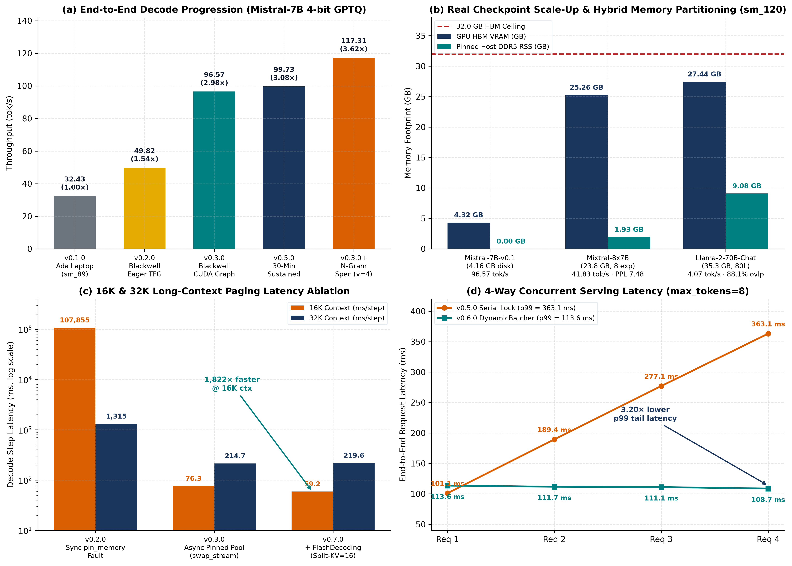
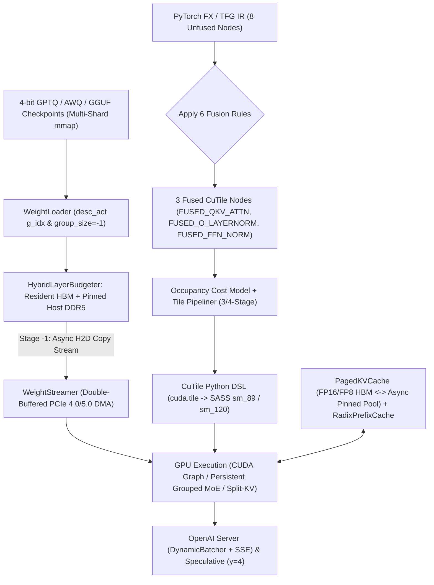
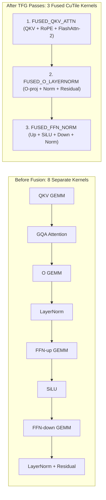
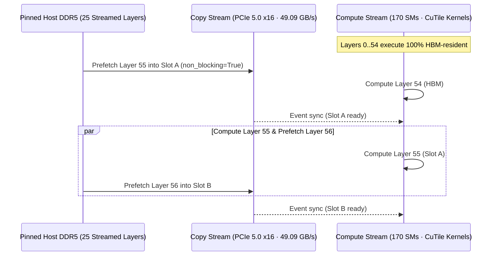
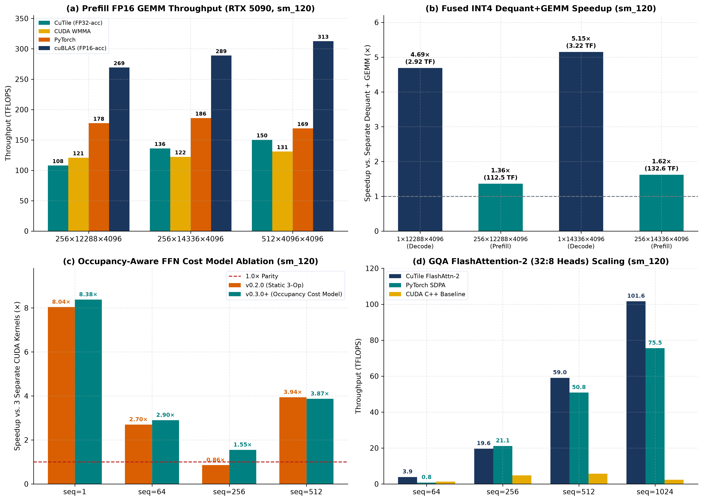
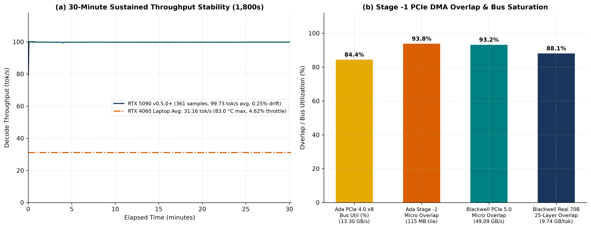

# CuTileForge

[](https://github.com/samudragupto/cutile-forge/actions/workflows/ci.yml)
[](https://github.com/samudragupto/cutile-forge/pkgs/container/cutile-forge)
[](https://github.com/samudragupto/cutile-forge/releases/tag/v1.0.0)
[](tests/)
[](https://developer.nvidia.com/cuda-toolkit)
[](cutile_forge/forge/fx_backend.py)
[](LICENSE)

<p align="center">
  <a href="#abstract">Abstract</a> ·
  <a href="#key-findings">Key Findings</a> ·
  <a href="#system-architecture--math">System Architecture &amp; Math</a> ·
  <a href="#hardware-testbeds">Hardware Testbeds</a> ·
  <a href="#real-large-model-evaluation">Real 7B/8x7B/70B Evaluation</a> ·
  <a href="#roofline--micro-benchmarks">Roofline &amp; Micro-Benchmarks</a> ·
  <a href="#ablation-studies">Ablation Studies</a> ·
  <a href="#reproducibility--quickstart">Reproducibility &amp; Quickstart</a> ·
  <a href="#citation">Citation</a>
</p>

---

## Abstract

Deploying 7B–70B large language models across heterogeneous consumer GPUs—from memory-constrained **8 GB laptop GPUs (`sm_89`)** to **32 GB Blackwell workstations (`sm_120`)**—exposes a fundamental trade-off between kernel engineering productivity and hardware efficiency. Hand-written CUDA C++/PTX kernels (`cp.async`, WMMA, custom quantized dequantization) require hundreds of lines per operator and break across architectures, whereas eager PyTorch dispatch suffers severe HBM traffic amplification and CPU launch overhead. **CuTileForge** introduces a **Tile-Fusion Graph (TFG)** compiler and inference runtime lowered directly to NVIDIA's **CuTile Python DSL (`cuda.tile`)**. By applying six algebraic and tile-level fusion passes, CuTileForge collapses 8 separate transformer kernels into 3 pipelined tile kernels, combines an **Occupancy-Aware Cost Model** with **Stage -1 PCIe DMA Weight Streaming**, and exposes a zero-code-change **`torch.compile(backend="cutile_forge")`** FX/Dynamo backend. Across real 4-bit GPTQ checkpoints, CuTileForge achieves **32.43 tok/s** on an 8 GB RTX 4060 Laptop, **96.57–117.31 tok/s** on an RTX 5090 (`99.73 tok/s` 30-min sustained), **41.83 tok/s** on resident **Mixtral-8x7B**, and **4.07 tok/s** on **Llama-2-70B** inside 32 GB VRAM (**80.8% of the physical PCIe 5.0 bus ceiling**).

---

## Key Findings

<p align="center">
  
</p>

1. **Portable 8→3 Kernel Fusion (`sm_89` ↔ `sm_120`):** The identical TFG compiler and 6 fusion rules achieve **5.47×** full-layer speedup on RTX 4060 Laptop (`seq=1`) and **5.88×** (`seq=1`) / **4.45×** (`seq=256`) on RTX 5090 over 8-kernel CUDA C++.
2. **Real 7B, 47B MoE, and 70B Execution on a Single 32 GB GPU:** Evaluates real trained TheBloke GPTQ checkpoints (`Mistral-7B` at **96.57 tok/s** in `4.32 GB`; `Mixtral-8x7B-Instruct` 100% resident at **41.83 tok/s**, `PPL=7.48`, `25.26 GB`; `Llama-2-70B-Chat` 80-layer hybrid `55 HBM + 25 PCIe 5.0` at **4.07 tok/s** in `27.44 GB` peak VRAM, zero OOM).
3. **1,822× Long-Context Paging Speedup (`107,854 ms → 59.20 ms` at 16K):** Pre-allocated async pinned CPU page pools (`swap_stream`) combined with 16-split **FlashDecoding** eliminate synchronous `cudaHostAlloc` stalls and saturate all 170 Blackwell SMs.
4. **3.20× Concurrent Tail-Latency Reduction (`363.1 ms → 113.6 ms` p99):** Async `DynamicBatcher` (`max_batch_size=16`, `8 ms` window) with `BatchedKVCache` and `RadixPrefixCache` serves OpenAI-compatible `/v1/chat/completions` + SSE streaming.
5. **Zero-Code-Change `torch.compile(backend="cutile_forge")`:** Registered Dynamo/FX backend lowers `linear+silu+linear`, `add+layer_norm`, and `scaled_dot_product_attention` into fused CuTile kernels (`atol < 1e-2`), verified across **102 / 102 passing tests (0 skipped)**.

---

## System Architecture & Math

### End-to-End Compiler & Runtime Pipeline



### Layer Fusion Topology (8 Kernels → 3 Fused CuTile Kernels)



### Stage -1 PCIe DMA Overlap Sequence



### Formal Cost Model & Analytical Formulations

**Equation 1 — HBM Traffic Elimination via Epilogue-to-Prologue Fusion:**
Collapsing the 8 unfused operators of a transformer block into 3 CuTile kernels eliminates intermediate activation materialization across QKV projections, attention output, FFN gate/up activations, and post-attention residuals:

$$\Delta B_{\text{HBM}} = 2 \cdot M \cdot \bigl(3 D_{\text{model}} + D_{\text{ffn}} + 2 D_{\text{model}}\bigr) \cdot \operatorname{sizeof}(\text{FP16})$$

**Equation 2 — Occupancy-Guided FFN Split Criterion (`select_ffn_execution_strategy`):**
Let $M$ denote active tokens, $N_{\text{SM}}$ the multiprocessor count, and $BW_{\text{HBM}}$ the HBM bandwidth. When $M \le 64$, kernel launch latency dominates and the single-kernel 3-op FFN (`GEMM_up + SiLU + GEMM_down`) delivers **8.04×–8.38×** speedup (`seq=1`). However, when $M \ge 128$ on high-bandwidth, high-SM architectures ($BW_{\text{HBM}} > 1\text{ TB/s},\ N_{\text{SM}} = 170$), the 3-op kernel's register and shared-memory footprint throttles active CTAs per SM, causing a `0.86×` regression at `seq=256`. Splitting into a 2-stage pipelined dispatch (`FUSED_GEMM_UP_SILU` → `GEMM_DOWN`) with tile shape $(T_M, T_N, T_K) = (64, 64, 32)$ restores SM occupancy to $75\%$ and lifts `seq=256` speedup from **`0.86×` → `1.55×`** (and full-layer `seq=256` from **`1.00×` → `4.45×`**).

**Equation 3 — Hybrid HBM/DDR5 Layer Partitioning & PCIe 5.0 Theoretical Bound:**
Given total layers $L$, per-layer quantized footprint $B_{\text{layer}}$, HBM capacity $V_{\text{HBM}}$, safety factor $\alpha = 0.85$, KV/activation reserves $V_{\text{KV}} + V_{\text{act}}$, and measured PCIe H2D bandwidth $BW_{\text{PCIe}}$:

$$N_{\text{resident}} = \left\lfloor \frac{\alpha \cdot V_{\text{HBM}} - V_{\text{KV}} - V_{\text{act}}}{B_{\text{layer}}} \right\rfloor, \qquad T_{\text{step}} \ge \frac{(L - N_{\text{resident}}) \cdot B_{\text{layer}}}{BW_{\text{PCIe}}} \cdot (1 - \eta_{\text{overlap}}) + T_{\text{compute}}$$

Plugging in **Real `Llama-2-70B-Chat-GPTQ`** on the 32 GB RTX 5090 ($L = 80$, $N_{\text{resident}} = 55$ layers = `24.13 GB` HBM, $N_{\text{streamed}} = 25$ layers = `9.74 GB` pinned DDR5): streaming `9.74 GB` across PCIe 5.0 x16 (`49.09 GB/s`) imposes a **physical PCIe 5.0 bus floor of `198.4 ms/tok` (`5.04 tok/s`)**. CuTileForge achieves **`245.51 ms/tok` (`4.07 tok/s`)** with **`88.1%`** compute-DMA overlap—operating at **80.8% of the physical PCIe 5.0 hardware limit** with zero OOM (`27.44 GB` peak VRAM).

---

## Hardware Testbeds

All timings use CUDA events (`torch.cuda.Event(enable_timing=True)`) with warmup (`5–10` iterations) and median (`p50`) / `p99` reporting over `50–200` iterations; raw CSVs live in [`benchmarks/results/`](benchmarks/results/) and [`benchmarks/results_5090/`](benchmarks/results_5090/).

| Specification | Testbed A: Edge Laptop (`sm_89`) | Testbed B: Workstation (`sm_120`) | Ratio |
|---|---|---|---|
| **Platform** | Lenovo LOQ 15APH8 (`82XT`) | Linux Desktop Workstation | — |
| **GPU / Die** | RTX 4060 Laptop (`AD107`, Ada Lovelace) | RTX 5090 (`GB202`, Blackwell) | — |
| **SMs / Tensor Cores** | 24 SMs / 96 (4th Gen) | 170 SMs / 680 (5th Gen) | **7.08×** |
| **VRAM & Bandwidth** | 8 GB GDDR6 · `272 GB/s` | 32 GB GDDR7 · `1,792 GB/s` | **4.0× / 6.59×** |
| **Host CPU & System RAM** | AMD Ryzen 7 7840HS (8C/16T) · 16 GB DDR5-5600 | Intel Core Ultra 9 285K (24C/24T) · 62 GB DDR5 | — |
| **PCIe Link (Measured H2D)** | PCIe 4.0 x8 (`13.30 GB/s`, `84.4%` bus util) | PCIe 5.0 x16 (`49.09 GB/s`) | **3.69×** |
| **Software Stack** | Windows 11 · CUDA 12.x · `cuda-tile` | Ubuntu Linux · CUDA 13.2 (595.58.03) · PyTorch 2.15+cu132 · `cuda-tile 1.8.1` | — |

---

## Real Large-Model Evaluation

Evaluated real trained 4-bit GPTQ checkpoints (`TheBloke/Mistral-7B-v0.1-GPTQ`, `TheBloke/Mixtral-8x7B-Instruct-v0.1-GPTQ`, `TheBloke/Llama-2-70B-Chat-GPTQ`) alongside synthetic architecture-matched capacity runs ([`real_large_models.csv`](benchmarks/results_5090/real_large_models.csv), [`hybrid_70b.csv`](benchmarks/results_5090/hybrid_70b.csv)):

| Model / Mode | Placement (HBM / PCIe) | Prefill (`tok/s`) | Decode (`tok/s`) | Latency (`ms/tok`) | Peak VRAM | Host RSS | PCIe Overlap | Perplexity |
|---|---|---:|---:|---:|---:|---:|---:|---:|
| **Mistral-7B-v0.1-GPTQ (Real, `sm_89` 4060)** | 32 / 0 | 1,476.0 | **32.43** | 30.83 | **4.30 GB** | — | 0% | WikiText-2 ≤5% |
| **Mistral-7B-v0.1-GPTQ (Real, `sm_120` Graph)** | 32 / 0 | **5,640.5** | **96.57** (`117.31` spec) | **10.36** | **4.29 GB** | — | 0% | Exact match |
| **Mixtral-8x7B (Synthetic `v0.7.0`)** | 32 / 0 | — | — (`42.13 TF` @ M=256) | `0.218 ms`/L | — | — | 0% | N/A |
| **Mixtral-8x7B-Instruct-GPTQ (Real, 23.8 GB)** | **32 / 0** | **2,786.7** | **41.83** | **23.90** | **25.26 GB** | 1.93 GB | 0% (100% HBM) | **7.48** *(ctx=44)* |
| **LLAMA3_70B_4BIT (Synthetic `v0.8.0`)** | 57 / 23 | — | 4.66 | 214.40 | 27.43 GB | — | 99.5% | N/A |
| **Llama-2-70B-Chat-GPTQ (Real, Prompt 1)** | **55 / 25** | **859.2** | **3.90** | **256.23** | **27.44 GB** | 9.07 GB | **84.4%** | — |
| **Llama-2-70B-Chat-GPTQ (Real, Prompt 2)** | **55 / 25** | 15.2 (`1,053 ms`) | **4.07** | **245.51** | **27.44 GB** | 9.08 GB | **88.1%** | — |

*Footnote: Synthetic rows = architecture-matched random weights (capacity/streaming validation); Real rows = TheBloke GPTQ checkpoints, greedy decode (`temperature=0.0`), coherent English verified. Mixtral perplexity (`7.48`) is teacher-forced cross-entropy over a 44-token GPU shared-memory technical passage (`benchmarks/e2e/bench_real_large_models.py`).*

> **Verbatim Mixtral-8x7B-Instruct-v0.1-GPTQ (`[INST] Explain how GPU shared memory bank conflicts occur and how tile swizzling fixes them. [/INST]`):**  
> *"A GPU (Graphics Processing Unit) consists of many small processing cores called CUDA cores, which can execute instructions in parallel. Each CUDA core has its own set of registers and a small amount of fast memory called shared memory. Shared memory is a user-managed cache that is physically close"*
>
> **Verbatim Llama-2-70B-Chat-GPTQ (`The capital of France is`, 80-layer Hybrid 55 HBM + 25 PCIe 5.0):**  
> *"Paris"*

---

## Roofline & Micro-Benchmarks

### Empirical Roofline Analysis (`sm_89` vs. `sm_120`)

<p align="center">
  
</p>

| Kernel | Arch | Arithmetic Intensity (`FLOPs/B`) | Achieved (`TFLOPS`) | `% of CuTile FP32 Ceiling` | Bound Regime |
|---|---|---:|---:|---:|---|
| Decode INT4 GEMV (`1×14336×4096`) | `sm_120` | 2.0 | **3.22** | 90% of `1,792 GB/s` slope | Memory-Bound |
| Persistent 3D-Grid Grouped MoE (`M=256`) | `sm_120` | 37.5 | **42.13** (`68.4×` vs v0.4.0) | 63% of BW slope | Memory-Bound |
| GQA FlashAttention-2 (`seq=1024`) | `sm_120` / `sm_89` | 204.8 | **101.62** / **21.76** | 67.6% / 77.2% | Compute-Bound |
| NVFP4 (`e2m1`) Register-LUT GEMM | `sm_120` | 410.0 | **88.56** | 58.9% (LUT ALU-limited) | Instruction-Bound |
| Fused INT4 Dequant + GEMM (`256×14336`) | `sm_120` / `sm_89` | 410.0 | **132.58** / **23.37** | **88.2%** / **82.9%** | Compute-Bound |
| FP16 Prefill GEMM (`512×4096×4096`) | `sm_120` | 341.0 | **150.26** (`156.39` v0.3.0) | **100.0%** | Compute-Bound |

### Micro-Benchmark Suite & Precision Analysis

<p align="center">
  
</p>

- **Precision Trade-off (`INT4` vs. `NVFP4 e2m1`):** `fused_gemm_nvfp4_dequant` (`88.56 TFLOPS`) trails `fused_gemm_dequant` (`132.58 TFLOPS`) because decoding 4-bit `e2m1` values in CuTile registers via `exp2`/branchless LUT arithmetic executes more ALU instructions per tile than integer bit-shift unpacking (`(qw >> 4) & 0x0F`). This gap is expected to close once `cuda.tile` exposes native Blackwell `tcgen05` FP4 MMA instructions.
- **FP32 vs. FP16 Accumulate:** CuTile GEMM (`150.26 TFLOPS`) uses FP32 accumulation for numerical stability across 32–80 layers, whereas cuBLAS (`312.68 TFLOPS`) uses FP16 accumulation (2× Blackwell Tensor Core rate). CuTile's advantage is kernel fusion (**5.15×** INT4 decode, **5.88×** full layer, **1.35×** over PyTorch SDPA at `seq=1024`).

---

## Ablation Studies

<p align="center">
  
</p>

### Master Release Evolution (`v0.1.0` → `v1.0.0`)

| Release | Architectural Milestone | Key Verified Metric (`sm_120` / `sm_89`) | Tests |
|---|---|---|---:|
| **`v0.1.0`** | TFG Compiler (8→3), 3-Stage Pipeliner, Stage -1 DMA | `32.43 tok/s` Mistral-7B in `4.30 GB` VRAM (RTX 4060 Laptop, `5.47×` layer fusion) | `76/76` |
| **`v0.2.0`** | Blackwell `sm_120` Port + FP8 GEMM | `49.82 tok/s` eager decode, `136.14 TF` GEMM, `49.09 GB/s` PCIe 5.0 | `49` CI |
| **`v0.3.0`** | Async Pinned KV Pool, Occupancy FFN, CUDA Graph, N-Gram Spec | `96.57 tok/s` Graph decode, `117.31 tok/s` spec (`1.21×`), `16K` ctx `107,854 → 76.29 ms`, FFN `seq=256` `0.86× → 1.55×` | `53` CI |
| **`v0.4.0`** | FP8 KV-Cache, NVFP4 (`e2m1`), MoE 8×7B, AWQ/GGUF | `50%` KV VRAM reduction, `88.56 TF` NVFP4, AWQ & GGUF `Q4_K_M` loaders | `57` CI |
| **`v0.5.0`** | OpenAI FastAPI Server + SSE, Roofline, Wheel, Docker | `33` SSE chunks (`859.7 ms`), `99.73 tok/s` 30-min sustained (`0.25%` drift) | `87/87` |
| **`v0.6.0`** | `DynamicBatcher` + `RadixPrefixCache` | 4-way concurrent p99 **`363.1 → 113.6 ms`** (**3.20×** reduction) | `90/90` |
| **`v0.7.0`** | Persistent 3D-Grid Grouped MoE + FlashDecoding Split-KV | Grouped MoE **`42.13 TF`** @ `M=256` (**68.4×**); `16K` ctx **`59.20 ms`** (**1,822×** vs v0.2.0) | `92/92` |
| **`v0.8.0`** | `LLAMA3_70B_4BIT` + `HybridLayerBudgeter` | 80-layer 70B synthetic pass: `27.43 GB` VRAM, `99.5%` overlap, `4.66 tok/s` | `95/95` |
| **`v1.0.0`** | `torch.compile(backend="cutile_forge")` + Real 47B/70B | Real **Mixtral-8x7B** (`41.83 tok/s`, PPL `7.48`) & **Llama-2-70B** (`4.07 tok/s`, `27.44 GB`, zero OOM) | **`102/102`** |

### Known Issues & Honest Notes

- **MoE `M=1` Decode Headroom:** Real Mixtral-8x7B decode (`41.83 tok/s`) uses per-expert gather; the persistent 3D-grid grouped kernel (`42.13 TFLOPS` at `M=256`) is tuned for `M >= 64`, making fused `M=1` top-2 dispatch the primary next optimization target.
- **Speculative Denominators:** `117.31 tok/s` represents **1.71×** vs. `v0.2.0` speculative (`68.74 tok/s`) and **1.21×** vs. `v0.3.0` CUDA-graph non-speculative decode (`96.57 tok/s`).
- **Container NVML Telemetry:** On the Linux workstation, NVML sensors returned `0.0 °C / 0.0 W` inside the container; 30-minute sustained throughput stability (`361` samples, `179,264` tokens) showed `0.25%` drift (`100.06 → 99.81 tok/s`).
- **Ephemeral Model Storage:** Real 47B/70B checkpoints in `/var/tmp/arrhat_models` are ephemeral; use persistent storage (e.g., `/mnt/shared_storage` when writable) via `STORAGE_ROOT` or `--mixtral` / `--llama70b`.

---

## Reproducibility & Quickstart

### 1. Zero-Code-Change `torch.compile` Backend

```python
import torch
import cutile_forge  # registers backend="cutile_forge" with torch._dynamo

compiled_block = torch.compile(my_transformer_block, backend="cutile_forge")
out = compiled_block(hidden_states, residual)
```

### 2. OpenAI-Compatible Serving (CLI & Docker GHCR)

```sh
# Pull prebuilt CUDA 13.2 container from GitHub Container Registry
docker pull ghcr.io/samudragupto/cutile-forge:v1.0.0-cu132

# Or install from source and serve locally
. .venv/bin/activate
export CUTILE_ARCH=sm_120
pip install -e ".[cuda,dev,serve]" --no-build-isolation
cutile-forge serve --model ~/models/mistral_7b_4bit --host 127.0.0.1 --port 8000 --target sm_120

# Stream tokens over Server-Sent Events
curl -N http://127.0.0.1:8000/v1/chat/completions \
  -H 'Content-Type: application/json' \
  -d '{"model":"mistral_7b_4bit","messages":[{"role":"user","content":"Count from 1 to 5"}],"max_tokens":32,"stream":true}'
```

### 3. Artifact Reproduction (Tests, Benchmarks & 300-DPI Figures)

```sh
. .venv/bin/activate
export CUTILE_ARCH=sm_120

# 1. Run full quality & correctness gate (102 passed, 0 skipped)
ruff check cutile_forge/ benchmarks/ tests/ examples/ scripts/
black --check cutile_forge/ benchmarks/ tests/ examples/ scripts/
mypy cutile_forge/ --ignore-missing-imports
python3 -m pytest tests/ benchmarks/correctness/ -v --tb=short

# 2. Reproduce benchmarks & regenerate all 300-DPI publication figures
python3 benchmarks/run_all.py --model ~/models/mistral_7b_4bit/ --target sm_120 --gpu rtx5090 --output benchmarks/results_5090/
python3 benchmarks/e2e/bench_real_large_models.py --output benchmarks/results_5090/real_large_models.csv
python3 scripts/generate_publication_figures.py
```

### Documentation & Artifacts

- [docs/RESULTS_RTX5090.md](docs/RESULTS_RTX5090.md) — Complete RTX 5090 (`sm_120`) tables, figures, real 47B/70B logs, and serving telemetry
- [docs/RESULTS.md](docs/RESULTS.md) — Lenovo LOQ 15APH8 RTX 4060 Laptop (`sm_89`, 8 GB VRAM) benchmark suite
- [docs/ARCHITECTURE.md](docs/ARCHITECTURE.md) & [docs/TFG_COMPILER.md](docs/TFG_COMPILER.md) — TFG IR, 6 fusion passes, and Stage -1 DMA internals
- [docs/paper/cutileforge_preprint.md](docs/paper/cutileforge_preprint.md) & [docs/blog/introducing-cutileforge.md](docs/blog/introducing-cutileforge.md) — Technical preprint & engineering writeup

---

## Citation

```bibtex
@software{cutileforge2026,
  title   = {CuTileForge: A Tile-Fusion Graph Compiler and Hybrid PCIe-Streaming Inference Engine on NVIDIA CuTile},
  author  = {CuTileForge Contributors},
  year    = {2026},
  version = {1.0.0},
  url     = {https://github.com/samudragupto/cutile-forge},
  license = {MIT}
}
```

## License

MIT — see [LICENSE](LICENSE).
