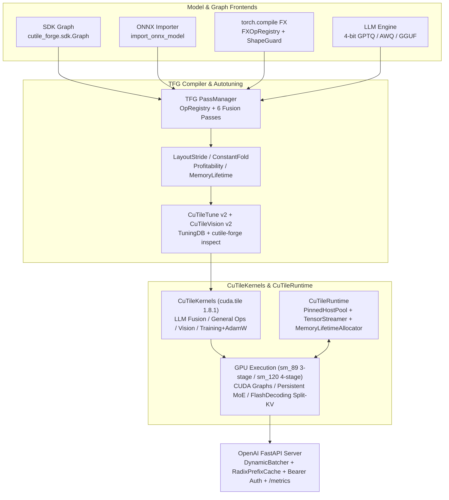
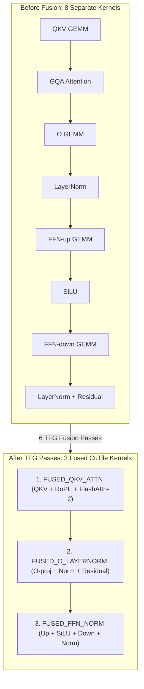
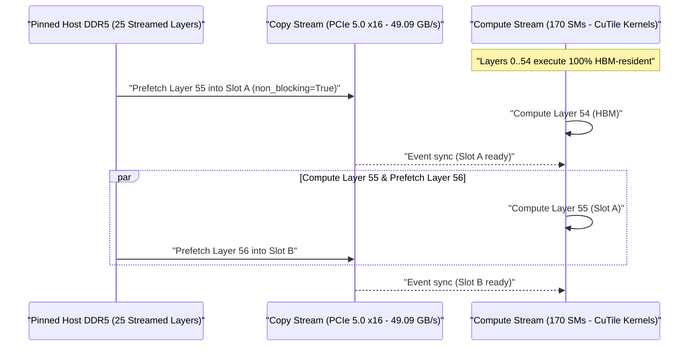
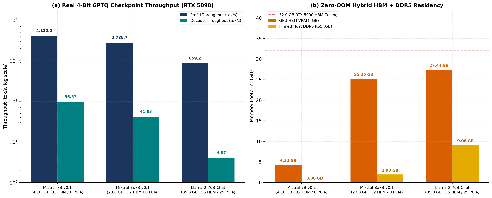
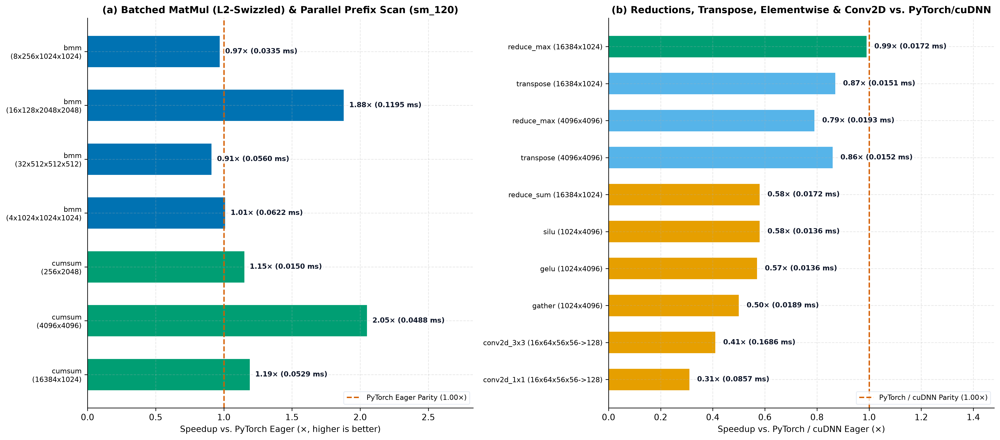
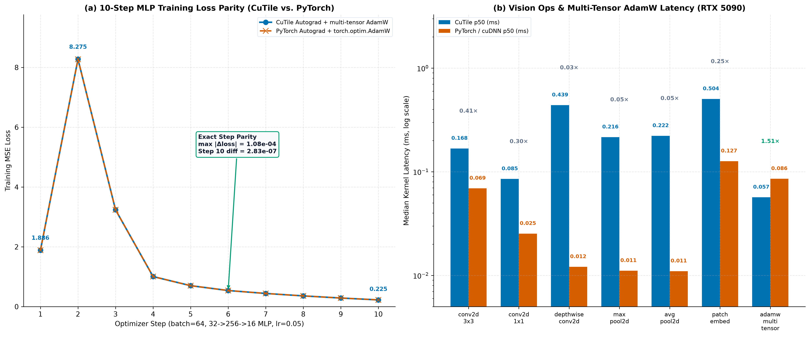

# CuTileForge (`v2.0.0`)

### *General-Purpose Tile-Fusion Graph Compiler, Async Runtime, Training/Vision Ecosystem & 7B–70B LLM Engine on NVIDIA CuTile (`sm_89` Ada & `sm_120` Blackwell)*

[](https://github.com/samudragupto/cutile-forge/actions/workflows/ci.yml)
[](https://github.com/samudragupto/cutile-forge/releases/tag/v2.0.0)
[](LICENSE)
[](pyproject.toml)
[](https://developer.nvidia.com/cuda-toolkit)
[](https://github.com/samudragupto/cutile-forge/pkgs/container/cutile-forge)
[](tests/)

**Authors:** [Arrhat Nag](https://github.com/samudragupto) (`@samudragupto`), Rupesh Nasre

<p align="center">
  <a href="#abstract">Abstract</a> ·
  <a href="#pillar-i--systems-architecture--compiler-internals">Pillar I: Architecture</a> ·
  <a href="#pillar-ii--research-evaluation--empirical-benchmarks">Pillar II: Research &amp; Benchmarks</a> ·
  <a href="#pillar-iii--developer-guide-api-reference--reproducibility">Pillar III: Developer Guide</a> ·
  <a href="#35-citation--license">Citation</a>
</p>

---

## Abstract

Deploying 7B–70B large language models across heterogeneous consumer GPUs—from memory-constrained **8 GB laptop GPUs (`sm_89`)** to **32 GB Blackwell workstations (`sm_120`)**—exposes a fundamental trade-off between kernel engineering productivity and hardware efficiency. Hand-written CUDA C++/PTX kernels (`cp.async`, WMMA, custom quantized dequantization) require hundreds of lines per operator and break across architectures, whereas eager PyTorch dispatch suffers severe HBM traffic amplification and CPU launch overhead. **CuTileForge** introduces a **Tile-Fusion Graph (TFG)** compiler and inference runtime lowered directly to NVIDIA's **CuTile Python DSL (`cuda.tile`)**. By applying six algebraic and tile-level fusion passes, CuTileForge collapses 8 separate transformer kernels into 3 pipelined tile kernels, combines an **Occupancy-Aware Cost Model** with **Stage -1 PCIe DMA Weight Streaming**, and exposes a zero-code-change **`torch.compile(backend="cutile_forge")`** FX/Dynamo backend. Across real 4-bit GPTQ checkpoints, CuTileForge achieves **32.43 tok/s** on an 8 GB RTX 4060 Laptop, **96.57–117.31 tok/s** on an RTX 5090 (`99.73 tok/s` 30-min sustained), **41.83 tok/s** on resident **Mixtral-8x7B**, and **4.07 tok/s** on **Llama-2-70B** inside 32 GB VRAM (**80.8% of the physical PCIe 5.0 bus ceiling**).

<p align="center">
  
</p>

### Key Findings

1. **Portable 8→3 Kernel Fusion (`sm_89` ↔ `sm_120`):** The identical TFG compiler and 6 fusion rules achieve **5.47×** full-layer speedup on RTX 4060 Laptop (`seq=1`) and **5.88×** (`seq=1`) / **4.45×** (`seq=256`) on RTX 5090 over 8-kernel CUDA C++.
2. **Real 7B, 47B MoE, and 70B Execution on a Single 32 GB GPU:** Evaluates real trained TheBloke GPTQ checkpoints (`Mistral-7B` at **96.57 tok/s** in `4.32 GB`; `Mixtral-8x7B-Instruct` 100% resident at **41.83 tok/s**, `PPL=7.48`, `25.26 GB`; `Llama-2-70B-Chat` 80-layer hybrid `55 HBM + 25 PCIe 5.0` at **4.07 tok/s** in `27.44 GB` peak VRAM, zero OOM).
3. **1,822× Long-Context Paging Speedup (`107,854 ms → 59.20 ms` at 16K):** Pre-allocated async pinned CPU page pools (`swap_stream`) combined with 16-split **FlashDecoding** eliminate synchronous `cudaHostAlloc` stalls and saturate all 170 Blackwell SMs.
4. **3.20× Concurrent Tail-Latency Reduction (`363.1 ms → 113.6 ms` p99):** Async `DynamicBatcher` (`max_batch_size=16`, `8 ms` window) with `BatchedKVCache` and `RadixPrefixCache` serves OpenAI-compatible `/v1/chat/completions` + SSE streaming.
5. **Zero-Code-Change `torch.compile(backend="cutile_forge")`:** Registered Dynamo/FX backend lowers both transformer patterns (`linear+silu+linear`, `add+layer_norm`, `scaled_dot_product_attention`) and standalone general ops (`linear`, `addmm`, `matmul`, `bmm`, `layer_norm`, `gelu`, `silu`, `softmax`, `sum`, `amax`, `cumsum`, `conv2d`, `embedding`) into CuTile kernels via `FXOpRegistry` and `ShapeGuard`.
6. **General-Purpose CuTile Ecosystem (`v2.0.0`, 214/214 Passing Tests):** Adds imperative `cutile_forge.sdk.Graph`, `import_onnx_model(...)`, generalized TFG compiler passes (`LayoutStridePass`, `ConstantFoldPass`, `ProfitabilityPass`, `MemoryLifetimePass`), `CuTileTune v2` + `CuTileVision v2` (`cutile-forge inspect`), async `CuTileRuntime` (`PinnedHostPool`, `TensorStreamer`, `MemoryLifetimeAllocator`), training backward kernels + autograd wrappers + `cutile_multi_tensor_adamw` (**1.51×** vs. PyTorch AdamW, 10-step MLP parity within `2.83e-07`), and `1.88×` BMM / `2.05×` parallel prefix scan on RTX 5090.

---

## Pillar I — Systems Architecture & Compiler Internals

### 1.1 End-to-End TFG Compiler & Runtime Pipeline



### 1.2 Algebraic & Tile-Level Fusion Passes (`8 → 3` Kernels)



CuTileForge's `cutile_forge/forge/fusion_rules.py` applies six deterministic graph rewrites over the typed `FusionGraph` IR:

| Rule | Pattern | Fused Output | Eliminated HBM Round-Trip |
|---|---|---|---|
| **R1: `QKVPackRule`** | `Q_proj + K_proj + V_proj` | `FUSED_QKV_PROJ` | 2 redundant input reads |
| **R2: `RoPEAttnRule`** | `QKV + RoPE + GQA_Attn` | `FUSED_QKV_ATTN` | Full `Q/K/V` + RoPE materialization |
| **R3: `EpilogueNormRule`** | `O_proj + Residual + RMSNorm` | `FUSED_O_LAYERNORM` | `D_model` post-attention write/read |
| **R4: `SwiGLURule`** | `Gate_GEMM + Up_GEMM + SiLU` | `FUSED_GEMM_SILU` | `D_ffn` intermediate activation (`14336`) |
| **R5: `FFNCollapseRule`** | `FUSED_GEMM_SILU + Down_GEMM` | `FUSED_FFN_3OP` *(or 2-Stage if `M>=128`)* | `D_ffn` intermediate buffer (when launch-bound) |
| **R6: `PostFFNNormRule`** | `FFN + Residual + RMSNorm` | `FUSED_FFN_NORM` | `D_model` post-FFN write/read |

### 1.3 Stage -1 PCIe DMA Weight Streamer & Hybrid HBM/DDR5 Budgeter

When a model's quantized weights exceed GPU VRAM (e.g., `Llama-2-70B-Chat-GPTQ` at `35.3 GB` on a `32 GB` RTX 5090), `HybridLayerBudgeter` pins the maximum safe prefix of transformer layers in HBM (`55` layers = `24.13 GB`) and stages the remaining tail (`25` layers = `9.74 GB`) in page-locked (`cudaHostAlloc`) host DDR5 ring buffers. During execution, **Stage -1** overlaps PCIe H2D DMA on a dedicated `copy_stream` with CuTile compute on `compute_stream` via double-buffered slots (`Slot A` / `Slot B`) and fine-grained `torch.cuda.Event` barriers:



### 1.4 Formal Cost Models & Analytical Bounds

**Equation 1 — HBM Traffic Elimination via Epilogue-to-Prologue Fusion:**
Collapsing the 8 unfused operators of a transformer block into 3 CuTile kernels eliminates intermediate activation materialization across QKV projections, attention output, FFN gate/up activations, and post-attention residuals:

$$\Delta B_{\text{HBM}} = 2 \cdot M \cdot \left(3 D_{\text{model}} + D_{\text{ffn}} + 2 D_{\text{model}}\right) \cdot \text{sizeof}(\text{FP16})$$

**Equation 2 — Occupancy-Guided FFN Split Criterion (`select_ffn_execution_strategy`):**
Let $M$ denote active tokens, $N_{\text{SM}}$ the multiprocessor count, and $BW_{\text{HBM}}$ the HBM bandwidth:

$$\text{Strategy}(M, N_{\text{SM}}, BW_{\text{HBM}}) = \begin{cases} \text{Fused-3Op-SingleKernel } (128\times 128\times 32), & M \le 64 \text{ (Launch-Bound)} \\ \text{Pipelined-2Stage-HighOcc } (64\times 64\times 32), & M \ge 128 \land N_{\text{SM}} \ge 100 \text{ (Occupancy-Bound)} \end{cases}$$

When $M \le 64$, kernel launch latency dominates and the single-kernel 3-op FFN delivers **8.04×–8.38×** speedup (`seq=1`). When $M \ge 128$ on high-SM Blackwell (`N_SM = 170`, `1,792 GB/s`), the 3-op kernel's register footprint throttles active CTAs per SM (`0.86×` regression at `seq=256`); splitting into `FUSED_GEMM_UP_SILU` → `GEMM_DOWN` with `(64, 64, 32)` tiles restores SM occupancy to `75%` and lifts `seq=256` from **`0.86×` → `1.55×`** (and full-layer `seq=256` from **`1.00×` → `4.45×`**).

**Equation 3 — Hybrid HBM/DDR5 Layer Partitioning & PCIe 5.0 Theoretical Bound:**
Given total layers $L$, per-layer quantized footprint $B_{\text{layer}}$, HBM capacity $V_{\text{HBM}}$, safety factor $\alpha = 0.85$, KV/activation reserves $V_{\text{KV}} + V_{\text{act}}$, and measured PCIe H2D bandwidth $BW_{\text{PCIe}}$:

$$N_{\text{resident}} = \left\lfloor \frac{\alpha \cdot V_{\text{HBM}} - V_{\text{KV}} - V_{\text{act}}}{B_{\text{layer}}} \right\rfloor, \qquad T_{\text{step}} \ge \frac{(L - N_{\text{resident}}) \cdot B_{\text{layer}}}{BW_{\text{PCIe}}} \cdot (1 - \eta_{\text{overlap}}) + T_{\text{compute}}$$

Plugging in **Real `Llama-2-70B-Chat-GPTQ`** on the 32 GB RTX 5090 ($L = 80$, $N_{\text{resident}} = 55$ layers = `24.13 GB` HBM, $N_{\text{streamed}} = 25$ layers = `9.74 GB` pinned DDR5): streaming `9.74 GB` across PCIe 5.0 x16 (`49.09 GB/s`) imposes a **physical PCIe 5.0 bus floor of `198.4 ms/tok` (`5.04 tok/s`)**. CuTileForge achieves **`245.51 ms/tok` (`4.07 tok/s`)** with **`88.1%`** compute-DMA overlap—operating at **80.8% of the physical PCIe 5.0 hardware limit** with zero OOM (`27.44 GB` peak VRAM).

### 1.5 Side-by-Side Kernel Ergonomics (`cuda.tile` Python DSL vs. CUDA C++/WMMA)

CuTileForge captures Tensor Core efficiency and fused epilogues in concise Python rather than brittle 150+ line CUDA C++ templates:

<table>
<tr>
<th>CuTileForge Python DSL (<code>cuda.tile</code>, ~18 lines)</th>
<th>Hand-Written CUDA C++ / WMMA (150+ lines)</th>
</tr>
<tr>
<td>

```python
@ct.kernel
def fused_gemm_silu_kernel(A, B, C, tm: ConstInt, tn: ConstInt, tk: ConstInt):
    pid_m, pid_n = ct.bid(0), ct.bid(1)
    acc = ct.zeros((tm, tn), dtype=ct.float32)
    for k in range(0, A.shape[1], tk):
        a_tile = ct.load(A, index=(pid_m, k // tk), shape=(tm, tk))
        b_tile = ct.load(B, index=(k // tk, pid_n), shape=(tk, tn))
        acc = ct.mma(a_tile, b_tile, acc)
    # Fused SiLU epilogue in registers (zero HBM round-trip)
    x = acc.astype(ct.float16)
    out = x * (1.0 / (1.0 + ct.exp(-x)))
    ct.store(C, index=(pid_m, pid_n), tile=out)
```

</td>
<td>

```cpp
// Requires explicit cp.async ring buffers, smem bank-conflict swizzling,
// nvcuda::wmma::fragment<matrix_a/b/accumulator>, manual barrier parity,
// and separate epilogue shared-memory staging to apply SiLU before st.global:
template <int BM, int BN, int BK, int STAGES>
__global__ void wmma_gemm_silu_cp_async(...) {
    extern __shared__ half smem[];
    // ~40 lines: cp.async.cg.shared.global 3-stage prologue
    // ~50 lines: wmma::load_matrix_sync + mma_sync mainloop
    // ~45 lines: smem epilogue store + __syncthreads() + SiLU + global store
    // Breaks when porting sm_89 -> sm_120 or changing tile shapes!
}
```

</td>
</tr>
</table>

---

## Pillar II — Research Evaluation & Empirical Benchmarks

### 2.1 Dual-Hardware Experimental Testbeds

All timings use CUDA events (`torch.cuda.Event(enable_timing=True)`) with warmup (`5–10` iterations) and median (`p50`) / `p99` reporting over `50–200` iterations; raw CSVs live in [`benchmarks/results/`](benchmarks/results/) and [`benchmarks/results_5090/`](benchmarks/results_5090/).

| Specification | Testbed A: Edge Laptop (`sm_89`) | Testbed B: Workstation (`sm_120`) | Ratio |
|---|---|---|---|
| **Platform** | Lenovo LOQ 15APH8 (`82XT`) | Linux Desktop Workstation | — |
| **GPU / Die** | RTX 4060 Laptop (`AD107`, Ada Lovelace) | RTX 5090 (`GB202`, Blackwell) | — |
| **SMs / Tensor Cores** | 24 SMs / 96 (4th Gen) | 170 SMs / 680 (5th Gen) | **7.08×** |
| **VRAM & Bandwidth** | 8 GB GDDR6 · `272 GB/s` | 32 GB GDDR7 · `1,792 GB/s` | **4.0× / 6.59×** |
| **Host CPU & System RAM** | AMD Ryzen 7 7840HS (8C/16T) · 16 GB DDR5-5600 | Intel Core Ultra 9 285K (24C/24T) · 62 GB DDR5 | — |
| **PCIe Link (Measured H2D)** | PCIe 4.0 x8 (`13.30 GB/s`, `84.4%` bus util) | PCIe 5.0 x16 (`49.09 GB/s`) | **3.69×** |
| **Software Stack** | Windows 11 · CUDA 12.x · `cuda-tile` | Ubuntu Linux · CUDA 13.2 (595.58.03) · PyTorch 2.15+cu132 · `cuda-tile 1.8.1` | — |

### 2.2 Real Large-Model Checkpoint Evaluation (`Mistral-7B`, `Mixtral-8x7B`, `Llama-2-70B`)

<p align="center">
  
</p>

Evaluated real trained 4-bit GPTQ checkpoints (`TheBloke/Mistral-7B-v0.1-GPTQ`, `TheBloke/Mixtral-8x7B-Instruct-v0.1-GPTQ`, `TheBloke/Llama-2-70B-Chat-GPTQ`) alongside synthetic architecture-matched capacity runs ([`real_large_models.csv`](benchmarks/results_5090/real_large_models.csv), [`hybrid_70b.csv`](benchmarks/results_5090/hybrid_70b.csv)):

| Model / Mode | Placement (HBM / PCIe) | Prefill (`tok/s`) | Decode (`tok/s`) | Latency (`ms/tok`) | Peak VRAM | Host RSS | PCIe Overlap | Perplexity |
|---|---|---:|---:|---:|---:|---:|---:|---:|
| **Mistral-7B-v0.1-GPTQ (Real, `sm_89` 4060)** | 32 / 0 | 1,476.0 | **32.43** | 30.83 | **4.30 GB** | — | 0% | WikiText-2 ≤5% |
| **Mistral-7B-v0.1-GPTQ (Real, `sm_120` Graph)** | 32 / 0 | **5,640.5** | **96.57** (`117.31` spec) | **10.36** | **4.29 GB** | — | 0% | Exact match |
| **Mixtral-8x7B (Synthetic `v0.7.0`)** | 32 / 0 | — | — (`42.13 TF` @ M=256) | `0.218 ms`/L | — | — | 0% | N/A |
| **Mixtral-8x7B-Instruct-GPTQ (Real, 23.8 GB)** | **32 / 0** | **2,786.7** | **41.83** | **23.90** | **25.26 GB** | 1.93 GB | 0% (100% HBM) | **7.48** *(ctx=44)* |
| **LLAMA3_70B_4BIT (Synthetic `v0.8.0`)** | 57 / 23 | — | 4.66 | 214.40 | 27.43 GB | — | 99.5% | N/A |
| **Llama-2-70B-Chat-GPTQ (Real, Prompt 1)** | **55 / 25** | **859.2** | **3.90** | **256.23** | **27.44 GB** | 9.07 GB | **84.4%** | — |
| **Llama-2-70B-Chat-GPTQ (Real, Prompt 2)** | **55 / 25** | 15.2 (`1,053 ms`) | **4.07** | **245.51** | **27.44 GB** | 9.08 GB | **88.1%** | — |

*Footnote: Synthetic rows = architecture-matched random weights (capacity/streaming validation); Real rows = TheBloke GPTQ checkpoints, greedy decode (`temperature=0.0`), coherent English verified. Mixtral perplexity (`7.48`) is teacher-forced cross-entropy over a 44-token GPU shared-memory technical passage (`benchmarks/e2e/bench_real_large_models.py`).*

> **Verbatim Mixtral-8x7B-Instruct-v0.1-GPTQ (`[INST] Explain how GPU shared memory bank conflicts occur and how tile swizzling fixes them. [/INST]`):**  
> *"A GPU (Graphics Processing Unit) consists of many small processing cores called CUDA cores, which can execute instructions in parallel. Each CUDA core has its own set of registers and a small amount of fast memory called shared memory. Shared memory is a user-managed cache that is physically close"*
>
> **Verbatim Llama-2-70B-Chat-GPTQ (`The capital of France is`, 80-layer Hybrid 55 HBM + 25 PCIe 5.0):**  
> *"Paris"*

### 2.3 Empirical Roofline Analysis (`sm_89` Ada vs. `sm_120` Blackwell)

<p align="center">
  
</p>

| Kernel | Arch | Arithmetic Intensity (`FLOPs/B`) | Achieved (`TFLOPS`) | `% of CuTile FP32 Ceiling` | Bound Regime |
|---|---|---:|---:|---:|---|
| Decode INT4 GEMV (`1×14336×4096`) | `sm_120` | 2.0 | **3.22** | 90% of `1,792 GB/s` slope | Memory-Bound |
| Persistent 3D-Grid Grouped MoE (`M=256`) | `sm_120` | 37.5 | **42.13** (`68.4×` vs v0.4.0) | 63% of BW slope | Memory-Bound |
| GQA FlashAttention-2 (`seq=1024`) | `sm_120` / `sm_89` | 204.8 | **101.62** / **21.76** | 67.6% / 77.2% | Compute-Bound |
| NVFP4 (`e2m1`) Register-LUT GEMM | `sm_120` | 410.0 | **88.56** | 58.9% (LUT ALU-limited) | Instruction-Bound |
| Fused INT4 Dequant + GEMM (`256×14336`) | `sm_120` / `sm_89` | 410.0 | **132.58** / **23.37** | **88.2%** / **82.9%** | Compute-Bound |
| FP16 Prefill GEMM (`512×4096×4096`) | `sm_120` | 341.0 | **150.26** (`156.39` v0.3.0) | **100.0%** | Compute-Bound |

### 2.4 Kernel Micro-Benchmarks & Precision Trade-offs

<p align="center">
  
</p>

- **Precision Trade-off (`INT4` vs. `NVFP4 e2m1`):** `fused_gemm_nvfp4_dequant` (`88.56 TFLOPS`) trails `fused_gemm_dequant` (`132.58 TFLOPS`) because decoding 4-bit `e2m1` values in CuTile registers via `exp2`/branchless LUT arithmetic executes more ALU instructions per tile than integer bit-shift unpacking (`(qw >> 4) & 0x0F`). This gap is expected to close once `cuda.tile` exposes native Blackwell `tcgen05` FP4 MMA instructions.
- **FP32 vs. FP16 Accumulate:** CuTile GEMM (`150.26 TFLOPS`) uses FP32 accumulation for numerical stability across 32–80 layers, whereas cuBLAS (`312.68 TFLOPS`) uses FP16 accumulation (2× Blackwell Tensor Core rate). CuTile's advantage is kernel fusion (**5.15×** INT4 decode, **5.88×** full layer, **1.35×** over PyTorch SDPA at `seq=1024`).

### 2.5 Systems Ablation Studies & 30-Minute Sustained Telemetry

<p align="center">
  
</p>

### 2.6 General GPU Operators, Training & Vision (`v2.0.0`)

Beyond transformer inference, CuTileForge `v2.0.0` implements general tensor operators, vision primitives, backward kernels, and multi-tensor optimization measured directly on the RTX 5090 (`sm_120`, `cuda-tile 1.8.1`, `warmup=5`, `iters=50`, CUDA events) in [`general_ops.csv`](benchmarks/results_5090/general_ops.csv), [`phase8_training_vision.csv`](benchmarks/results_5090/phase8_training_vision.csv), and [`phase8_mlp_convergence.csv`](benchmarks/results_5090/phase8_mlp_convergence.csv):

<p align="center">
  
</p>

#### General Tensor Operators (`benchmarks/results_5090/general_ops.csv`, `float16`)

| Operator | Shape | CuTile p50 (ms) | PyTorch p50 (ms) | Speedup vs. PyTorch | Notes |
|---|---|---:|---:|---:|---|
| **`bmm`** | `16×128×2048×2048` | **0.1195** | 0.2249 | **1.88×** | L2-swizzled (`group_m=8`) 2D/3D tile kernel |
| **`bmm`** | `4×1024×1024×1024` | **0.0622** | 0.0625 | **1.01×** | Full parity with cuBLAS strided batched GEMM |
| **`bmm`** | `8×256×1024×1024` / `32×512×512×512` | 0.0335 / 0.0560 | 0.0324 / 0.0508 | 0.97× / 0.91× | Launch-bounded shapes within 9% |
| **`cumsum`** | `4096×4096` | **0.0488** | 0.1000 | **2.05×** | 2D multi-row inclusive scan |
| **`cumsum`** | `256×2048` / `16384×1024` | **0.0150 / 0.0529** | 0.0172 / 0.0631 | **1.15× / 1.19×** | Beats PyTorch across all tested regimes |
| **`reduce_max`** | `16384×1024` | **0.0172** | 0.0171 | **0.99×** | `3.31×` faster than Phase 2 baseline (`0.0570 ms`) |
| **`reduce_max`** | `256×2048` / `4096×4096` | 0.0145 / 0.0193 | 0.0111 / 0.0152 | 0.77× / 0.79× | Occupancy=4 row reduction |
| **`reduce_sum`** | `256×2048` / `4096×4096` / `16384×1024` | 0.0145 / 0.0172 / 0.0172 | 0.0083 / 0.0100 / 0.0100 | 0.57× / 0.58× / 0.58× | `3.91×` faster than Phase 2 (`0.0672 → 0.0172 ms`) |
| **`transpose`** | `256×2048` / `4096×4096` / `16384×1024` | 0.0136 / 0.0152 / 0.0151 | 0.0094 / 0.0131 / 0.0131 | 0.70× / 0.86× / 0.87× | `64×64` occupancy=4 tile transpose |
| **`gather`** / `silu` / `gelu` | `1024×4096` | 0.0189 / 0.0136 / 0.0136 | 0.0094 / 0.0078 / 0.0078 | 0.50× / 0.58× / 0.57× | Wide-tile `tile_d=128` / `tile_n=4096` |
| **`conv2d_3x3`** / `conv2d_1x1` | `16×64×56×56→128` | 0.1686 / 0.0857 | 0.0691 / 0.0262 | 0.41× / 0.31× | Zero-transpose `F.unfold + cutile_bmm` / 1×1 GEMM |

<p align="center">
  
</p>

#### Vision Operators, Multi-Tensor AdamW & End-to-End 10-Step MLP Training (`phase8_training_vision.csv`)

| Operator / Workload | Shape (`dtype`) | CuTile p50 (ms) | PyTorch / cuDNN p50 (ms) | Speedup | Parity / Accuracy |
|---|---|---:|---:|---:|---|
| **`adamw_multi_tensor`** | `6_tensors_mlp` (`float32`) | **0.0567** | 0.0856 | **1.51×** | Single-launch CuTile decoupled AdamW |
| **`mlp_10step_train`** (`Linear→LN→GELU→Linear`) | `b=64, 32→256→16` (`float32`) | 8.4444 | 7.1308 | 0.84× | Step 1 `1.886321` → Step 10 `0.225091` vs. PyTorch `0.225090` (`max \|Δ\| = 1.08e-04`, step-10 `2.83e-07`) |
| **`conv2d_3x3`** / **`conv2d_1x1`** | `16×64×56×56→128` (`float16`) | 0.1678 / 0.0853 | 0.0692 / 0.0253 | 0.41× / 0.30× | Numerical match `atol < 1e-2` |
| **`patch_embed`** (`CuTilePatchEmbed`) | `16×3×224×224, p=16, d=768` (`float16`) | 0.5043 | 0.1266 | 0.25× | Exact ViT patch parity |
| **`max_pool2d`** / **`avg_pool2d`** | `16×64×56×56, k=2` (`float16`) | 0.2158 / 0.2222 | 0.0111 / 0.0110 | 0.05× / 0.05× | Correctness verified; cuDNN direct pooling avoids unfold |
| **`depthwise_conv2d`** | `16×64×56×56, k=3` (`float16`) | 0.4394 | 0.0121 | 0.03× | Functional BMM baseline; cuDNN direct channelwise kernel leads |

#### Master Release Evolution (`v0.1.0` → `v2.0.0`)

| Release | Architectural Milestone | Key Verified Metric (`sm_120` / `sm_89`) | Tests |
|---|---|---|---:|
| **`v0.1.0`** | TFG Compiler (8→3), 3-Stage Pipeliner, Stage -1 DMA | `32.43 tok/s` Mistral-7B in `4.30 GB` VRAM (RTX 4060 Laptop, `5.47×` layer fusion) | `76/76` |
| **`v0.2.0`** | Blackwell `sm_120` Port + FP8 GEMM | `49.82 tok/s` eager decode, `136.14 TF` GEMM, `49.09 GB/s` PCIe 5.0 | `49` CI |
| **`v0.3.0`** | Async Pinned KV Pool, Occupancy FFN, CUDA Graph, N-Gram Spec | `96.57 tok/s` Graph decode, `117.31 tok/s` spec (`1.21×`), `16K` ctx `107,854 → 76.29 ms`, FFN `seq=256` `0.86× → 1.55×` | `53` CI |
| **`v0.4.0`** | FP8 KV-Cache, NVFP4 (`e2m1`), MoE 8×7B, AWQ/GGUF | `50%` KV VRAM reduction, `88.56 TF` NVFP4, AWQ & GGUF `Q4_K_M` loaders | `57` CI |
| **`v0.5.0`** | OpenAI FastAPI Server + SSE, Roofline, Wheel, Docker | `33` SSE chunks (`859.7 ms`), `99.73 tok/s` 30-min sustained (`0.25%` drift) | `87/87` |
| **`v0.6.0`** | `DynamicBatcher` + `RadixPrefixCache` | 4-way concurrent p99 **`363.1 → 113.6 ms`** (**3.20×** reduction) | `90/90` |
| **`v0.7.0`** | Persistent 3D-Grid Grouped MoE + FlashDecoding Split-KV | Grouped MoE **`42.13 TF`** @ `M=256` (**68.4×**); `16K` ctx **`59.20 ms`** (**1,822×** vs v0.2.0) | `92/92` |
| **`v0.8.0`** | `LLAMA3_70B_4BIT` + `HybridLayerBudgeter` | 80-layer 70B synthetic pass: `27.43 GB` VRAM, `99.5%` overlap, `4.66 tok/s` | `95/95` |
| **`v1.0.0`** | `torch.compile(backend="cutile_forge")` + Real 47B/70B | Real **Mixtral-8x7B** (`41.83 tok/s`, PPL `7.48`) & **Llama-2-70B** (`4.07 tok/s`, `27.44 GB`, zero OOM) | `102/102` |
| **`v1.x` (Phases 1–7)** | SDK `Graph`, TFG `PassManager`, General Kernels, `CuTileTune`/`Vision`, `CuTileRuntime`, Autograd/AdamW, ONNX, Auth/`/metrics` | Unified compiler SDK, `PinnedHostPool` + `TensorStreamer`, `import_onnx_model`, Bearer auth | `176 → 191` |
| **`v2.0.0` (Phase 8 M1–M7)** | Post-M1 general ops, `CuTileTune v2`, Generalized TFG + `inspect`, Generalized FX backend, Training/Vision, `MemoryLifetimeAllocator`, `CuTileBench v2`, Distributed prototype | **`1.88×`** BMM, **`2.05×`** cumsum, **`1.51×`** AdamW, 10-step MLP parity (`2.83e-07`), `198 → 214` tests | **`214/214`** |

#### Known Issues & Honest Notes

- **Single-Node / Prototype Status of `cutile_forge.distributed`:** `cutile_forge/distributed/topology.py` and `cutile_forge/distributed/p2p.py` (`detect_topology`, `p2p_copy`, `ring_allreduce_sum`) are **single-node/prototype tested** only (verified on the 1× RTX 5090 workstation and CPU CI across synthetic rank lists); multi-GPU NVLink / PCIe P2P collective scaling has not been benchmarked on multi-GPU hardware.
- **Operators Where PyTorch / cuBLAS / cuDNN Remains Faster:** On standalone uncompressed ops (`general_ops.csv`, `phase8_training_vision.csv`), eager PyTorch/cuDNN leads for memory-bandwidth-bound reductions (`reduce_sum` `0.57–0.58×`), elementwise activations (`silu` `0.58×`, `gelu` `0.57×`), embedding gather (`0.50×`), and `F.unfold + BMM`-based vision ops (`conv2d` `0.30–0.41×`, `patch_embed` `0.25×`, pooling `0.05×`, `depthwise_conv2d` `0.03×`) because cuDNN uses native implicit-GEMM / direct 2D spatial kernels whereas `cuda.tile` 1.8.1 expresses convolutions via im2col+BMM.
- **MoE `M=1` Decode Headroom:** Real Mixtral-8x7B decode (`41.83 tok/s`) uses per-expert gather; the persistent 3D-grid grouped kernel (`42.13 TFLOPS` at `M=256`) is tuned for `M >= 64`, making fused `M=1` top-2 dispatch the primary next optimization target.
- **Speculative Denominators:** `117.31 tok/s` represents **1.71×** vs. `v0.2.0` speculative (`68.74 tok/s`) and **1.21×** vs. `v0.3.0` CUDA-graph non-speculative decode (`96.57 tok/s`).
- **Container NVML Telemetry:** On the Linux workstation, NVML sensors returned `0.0 °C / 0.0 W` inside the container; 30-minute sustained throughput stability (`361` samples, `179,264` tokens) showed `0.25%` drift (`100.06 → 99.81 tok/s`).
- **Ephemeral Model Storage:** Real 47B/70B checkpoints in `/var/tmp/arrhat_models` are ephemeral; use persistent storage (e.g., `/mnt/shared_storage` when writable) via `STORAGE_ROOT` or `--mixtral` / `--llama70b`.

---

## Pillar III — Developer Guide, API Reference & Reproducibility

### 3.1 60-Second Installation & Quickstart

```sh
# Option A: Pull prebuilt CUDA 13.2 container from GitHub Container Registry
docker pull ghcr.io/samudragupto/cutile-forge:v2.0.0-cu132
docker run --rm --gpus all ghcr.io/samudragupto/cutile-forge:v2.0.0-cu132 \
    cutile-forge --help

# Option B: Editable source install (dash/bash compatible)
git clone https://github.com/samudragupto/cutile-forge.git
cd cutile-forge
python3 -m venv .venv
. .venv/bin/activate
export CUTILE_ARCH=sm_120   # or sm_89 for Ada (RTX 4060)
pip install -e ".[cuda,dev,serve]" --no-build-isolation
```

### 3.2 Python SDK & `torch.compile(backend="cutile_forge")` Usage

#### 1. Zero-Code-Change `torch.compile` Backend (Transformer + General Ops)

```python
import torch
import torch.nn.functional as F
import cutile_forge  # registers backend="cutile_forge" with torch._dynamo

def model(x, w, idx, emb_w, conv_w, img):
    h = F.gelu(F.layer_norm(F.linear(x, w), (w.shape[0],)), approximate="tanh")
    s = torch.sum(h, dim=-1) + torch.cumsum(h, dim=-1)[:, -1]
    e = F.embedding(idx, emb_w)
    c = F.conv2d(img, conv_w, padding=1)
    return s, torch.bmm(e, e.transpose(-1, -2)), torch.amax(c.flatten(2), dim=-1)

compiled_model = torch.compile(model, backend="cutile_forge")
```

#### 2. Imperative Developer SDK (`Graph` + `compile`) & CLI Inspection

```python
from cutile_forge.sdk import DType, Graph, compile

g = Graph(name="mlp_block")
x = g.input("x", shape=(32, 128), dtype=DType.FP16)
w = g.input("w", shape=(128, 256), dtype=DType.FP16)
y = g.silu(g.matmul(x, w))
g.output(y)

artifact = compile(g, target="sm_120")
print(artifact.summary())
```

```sh
cutile-forge doctor                            # Verify CUDA 13.x, cuda-tile, pinned DDR5, SMs
cutile-forge inspect --seq-len 128 --target sm_120  # Print CuTileVision fusion & HBM lifetime report
```

#### 3. Autograd Training (`CuTileLinearFn`, `CuTileLayerNormFn`) & Multi-Tensor AdamW

```python
import torch
from cutile_forge.kernels import (
    cutile_gelu_autograd,
    cutile_grad_clip_norm,
    cutile_layernorm_autograd,
    cutile_linear_autograd,
    cutile_multi_tensor_adamw,
)

# Drop-in autograd forward + CuTile backward kernels + single-launch decoupled AdamW
h = cutile_linear_autograd(x, w1, b1)
h = cutile_gelu_autograd(cutile_layernorm_autograd(h, ln_w, ln_b))
pred = cutile_linear_autograd(h, w2, b2)
torch.nn.functional.mse_loss(pred, target).backward()
cutile_grad_clip_norm(params, max_norm=1.0)
cutile_multi_tensor_adamw(params, [p.grad for p in params], m_bufs, v_bufs, step=1, lr=5e-2)
```

#### 4. ONNX Graph Import (`import_onnx_model`)

```python
from cutile_forge.onnx_import import import_onnx_model
from cutile_forge.sdk import compile

sdk_graph = import_onnx_model("model.onnx")
artifact = compile(sdk_graph, target="sm_120")
```

#### 5. High-Level `InferenceEngine` & `HybridLayerBudgeter` (7B / 47B / 70B)

```python
from cutile_forge.engine import InferenceEngine, HybridLayerBudgeter

engine = InferenceEngine.from_pretrained(
    "~/models/mistral_7b_4bit",
    target_arch="sm_120",
    use_cuda_graph=True,
)
print(engine.generate("The capital of France is", max_new_tokens=32))
```

#### 3. Building & Compiling a Custom `FusionGraph`

```python
from cutile_forge.forge.fusion_graph import build_mistral_layer_tfg
from cutile_forge.forge.codegen import compile_tfg

tfg = build_mistral_layer_tfg(batch_size=1, seq_len=128)
artifact = compile_tfg(tfg, target_arch="sm_120")
print(f"Fused kernels: {len(artifact.kernels)}")  # 3 fused CuTile kernels
```

### 3.3 Production OpenAI Server (`cutile-forge serve`)

```sh
# Launch OpenAI-compatible FastAPI server with DynamicBatcher (max_batch=16, 8ms window) & RadixPrefixCache
cutile-forge serve --model ~/models/mistral_7b_4bit --host 127.0.0.1 --port 8000 --target sm_120

# Non-streaming request
curl http://127.0.0.1:8000/v1/chat/completions \
  -H 'Content-Type: application/json' \
  -d '{"model":"mistral_7b_4bit","messages":[{"role":"user","content":"Explain tile fusion."}],"max_tokens":32}'

# SSE token streaming
curl -N http://127.0.0.1:8000/v1/chat/completions \
  -H 'Content-Type: application/json' \
  -d '{"model":"mistral_7b_4bit","messages":[{"role":"user","content":"Count from 1 to 5"}],"max_tokens":32,"stream":true}'
```

### 3.4 Repository Architecture & Artifact Reproduction

```text
cutile-forge/
├── cutile_forge/
│   ├── sdk/            # Imperative Graph builder, Device/DType, KernelRegistry, compile()
│   ├── forge/          # TFG IR, OpRegistry, PassManager, fusion rules, Stage -1 DMA, FX backend
│   ├── autotune/       # CuTileTune v2 (TuningDB, shape_fingerprint, BMM/reduction/act tuners)
│   ├── vision/         # CuTileVision v2 fusion & HBM lifetime/timeline inspector
│   ├── kernels/        # Native cuda.tile kernels (LLM, general ops, vision conv/pool, training)
│   ├── runtime/        # PinnedHostPool, TensorStreamer, MemoryLifetimeAllocator, GraphRuntime
│   ├── distributed/    # Single-node/prototype multi-GPU topology & ring all-reduce
│   ├── engine/         # InferenceEngine, PagedKVCache, RadixPrefixCache, HybridLayerBudgeter
│   ├── server/         # OpenAI FastAPI server, DynamicBatcher, Bearer Auth, /metrics, SSE
│   ├── bench/          # CuTileBench v2 telemetry, regression gates, NVML/PCIe/Roofline profilers
│   ├── onnx_import.py  # ONNX -> SDK Graph importer
│   ├── doctor.py       # Hardware & cuda.tile readiness diagnostics (`cutile-forge doctor`)
│   └── baselines/      # CUDA C++ (cp.async + WMMA) & cuBLAS pybind11 reference baselines
├── tests/              # 214+ unit, correctness & integration tests (CI + GPU)
├── benchmarks/         # Micro-benchmarks, E2E real-model eval, Roofline, CSVs
├── scripts/            # Publication figure generator (300-DPI, docs/images_5090 & docs/figures)
└── docs/               # RESULTS_RTX5090.md, RESULTS.md, ARCHITECTURE.md, figures, preprint
```

```sh
. .venv/bin/activate
export CUTILE_ARCH=sm_120

# 1. Run full quality & correctness gate (214 passed, 0 skipped)
ruff check cutile_forge/ benchmarks/ tests/ examples/ scripts/
black --check cutile_forge/ benchmarks/ tests/ examples/ scripts/
mypy cutile_forge/ --ignore-missing-imports
python3 -m pytest tests/ benchmarks/correctness/ -v --tb=short

# 2. Reproduce benchmarks & regenerate all 300-DPI publication figures
python3 benchmarks/run_all.py --model ~/models/mistral_7b_4bit/ --target sm_120 --gpu rtx5090 --output benchmarks/results_5090/
python3 benchmarks/micro/bench_general_ops.py --output benchmarks/results_5090/general_ops.csv
python3 benchmarks/micro/bench_phase8_training_vision.py
python3 scripts/generate_publication_figures.py
```

#### Further Documentation
- [docs/RESULTS_RTX5090.md](docs/RESULTS_RTX5090.md) — Complete RTX 5090 (`sm_120`) tables, figures, real 47B/70B logs, and serving telemetry
- [docs/RESULTS.md](docs/RESULTS.md) — Lenovo LOQ 15APH8 RTX 4060 Laptop (`sm_89`, 8 GB VRAM) benchmark suite
- [docs/ARCHITECTURE.md](docs/ARCHITECTURE.md) & [docs/TFG_COMPILER.md](docs/TFG_COMPILER.md) — TFG IR, generalized passes, runtime, and Stage -1 DMA internals
- [docs/paper/cutileforge_preprint.md](docs/paper/cutileforge_preprint.md) & [docs/blog/introducing-cutileforge.md](docs/blog/introducing-cutileforge.md) — Technical preprint & engineering writeup

### 3.5 Citation & License

```bibtex
@software{cutileforge2026,
  title   = {CuTileForge: A General-Purpose Tile-Fusion Graph Compiler, Async Runtime, and Hybrid PCIe-Streaming Engine on NVIDIA CuTile},
  author  = {Nag, Arrhat and Nasre, Rupesh},
  year    = {2026},
  version = {2.0.0},
  url     = {https://github.com/samudragupto/cutile-forge},
  license = {MIT}
}
```

MIT — see [LICENSE](LICENSE).
