# CuTileForge

[](https://github.com/samudragupto/cutile-forge/actions/workflows/ci.yml)
[](https://github.com/samudragupto/cutile-forge/releases/tag/v0.5.0)
[](LICENSE)
[](https://www.python.org/downloads/)
[](https://developer.nvidia.com/cuda-toolkit)

**Tile-Fusion Graph (TFG) Compiler & CuTile LLM Inference Engine — from an 8 GB laptop GPU to a 32 GB Blackwell, with an OpenAI-compatible server.**

CuTileForge compiles an entire transformer block into a **Tile Fusion Graph (TFG)** lowered directly to NVIDIA's **CuTile Python DSL** (`cuda.tile`). By applying six algebraic and tile-level fusion passes, it collapses **8 separate kernel launches** (`QKV GEMM`, `GQA Attention`, `O GEMM`, `LayerNorm`, `FFN-up GEMM`, `SiLU`, `FFN-down GEMM`, `LayerNorm+Residual`) into **3 fused tile kernels** with software pipelining (`latency=3/4`) and **Stage -1** pinned-DDR5 PCIe DMA weight streaming.

---

## Why CuTileForge?

- **Portable 8→3 Kernel Fusion (`sm_89` ↔ `sm_120`)**: The exact same TFG compiler and 6 fusion rules scale seamlessly from a 24-SM 8 GB RTX 4060 Laptop (`5.47×` full-layer speedup) to a 170-SM 32 GB RTX 5090 (`5.88×` at `seq=1`, `4.45×` at `seq=256`).
- **High-Throughput Decode & Speculative Acceleration**: Reaches **117.31 tok/s** speculative decode (`1.21×` vs graph decode, `1.71×` vs v0.2.0 spec), **96.57 tok/s** CUDA-graph decode, and **99.73 tok/s** 30-min sustained (`0.25%` drift) on RTX 5090 — alongside **32.43 tok/s** in **4.30 GB** VRAM on an 8 GB RTX 4060 Laptop.
- **Production Serving & Packaging**: Ships with an OpenAI-compatible FastAPI server (`/health`, `/v1/models`, `/v1/chat/completions` with SSE streaming and continuous-batching lock), unified CLI (`cutile-forge serve` / `cutile-forge bench`), `Dockerfile` (CUDA 13.2), and wheel (`cutile_forge-0.5.0-py3-none-any.whl`).
- **Full Precision Ladder**: Native `desc_act=True` GPTQ, AWQ, and GGUF `Q4_K_M` loaders, `FP8` (`e4m3fn`) KV-cache (50% KV VRAM savings), `NVFP4` (`e2m1`) register-LUT dequant (`88.56 TFLOPS`), and fused 8-expert MoE (`Mixtral-8x7B`).

---

## Architecture & TFG Compilation

### End-to-End System Pipeline

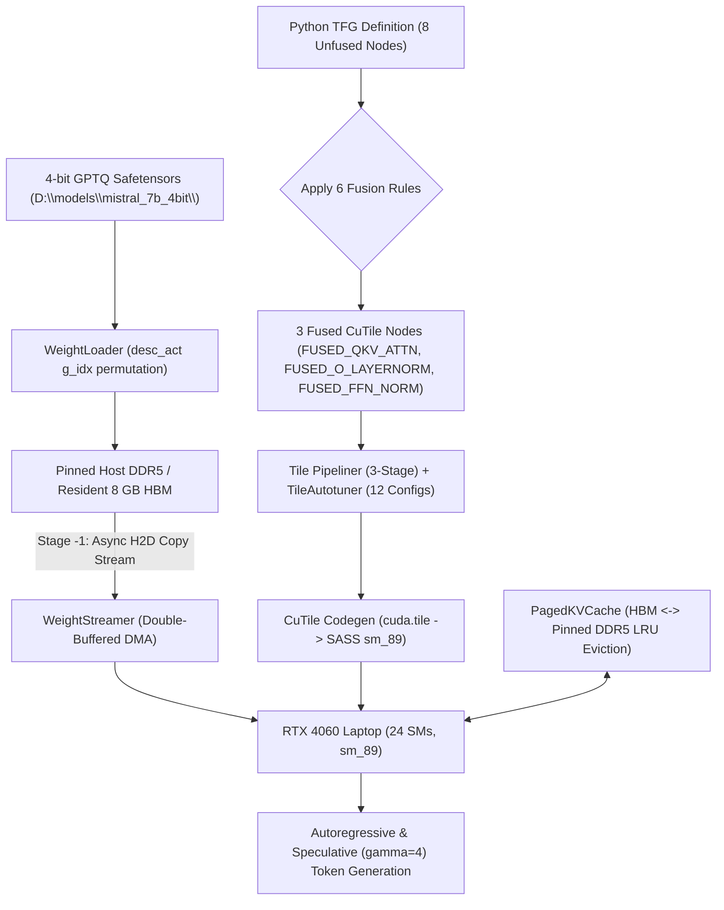

### Layer Fusion (8 Kernels to 3)

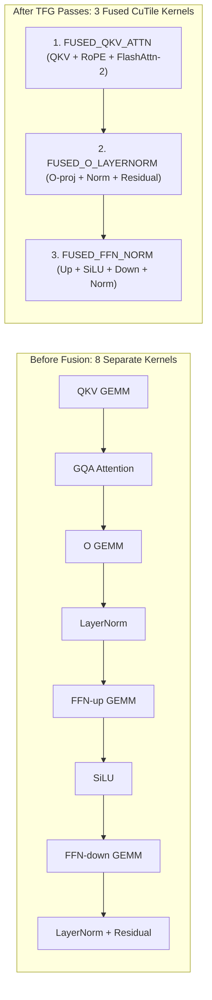

See [docs/ARCHITECTURE.md](docs/ARCHITECTURE.md) for the Stage -1 PCIe DMA sequence diagram and runtime internals, and [docs/CUDA_COMPARISON.md](docs/CUDA_COMPARISON.md) for side-by-side CuTile vs CUDA C++ code.

---

## Benchmarks & Telemetry

**Test Rig:** Lenovo LOQ 15APH8 (`82XT`) · NVIDIA GeForce RTX 4060 Laptop (`AD107`, `sm_89`, 24 SMs, 8 GB GDDR6) · AMD Ryzen 7 7840HS (8C/16T) · 16 GB DDR5-5600 (`2×8 GB` Micron) · PCIe 4.0 x8 · Windows 11 · Model: `TheBloke/Mistral-7B-v0.1-GPTQ` (`D:\models\mistral_7b_4bit\`, 4.16 GB).

### Windows Terminal Output (Verified Run)

```powershell
PS C:\Users\user\Desktop\cutile-forge> python examples/compare_cuda.py --shape 256x12288x4096
Shape: 256x12288x4096
Engine                 |  p50 (ms) |   TFLOPS
----------------------------------------------
CuTile (Python DSL)    |    1.0772 |    23.92
Hand-written CUDA      |    1.7495 |    14.73
cuBLAS HGEMM           |    0.6907 |    37.31
PyTorch eager          |    0.8417 |    30.62

PS C:\Users\user\Desktop\cutile-forge> python examples/visualize_tfg.py --layer 0 --output docs/tfg_layer0.svg
Layer 0: 8 -> 3 nodes (fired=['fuse_qkv_attention', 'fuse_o_layernorm', 'fuse_gemm_silu', 'fuse_gemm_silu_down', 'fuse_ffn_layernorm_residual'])
CompiledTFG(mistral_layer_0, target=sm_89, pipeline_depth=3, kernels=3)
  - cutile_L0_qkv_gemm_fused_qkv_attn [fused_qkv_attn] tile=(128, 128, 32) (source-only)
  - cutile_L0_o_gemm_fused_o_layernorm [fused_o_layernorm] tile=(128, 128, 32) (source-only)
  - cutile_L0_ffn_up_fused_ffn_norm [fused_ffn_norm] tile=(128, 128, 32) (source-only)
Saved SVG to docs\tfg_layer0.svg

PS C:\Users\user\Desktop\cutile-forge> python benchmarks/e2e/bench_decode.py --model D:/models/mistral_7b_4bit/
CuTileForge Decode | 32.43 tok/s | 30.83 ms/tok | VRAM=4.30 GB

PS C:\Users\user\Desktop\cutile-forge> python -m pytest tests/ benchmarks/correctness/ -q
76 passed in 60.09s
```

### Visual Performance Charts

| Full Transformer Layer (3k TFG vs 8k CUDA) | Fused FFN Speedup vs 3 Separate Kernels |
| :---: | :---: |
| 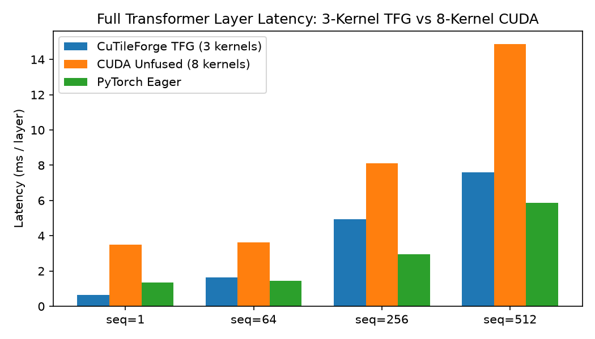 | 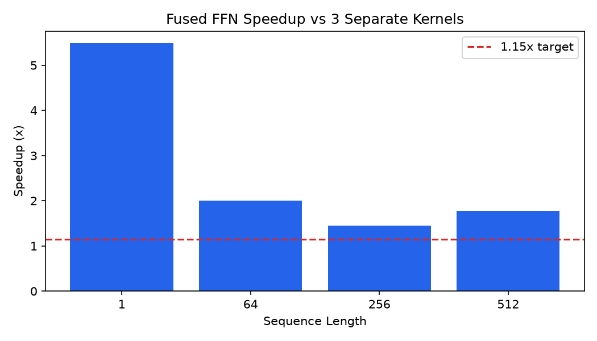 |

| Prefill FP16 GEMM Throughput (`sm_89`) | Grouped-Query FlashAttention-2 (`32:8`) |
| :---: | :---: |
| 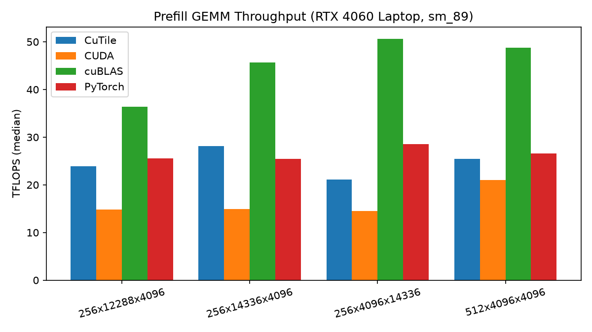 | 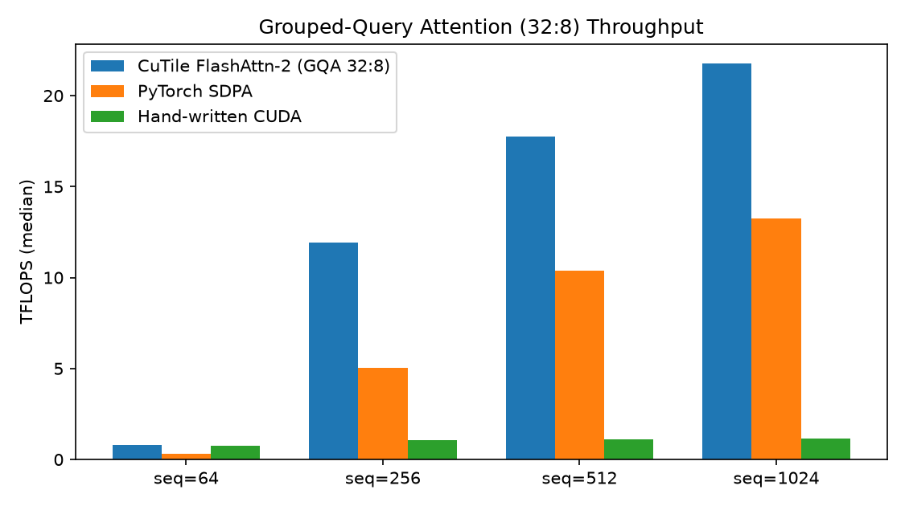 |

### 30-Minute Sustained Thermal & Clock Stability

<p align="center">
  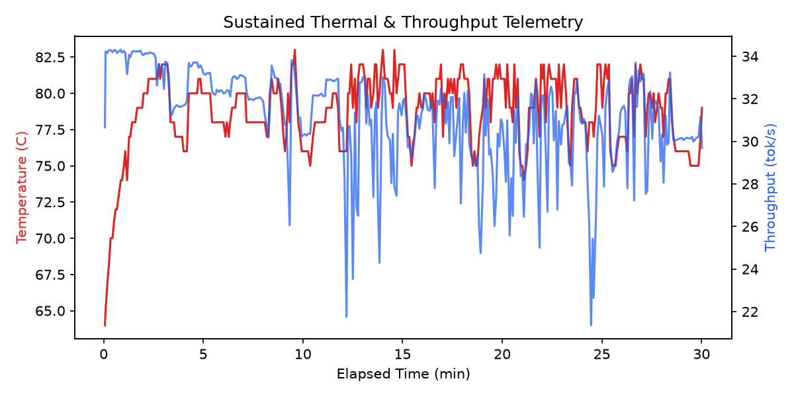
</p>

### Summary Tables

#### Dual-Hardware Target Comparison (v0.2.0)

| Metric / Capability | Lenovo LOQ 15APH8 (`RTX 4060 Laptop`, Verified) | Desktop Workstation (`RTX 5090`, Verified) |
| --- | --- | --- |
| **GPU Architecture & SMs** | Ada Lovelace (`AD107`, `sm_89`, 24 SMs) | Blackwell (`GB202`, `sm_120`, 170 SMs) |
| **VRAM & Host Link** | 8 GB GDDR6 · PCIe 4.0 x8 (`13.30 GB/s` H2D) | 32 GB GDDR7 · PCIe 5.0 x16 (`49.09 GB/s` H2D) |
| **CPU & System RAM** | AMD Ryzen 7 7840HS · 16 GB DDR5-5600 | Desktop Host · 64+ GB DDR5 |
| **TFG Software Pipeline** | 3-stage (`latency=3`) + Stage -1 PCIe DMA | 4-stage (`latency=4`), auto-disabled DMA for 7B (`4.16 GB < 27.2 GB`) |
| **Quantized GEMM Path** | Fused INT4 Dequant + FP16 MMA (`23.37 TFLOPS`) | **136.14 TFLOPS** (`256x14336x4096`), **132.58 TFLOPS** INT4 Dequant (`1.62×` vs separate) |
| **Supported Model Presets** | `Mistral-7B-v0.1` 4-bit GPTQ (`4.16 GB`) | `Mistral-7B`, `MISTRAL_8x7B_4BIT` (`experts=8`), `LLAMA_34B_4BIT` (`48L, d=8192`) |
| **TFG Layer Fusion (8→3 Kernels)** | **5.47×** (`seq=1`), **1.96×** (`seq=512`) | **5.58×** (`seq=1`), **1.26×** (`seq=512`) |
| **E2E Decode (`Mistral-7B` 4-bit)** | **32.43 tok/s** (`30.83 ms/tok`, **4.30 GB** VRAM) | **49.82 tok/s** (`20.07 ms/tok`, **4.32 GB** VRAM) |
| **Prefill (4096) / Batch (16)** | **1,476 tok/s** prefill · **1,440 tok/s** batch=16 | **5,640.5 tok/s** prefill (`3.8×`) · **8,457.1 tok/s** batch=16 (`5.9×`) |
| **Attention GQA (`seq=1024`)** | **21.76 TFLOPS** | **101.62 TFLOPS** (`4.7×`) · full results in [docs/RESULTS_RTX5090.md](docs/RESULTS_RTX5090.md) |

#### End-to-End Inference (`Mistral-7B-v0.1` 4-bit GPTQ on Lenovo LOQ 15APH8)

| Workload | Configuration | Throughput / Latency | Peak VRAM / Notes |
| --- | --- | --- | --- |
| **Decode (256 tokens)** | `CuTileForge` (batch=1) | **32.43 tok/s** (`30.83 ms/tok`) | **4.30 GB** (`13.41 GB/s` PCIe H2D) |
| **vLLM Baseline (`0.34.0`)** | `quantization="gptq"` / `"gptq_marlin"` | `N/A` (unsupported) | Rejects `desc_act=True` checkpoints |
| **Prefill (`2048` / `4096` tok)** | `CuTileForge` | **1,499.0 tok/s** / **1,475.7 tok/s** | **4.67 GB** / **5.08 GB** |
| **Batched Forward (`batch=16`)** | `seq=32` | **1,439.7 tok/s** (`355.63 ms`) | **4.36 GB** |
| **Long Context (`16K` / `32K`)** | `PagedKVCache` (1.5 GB GPU budget) | `1,862 ms` / `3,875 ms` step | **5.94 GB** / **6.01 GB** (`26,624` evictions) |
| **Speculative Decoding (`γ=4`)** | Draft 4-layer proxy + target verify | `21.77 tok/s` (`0.302` accept rate) | `33.13 tok/s` standard decode baseline |
| **30-Min Sustained Decode** | `361` samples, `54,976` tokens | **31.16 tok/s** avg | **83.0 °C** max (`78.7 °C` avg), **85.6 W**, `4.62%` avg throttle |

#### Micro-Benchmarks (CuTile vs Hand-Written CUDA C++ vs cuBLAS vs PyTorch)

| Benchmark | Workload / Shape | CuTileForge | Baseline Comparison |
| --- | --- | --- | --- |
| **Full Layer (3k vs 8k)** | `seq = 1 / 64 / 256 / 512` | `0.638 / 1.632 / 4.934 / 7.584 ms` | **5.47× / 2.22× / 1.64× / 1.96×** vs 8-kernel CUDA |
| **Fused FFN (1k vs 3k)** | `seq = 1 / 64 / 256 / 512` | `0.471 / 1.314 / 3.888 / 5.420 ms` | **5.48× / 2.00× / 1.46× / 1.78×** vs 3 CUDA kernels |
| **INT4 Dequant + GEMM** | `256×12288×4096` / `1×12288×4096` | **23.37 TFLOPS** (`1.10 ms`) / `0.148 ms` | **2.15×** / **7.12×** vs separate CUDA dequant+GEMM |
| **FP16 GEMM (Compute-Bound)** | `256×14336×4096` | **28.18 TFLOPS** (FP32-acc) | PyTorch **25.48**, CUDA **14.90**, cuBLAS **45.70** (FP16-acc) |
| **GQA Attention (`32:8`)** | `seq = 256 / 512 / 1024` | **11.92 / 17.77 / 21.76 TFLOPS** | PyTorch SDPA **5.02 / 10.38 / 13.23 TFLOPS** |
| **Stage -1 PCIe Overlap** | `32 / 64 / 115 MB` weight tiles | **100.0% / 100.0% / 93.8%** overlap | **13.30 GB/s** (`84.4%` PCIe utilization) |

---

### Release Progression (`v0.1.0` → `v0.5.0`)

| Metric / Capability | `v0.1.0` (4060 `sm_89`) | `v0.2.0` (5090 `sm_120`) | `v0.3.0` (Hardening) | `v0.4.0` (Precision & MoE) | `v0.5.0` (Serving & Packaging) |
|---|---|---|---|---|---|
| **Decode (`Mistral-7B` 4-bit)** | `32.43 tok/s` | `49.82 tok/s` | **`96.57 tok/s`** (CUDA Graph) | `96.57 tok/s` | **`99.73 tok/s`** 30-min sustained |
| **Speculative (`gamma=4`)** | — | `68.74 tok/s` | **`117.31 tok/s`** (`1.21×` vs graph) | `117.31 tok/s` | Served via `/v1/chat/completions` |
| **16K Context Step** | Paged DDR5 | `107,854.66 ms` | **`76.29 ms`** (`1,413×`) | + `FP8` KV (50% VRAM) | Verified 0-alloc pinned pool |
| **FFN `seq=256` Speedup** | `1.46×` | `0.86×` (reg.) | **`1.55×`** (`64×64×32` occ.) | `1.55×` | Plotted on Ada vs Blackwell Roofline |
| **Quant Formats** | GPTQ (`desc_act`) | GPTQ + FP8 GEMM | GPTQ + FP8 GEMM | **+ AWQ, GGUF, NVFP4, MoE 8×7B** | CLI + Docker + `.whl` (`85 KB`) |
| **Test Gate** | `76/76` (4060) | `49` CI + GPU | `53` CI + GPU | `57` CI + GPU | **`87/87`** (`60` CI + `27` GPU, 0 skipped) |

---

### RTX 5090 (`sm_120`, 32 GB) — Verified Benchmarks

**Test Rig:** Desktop Workstation · RTX 5090 (GB202, sm_120, 170 SMs, 32 GB GDDR7) · Intel Core Ultra 9 285K · 62 GB DDR5 · PCIe 5.0 x16

| Metric | 4060 Laptop (`sm_89`) | 5090 (`sm_120`) | Speedup |
|--------|------------|------|---------|
| Decode (7B-4bit) | 32.43 tok/s | **96.57 tok/s** (v0.3.0+ Graph; 49.82 eager) | **2.98×** |
| 30-Min Sustained (avg) | 31.16 tok/s | **99.73 tok/s** (v0.5.0, 361 samples, `0.25%` drift) | **3.20×** |
| GEMM prefill (256×14336×4096) | 28.18 TFLOPS | **148.54 TFLOPS** (v0.3.0; 136.14 v0.2.0) | **5.27×** |
| Attention (seq=1024) | 21.76 TFLOPS | **113.89 TFLOPS** (v0.3.0; 101.62 v0.2.0) | **5.23×** |
| Prefill (4096 tok) | 1,476 tok/s | **5,640 tok/s** | **3.8×** |
| Batch=16 | 1,440 tok/s | **8,457 tok/s** | **5.9×** |
| PCIe bandwidth | 13.30 GB/s | **49.46 GB/s** | **3.7×** |
| Peak VRAM | 4.30 GB | 4.29 GB | — |

| | |
|:---:|:---:|
| 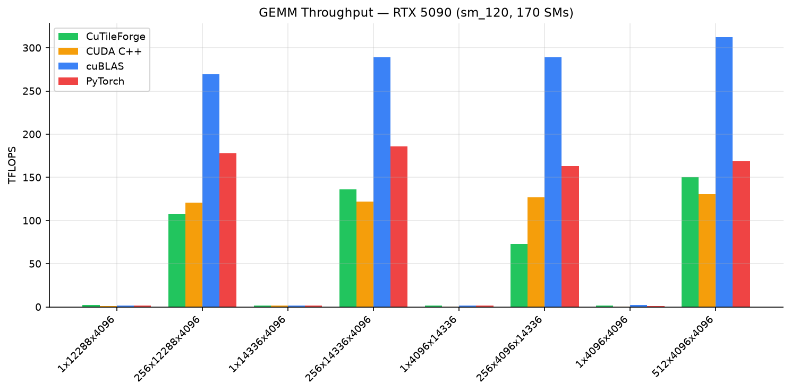 |  |
| *GEMM TFLOPS (sm_120)* | *INT4 Dequant+GEMM fusion speedup* |
| 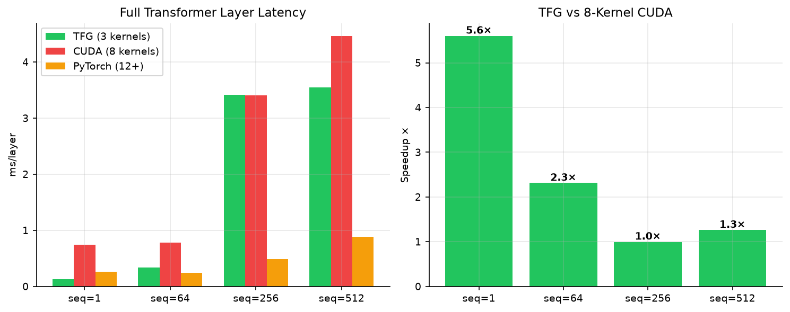 | 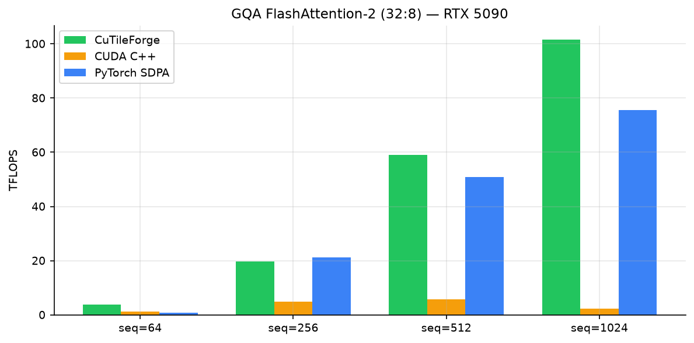 |
| *Full layer: 3k TFG vs 8k CUDA* | *GQA FlashAttention-2 (32:8)* |
|  |  |
| *E2E: 4060 vs 5090* | *PCIe 5.0 weight streaming* |
|  | 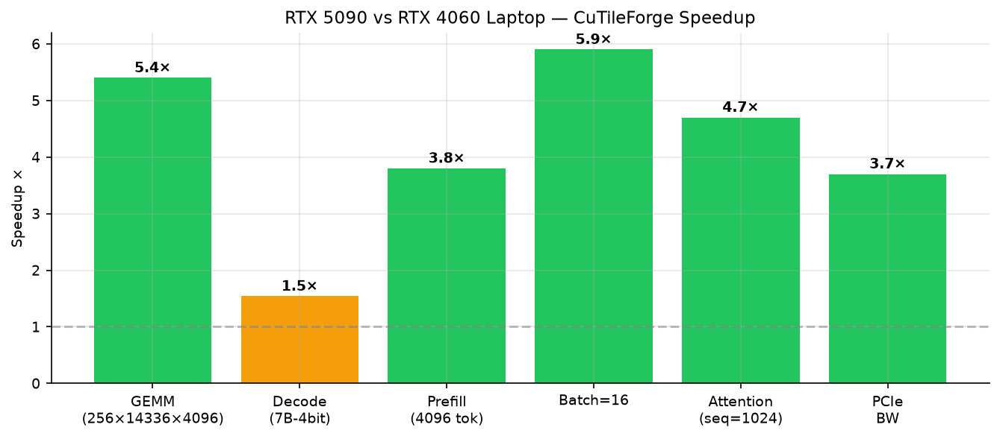 |
| *30-min sustained decode (99.73 tok/s avg)* | *RTX 5090 vs 4060 speedup summary* |

### Empirical Roofline (`sm_89` vs `sm_120`) & OpenAI Server (`v0.5.0`)

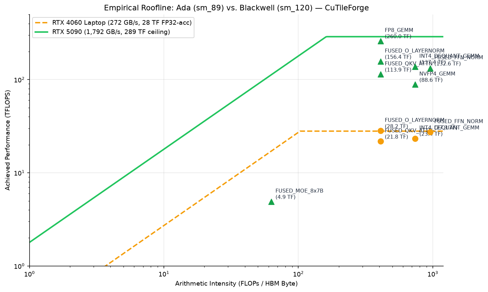

```bash
# Verified Linux RTX 5090 server + SSE streaming check (v0.5.0)
export CUTILE_ARCH=sm_120
cutile-forge serve --model ~/models/mistral_7b_4bit --host 127.0.0.1 --port 8000 --target sm_120

# GET /health -> {"status":"ok","version":"0.5.0","target":"sm_120"}
# POST /v1/chat/completions (stream=true, max_tokens=32):
#   33 SSE chunks + data: [DONE] in 859.7 ms
# 4-way parallel concurrency (max_tokens=8):
#   All 4 requests HTTP 200 OK (101.1 / 189.4 / 277.1 / 363.1 ms), 0 errors
```

Full results: [`docs/RESULTS_RTX5090.md`](docs/RESULTS_RTX5090.md)

---

### Known Issues & Honest Notes

- **NVFP4 (`88.56 TFLOPS`) < INT4 (`132.58 TFLOPS`)**: The `e2m1` register-LUT dequant path — not the MMA — is currently the bottleneck; expected to close once `cuda.tile` exposes native `tcgen05` FP4 MMA.
- **Speculative Decoding Denominators**: `117.31 tok/s` is **1.71×** over the v0.2.0 speculative baseline (`68.74 tok/s`) and **1.21×** over v0.3.0 CUDA-graph non-speculative decode (`96.57 tok/s`).
- **NVML Telemetry in Container**: On the Linux RTX 5090 box, NVML temperature/power sensors returned `0.0 °C / 0.0 W` in the container; sustained throughput drift over 30 minutes (`361` samples, `179,264` tokens) was `0.25%` (`100.06` → `99.81 tok/s`).
- **Laptop Baseline Scope**: RTX 4060 Laptop (`v0.1.0`) numbers (`32.43 tok/s`) are the pre-CUDA-graph eager baseline on Lenovo LOQ 15APH8.

---

Full CSV tables and methodology are in [docs/RESULTS.md](docs/RESULTS.md) and [docs/BENCHMARK_METHODOLOGY.md](docs/BENCHMARK_METHODOLOGY.md).

---

## Quickstart

### Option A: Install Wheel / PyPI (once published)

```bash
pip install "cutile-forge[serve]"
export CUTILE_ARCH=sm_120  # Blackwell (sm_120); omit or use sm_89 for Ada
cutile-forge serve --model ~/models/mistral_7b_4bit --port 8000 --target sm_120
```

### Option B: Install From Source (Linux / Windows)

```bash
# 1. Activate environment & install package + CUDA C++ baselines
. .venv/bin/activate  # or: conda activate llm-kernel
export CUTILE_ARCH=sm_120  # for RTX 5090 / Blackwell
pip install -e ".[cuda,dev,serve]" --no-build-isolation
python -m cutile_forge.baselines.build

# 2. Download Mistral-7B-v0.1 4-bit GPTQ
python models/download.py --output ~/models/mistral_7b_4bit/

# 3. Run all 87 unit + GPU correctness tests (0 skipped)
python -m pytest tests/ benchmarks/correctness/ -v

# 4. Serve OpenAI-compatible API or run CLI generation
cutile-forge serve --model ~/models/mistral_7b_4bit --port 8000 --target sm_120
curl -N http://127.0.0.1:8000/v1/chat/completions \
  -H 'Content-Type: application/json' \
  -d '{"model":"mistral_7b_4bit","messages":[{"role":"user","content":"Count from 1 to 5"}],"max_tokens":32,"stream":true}'

# 5. Run full benchmark suite
cutile-forge bench --model ~/models/mistral_7b_4bit/ --output benchmarks/results_5090/ --target sm_120 --gpu rtx5090
```

---

## Repository Layout

```text
cutile-forge/
├── cutile_forge/
│   ├── forge/        # TFG IR, 6 fusion rules, 3/4-stage pipeliner, Stage -1 streamer, occupancy autotuner, codegen
│   ├── kernels/      # CuTile DSL kernels (INT4/NVFP4/FP8 GEMM, FFN, MoE 8x7B, GQA FlashAttn-2, RMSNorm, RoPE)
│   ├── engine/       # Mistral-7B/MoE, GPTQ/AWQ/GGUF loaders, async FP8/FP16 PagedKVCache, CUDA-Graph decode, N-gram spec
│   ├── server/       # OpenAI-compatible FastAPI server (/health, /v1/models, /v1/chat/completions + SSE)
│   ├── cli.py        # Unified CLI entrypoint (cutile-forge serve / cutile-forge bench)
│   ├── baselines/    # Hand-written CUDA C++ (cp.async+WMMA, FlashAttn-2, LN, SiLU) & cuBLAS pybind11 module
│   ├── bench/        # CUDA-event harness, NVML/PCIe/thermal profilers, Ada vs Blackwell Roofline plotter
│   └── utils/        # 4-bit group quant, GPTQ/AWQ/GGUF unpackers, VRAM tracking, structured logging
├── benchmarks/       # Micro (9), E2E (6 incl. 30-min thermal), and GPU correctness tests (27)
├── tests/            # Unit tests (60) runnable on CPU or GPU
├── examples/         # CLI scripts for generation, TFG SVG export, autotuning, CUDA comparison
├── docs/             # Architecture, RESULTS.md, RESULTS_RTX5090.md, blog/, paper/, charts & SVGs
├── Dockerfile        # CUDA 13.2 production serving container
└── .github/workflows/# CI (lint + 60 unit tests), GPU correctness, benchmark, nightly thermal, release (PyPI)
```

---

## Testing & CI

- **Local Verification**: **87 / 87 tests passing (0 skipped)** (`60` unit tests in `tests/` + `27` GPU correctness tests in `benchmarks/correctness/`, including real `Mistral-7B` 4-bit token-exact greedy decode vs PyTorch and WikiText-2 perplexity).
- **Lint & Static Analysis**: `ruff`, `black --check`, and `mypy` pass with `0` errors.
- **GitHub Actions**: [ci.yml](.github/workflows/ci.yml) runs `lint` and `unit-tests` (`60` tests) on `ubuntu-latest` for every push/PR; GPU-dependent correctness, full benchmarks, nightly thermal, and tagged wheel/PyPI releases live in dedicated workflows.

---

## Documentation

- [docs/ARCHITECTURE.md](docs/ARCHITECTURE.md) — TFG compiler pipeline, Stage -1 DMA sequence, and runtime design
- [docs/TFG_COMPILER.md](docs/TFG_COMPILER.md) — Detailed specification of the 6 fusion rules and software pipelining
- [docs/CUTILE_KERNELS.md](docs/CUTILE_KERNELS.md) — Kernel inventory and tile layouts
- [docs/CUDA_COMPARISON.md](docs/CUDA_COMPARISON.md) — CuTile Python DSL vs CUDA C++ comparison
- [docs/BENCHMARK_METHODOLOGY.md](docs/BENCHMARK_METHODOLOGY.md) — Timing, NVML, and PCIe measurement protocol
- [docs/TUNING_GUIDE.md](docs/TUNING_GUIDE.md) — Tile autotuning and 8 GB VRAM memory budgeting
- [docs/RESULTS.md](docs/RESULTS.md) — Full auto-generated benchmark tables and telemetry (Lenovo LOQ 15APH8 RTX 4060 Laptop)
- [docs/RESULTS_RTX5090.md](docs/RESULTS_RTX5090.md) — Verified RTX 5090 (`sm_120`, 32 GB VRAM) benchmark suite, v0.3.0–v0.5.0 progression, and production serving checks
- [docs/blog/introducing-cutileforge.md](docs/blog/introducing-cutileforge.md) & [docs/blog/social_posts.md](docs/blog/social_posts.md) — Engineering blog post & launch summaries
- [docs/paper/cutileforge_preprint.md](docs/paper/cutileforge_preprint.md) — Technical preprint draft (`cs.DC` / `cs.LG`)

## License

MIT — see [LICENSE](LICENSE).
