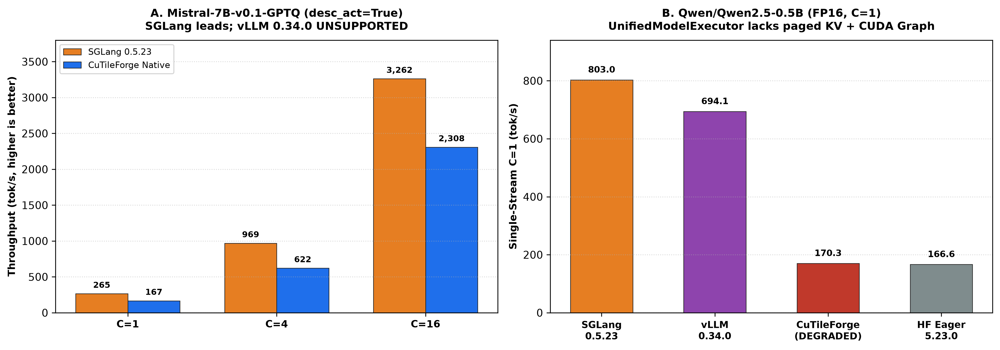

# CuTileForge

**A Tile-Fusion Graph (TFG) compiler, native [`cuda-tile`](https://pypi.org/project/cuda-tile/) GPU kernel library, universal quantized inference engine, and OpenAI-compatible serving runtime.**

- **Current release:** **`v3.8.0`** (`2026-11-24`) — Phase 22 `PagedKVCache` numerical correctness & documentation release (see [CHANGELOG.md](CHANGELOG.md)).
- **Verified hardware target:** Single `NVIDIA GeForce RTX 5090` (`sm_120`, 32 GB GDDR7, CUDA `13.2`, PyTorch `2.15.0+cu132`, `cuda-tile 1.8.1`, `transformers 5.23.0`).
- **Validation discipline:** Green unit/integration tests and zero-fallback native execution are tracked separately from strict all-layer numerical parity (`2 PASS / 6 FAIL` under unchanged strict regression gates) and external engine performance (`SGLang` and `vLLM` lead CuTileForge on core serving benchmarks).

---

## Table of Contents

1. [Overview](#overview)
2. [Regression & Numerical Parity Status (`v3.8.0`)](#regression--numerical-parity-status-v380)
3. [Compatibility Matrix, Quantization & Operational Limits](#compatibility-matrix-quantization--operational-limits)
4. [External Engine Comparison](#external-engine-comparison)
5. [Hardware & Validation Scope](#hardware--validation-scope)
6. [Prerequisites & Installation](#prerequisites--installation)
7. [Tested Quickstart & Usage Examples](#tested-quickstart--usage-examples)
8. [Benchmark Methodology & Phase 22 Metrics](#benchmark-methodology--phase-22-metrics)
9. [Release Evolution & Roadmap (Phases 22–24)](#release-evolution--roadmap-phases-2224)
10. [Contributing, Documentation & License](#contributing-documentation--license)

---

## Overview

CuTileForge compiles PyTorch/ONNX workloads and quantized HuggingFace/GGUF checkpoints onto NVIDIA CuTile kernels without fallback to PyTorch compute operators (`torch.matmul`, `F.scaled_dot_product_attention`, `F.conv2d`, `F.layer_norm`) in native execution paths:

- **TFG Compiler & SDK (`cutile_forge.sdk`, `cutile_forge.forge`):** Imperative `Graph` builder, algebraic operator fusion passes, HBM buffer lifetime planning (`cutile-forge inspect`), Stage -1 async pinned-DDR5 streaming (`HybridLayerBudgeter` for 70B models on 32 GB VRAM), ONNX import, and `torch.compile(backend="cutile_forge")`.
- **Native CuTile Kernels (`cutile_forge.kernels`):** Split-K GEMM, FlashAttention-2 GQA + Split-KV FlashDecoding with sliding-window boundary masking, RoPE, fused RMSNorm+SiLU, LayerNorm, implicit-GEMM Conv2D, Top-K MoE router (`cutile_moe_router_topk`), and native tensor-core dequantization (`GPTQ`, `AWQ`, `GGUF Q4_0/Q8_0/Q4_K/Q6_K/Q4_K_M`, `INT8`, `FP8`).
- **Native Serving & KV Runtime (`cutile_forge.runtime`, `cutile_forge.engine`, `cutile_forge.server`):** Full-step CUDA Graph decode (`NativeModelRuntime`), paged FP16/FP8 E4M3 KV-cache with per-slot FP8 scales (`PagedKVCache`, `NativePagedKVCache`), continuous batching scheduler (`ContinuousBatchScheduler`), SSE streaming, Bearer auth, and Prometheus `/metrics`.

---

## Regression & Numerical Parity Status (`v3.8.0`)

> **Important distinction:** `8/8` regression models execute **natively on CuTile (`0` PyTorch compute fallbacks)**, and CI/unit suites pass (`298 passed` on GPU; `203 passed, 4 skipped` on CPU). **Neither green CI nor native execution implies full strict numerical parity.** Under unchanged strict thresholds (`cutile-forge regress --tier full`), the 8-model suite stands at **`2 PASS / 6 FAIL`**.

<p align="center">
  
</p>

Pinned evidence:
- `v3.7.1` baseline (`bd9ec7d`): [`benchmarks/validation_artifacts/v3.7.1/phase21_1_regression/regress_full.json`](benchmarks/validation_artifacts/v3.7.1/phase21_1_regression/regress_full.json)
- `v3.8.0` Phase 22 rerun (`40b8d43`): [`benchmarks/validation_artifacts/v3.8.0/phase22_regression/regress_full.json`](benchmarks/validation_artifacts/v3.8.0/phase22_regression/regress_full.json)

| Category | Model (`Weight Source`) | Native Exec | Strict Parity (`v3.8.0`) | Key Measured Metrics (`40b8d43`) | Failure / Scope Detail (Unchanged Gates) |
|---|---|---:|---|---|---|
| Multimodal | `LLaVA-1.5` (`real-checkpoint`, 55L) | Yes | **`PASS`** | `cos=1.000000`, `max_diff=0.0156`, `greedy=1/1 (16/16 tok)` | **Single 16-token greedy continuation only** (does not establish 5-prompt x 256-token parity). |
| Diffusion | `DiT-XL/2` (`real-checkpoint`, 28L) | Yes | **`PASS`** | `cos=0.999999`, `max_diff=0.00439` | Passes `cos >= 0.9999` and `max_abs_diff < 0.05` against `diffusers==0.43.0`. |
| Dense decoder | `Mistral-7B` (`real-checkpoint`, 32L GPTQ) | Yes | **`FAIL`** | `cos=1.000000`, `ppl=5.1475 vs 5.1473`, `greedy=4/5 (99.84%)`, `169.83 tok/s` | Misses strict `greedy == 5/5` on `P4 @ step 50` (`ONE_SIDED_TIE`, `ref_margin=0.0`, `cu_margin=1 ULP`); path: `NativeModelRuntime` CUDA Graph. |
| Small decoder | `Qwen2.5-0.5B` (`real-checkpoint`, 24L FP16) | Yes | **`FAIL`** | `cos=0.999997`, `ppl=12.9381 vs 12.9413`, `greedy=4/5 (99.92%)` | Misses strict `greedy == 5/5` on `P0 @ step 97` (`ONE_SIDED_TIE`, `1 ULP`); path: uncached `UnifiedModelExecutor.forward`. |
| MoE | `Mixtral-8x7B` (`real-checkpoint`, 32L GPTQ) | Yes | **`FAIL`** | `cos=0.999988`, `ppl=4.3428 vs 4.3427`, `greedy=3/5 (99.77%)`, `43.06 tok/s` | `P1 @ step 45` (`ONE_SIDED_TIE`) and **`P2 @ step 185` (`SUBSTANTIVE_DIVERGENCE`, `6.0 ULPs`, token `28725` vs `28723`)** on `PagedKVCache`. |
| Large decoder | `Llama-2-70B` (`real-checkpoint`, 80L GPTQ) | Yes | **`FAIL`** | `cos=0.999998`, `ppl=4.8154 vs 4.8143`, `greedy=4/5 (99.92%)`, `3.88 tok/s` | Misses strict `greedy == 5/5` on `P2 @ step 124` (`ONE_SIDED_TIE`, `1 ULP`) with Stage -1 PCIe streaming (`55 HBM + 25 DDR5`). |
| Vision | `SigLIP ViT-B/16` (`real-checkpoint`, 12L) | Yes | **`FAIL`** | `emb_cos=0.999979`, `max_diff=0.125` | Exceeds strict `max_abs_diff < 0.05` gate against `transformers==5.23.0`. |
| Audio | `Whisper-Tiny` (`real-checkpoint`, 4L enc) | Yes | **`FAIL`** | `emb_cos=0.999996`, `max_diff=0.31348` | Exceeds `max_abs_diff < 0.1` vs HF SDPA FP16; vs HF SDPA **FP32**, `v3.7.1` measured `0.42506` (**`1.71x`** of the `0.24896` HF FP16-vs-FP32 noise floor). |

Decoder tie classifications (`ONE_SIDED_TIE`, `EXACT_LOGIT_TIE`, `NUMERIC_NEAR_TIE`, `SUBSTANTIVE_DIVERGENCE`) and single-sample encoder noise-floor measurements are **diagnostic only** and do not relax strict gates.

---

## Compatibility Matrix, Quantization & Operational Limits

- **Full 4-Axis Matrix:** [`docs/FINAL_COMPATIBILITY_MATRIX.md`](docs/FINAL_COMPATIBILITY_MATRIX.md) (`29` representative cells: **`14 PASS` / `8 FAIL` / `4 UNSUPPORTED` / `3 NOT RUN`**).
- **Operational Limits:** [`docs/OPERATIONAL_LIMITS.md`](docs/OPERATIONAL_LIMITS.md) documents strict context ceilings (`64K` on Mistral-7B `UNSUPPORTED`), GGUF `Q5_0` rejection (`UNSUPPORTED`), `qwen2_moe`/`deepseek_moe` (`SYNTHETIC-ONLY`), and serving gate status.
- **Phase 16 HTTP Non-Streaming Gate (`FAIL`):** At concurrency `C=64` on `Mistral-7B-v0.1-GPTQ`, HTTP streaming SSE passes at `90.98%` (`2,697.14 tok/s`), whereas **HTTP non-streaming `C=64` is `FAIL` at `84.99%` (`2,519.59 tok/s` 3-run median vs strict `>= 85%` target; single run-0 `85.02%` does not override the median)**.

### Quantization & Architecture Coverage Highlights (`real-checkpoint` vs `UNSUPPORTED` / `NOT RUN`)

| Model / Family | Format / Quantization | Path | Status | Measured PPL / Parity (`FINAL_COMPATIBILITY_MATRIX.md`) |
|---|---|---|---|---|
| `Mistral-7B-v0.1` | `GGUF Q4_K_M` | `eager` | **`PASS`** | `ppl=6.0710 vs 6.0716` (`0.0094%`) |
| `Mistral-7B-v0.1` | `GPTQ Int4 (desc_act=True)` | `batched` (`C=64`) / `speculative` | **`PASS`** | `2,964.61 tok/s` (`C=64`); `354.51 tok/s` (`89.29%` accept) |
| `Mistral-7B-v0.1` | `GPTQ Int4 (desc_act=True)` | `http` (`C=64` nonstream) | **`FAIL`** | `2,519.59 tok/s` (`84.99% < 85%`) |
| `Qwen2.5-0.5B` | `GPTQ` / `AWQ` / `FP8_channel` / `GGUF Q4_0, Q8_0, Q6_K` | `eager` | **`PASS`** | `0.0001%–0.032%` PPL diff (`v3.2.0/phase15_quant_real`) |
| `Qwen2.5-0.5B` | `GGUF Q4_K_M` (mixed `Q5_0` tensors) | `eager` | **`UNSUPPORTED`** | `GGML tensor type 'Q5_0' has no native CuTile kernel` |
| `Llama-3.2-1B-Instruct` | `FP16` (`hf_transformers`) | `eager` | **`PASS`** | `cos=0.999996`, `max_diff=0.03125`, `greedy=5/5` |
| `ViT-B/16` / `CLIP-ViT-B/32` | `FP16` (`hf_transformers`) | `eager` | **`PASS`** | `cos=1.0 / 0.999989`, `max_diff=0.00391 / 0.03711` |
| `Qwen2-MoE` / `DeepSeek-MoE` | `FP16` (`synthetic_weights`) | `eager` | **`NOT RUN`** (`SYNTHETIC-ONLY`) | No ungated `< 16 GB` FP16 checkpoint fits with reference in 32 GB |

<p align="center">
  
</p>

---

## External Engine Comparison

Measured in [`docs/EXTERNAL_ENGINE_COMPARISON.md`](docs/EXTERNAL_ENGINE_COMPARISON.md) on `NVIDIA GeForce RTX 5090` (`sm_120`, `OUT_TOKENS=64`, `temperature=0.0`, `5` runs after `2` warmup; `v3.6.0/phase20_external_engines/manifest.json`):

<p align="center">
  
</p>

| Engine | Model / Format | C=1 (`tok/s`) | C=4 (`tok/s`) | C=16 (`tok/s`) | Peak VRAM (MB) | Status & Takeaways |
|---|---|---:|---:|---:|---:|---|
| **`SGLang 0.5.23`** | `Mistral-7B-v0.1-GPTQ` (`desc_act=True`) | **265.01** | **969.40** | **3,261.84** | 18,512–18,532 | **Wins latency & throughput** (`1.59x` @ `C=1`, `1.41x` @ `C=16` vs CuTileForge). |
| CuTileForge Native | `Mistral-7B-v0.1-GPTQ` (`desc_act=True`) | 167.03 | 621.53 | 2,308.02 | 8,570–8,679 | Lower VRAM allocation; supports `desc_act=True` where `vLLM 0.34.0` errors. |
| `vLLM 0.34.0` | `Mistral-7B-v0.1-GPTQ` (`desc_act=True`) | — | — | — | — | `UNSUPPORTED` (`VllmConfig` `ValidationError` on `desc_act=True` checkpoint). |
| **`SGLang 0.5.23`** | `Qwen/Qwen2.5-0.5B` (`FP16`) | **803.05** | **2,873.88** | **10,825.80** | 18,418–18,438 | **Beats CuTileForge (`4.7x` @ `C=1`)** and scales with continuous batching. |
| **`vLLM 0.34.0`** | `Qwen/Qwen2.5-0.5B` (`FP16`) | **694.12** | **2,535.79** | **9,494.11** | 16,914 | **Beats CuTileForge (`4.1x` @ `C=1`)**. |
| `HF Transformers 5.23.0` | `Qwen/Qwen2.5-0.5B` (`FP16`, eager) | 166.56 | — | — | 984 | Eager reference baseline only. |
| CuTileForge `UnifiedModelExecutor` | `Qwen/Qwen2.5-0.5B` (`FP16`) | 170.27 | — | — | 1,957 | **`DEGRADED`**: lacks persistent paged KV-cache + CUDA Graph decode loop. |
| `TensorRT-LLM 1.3.0` | Both models | — | — | — | — | `NOT_RUN` (`RuntimeError`: missing vendored `triton_kernels`). |

---

## Hardware & Validation Scope

Full status matrix: [`docs/HARDWARE_SUPPORT_MATRIX.md`](docs/HARDWARE_SUPPORT_MATRIX.md).

| Target / Environment | Scope | Status | Important Qualification |
|---|---|---|---|
| **NVIDIA RTX 5090 (`sm_120`, 32 GB)** | Local 1-GPU workstation | **`VERIFIED`** (within above parity/serving limits) | **Does NOT validate RTX 4060 (`sm_89`) or physical multi-GPU clusters.** |
| **NVIDIA RTX 4060 Laptop (`sm_89`, 8 GB)** | Deferred laptop validation | **`UNVALIDATED`** | [`scripts/run_laptop_4060.sh`](scripts/run_laptop_4060.sh) and `cutile-forge import-hardware-report` exist; real hardware run deferred. |
| **Physical Multi-GPU (`>= 2` GPUs)** | NCCL / TP / PP / EP / Distributed KV | **`BLOCKED: hardware`** | Single-GPU host; loopback tests (`LoopbackCommTransport`) are **`SIMULATED`** math checks only and excluded from perf claims. |
| **Docker Daemon (Local Host)** | Container runtime execution | **`BLOCKED`** | `permission denied` on `/var/run/docker.sock` (no `sudo`); image builds run on CI via [`.github/workflows/docker.yml`](.github/workflows/docker.yml). |
| **Clean-Room Independent Repro** | External operator reproduction | **`PENDING_INDEPENDENT_RUN`** | Kit pinned in [`benchmarks/repro_kit/`](benchmarks/repro_kit/) & [`docs/REPRODUCE.md`](docs/REPRODUCE.md); awaiting non-author execution. |
| **CPU-Only CI (`ubuntu-latest`)** | Unit, compiler, schema, KV invariants | **`VERIFIED`** | Does not exercise GPU CuTile kernel execution (`4` CUDA-only tests skip on CPU). |

---

## Prerequisites & Installation

- **OS & Python:** Linux, Python `>= 3.11` (verified on Python `3.12.3`).
- **GPU Stack (for CUDA execution):** NVIDIA Blackwell/Ada driver supporting CUDA `13.x` (`13.2` verified), PyTorch `>= 2.3` (`2.15.0+cu132` verified), and `cuda-tile >= 1.0.0` (`1.8.1` verified).

```sh
git clone https://github.com/samudragupto/cutile-forge.git
cd cutile-forge
python3 -m venv .venv
. .venv/bin/activate
export CUTILE_ARCH=sm_120   # or sm_89 for Ada (RTX 4060, UNVALIDATED)
pip install -e ".[cuda,dev,serve]" --no-build-isolation
```

Optional HTTP serving extras are included in `[serve]` (`fastapi`, `uvicorn`, `httpx`). For pinned clean-room reproduction dependencies, see [`benchmarks/repro_kit/requirements-lock.txt`](benchmarks/repro_kit/requirements-lock.txt).

---

## Tested Quickstart & Usage Examples

### 1. CLI Health Check & Compiler Inspection

```sh
. .venv/bin/activate
export CUTILE_ARCH=sm_120
cutile-forge --help
cutile-forge doctor                                  # Check CUDA, cuda.tile, GPU SMs, DDR5 pinning
cutile-forge inspect --seq-len 128 --target sm_120   # Print TFG fusion & HBM lifetime plan
```

### 2. Run the Standalone SDK Quickstart ([`examples/sdk_quickstart.py`](examples/sdk_quickstart.py))

Builds a 4-op `Graph` (`matmul -> silu -> matmul -> rmsnorm`), compiles to native CuTile on GPU (with CPU fallback verification), and checks numerical parity against PyTorch:

```sh
python3 examples/sdk_quickstart.py
```

### 3. `torch.compile(backend="cutile_forge")`

```python
import torch
import torch.nn.functional as F
import cutile_forge  # registers backend="cutile_forge"

def block(x: torch.Tensor, w: torch.Tensor) -> torch.Tensor:
    return F.silu(F.linear(x, w))

compiled_block = torch.compile(block, backend="cutile_forge")
```

### 4. Continuous-Batching OpenAI Server & Regression CLI

```sh
# Launch OpenAI-compatible FastAPI server (default binds 127.0.0.1)
cutile-forge serve --model /path/to/mistral_7b_4bit --host 127.0.0.1 --port 8000 --target sm_120

# Run the full 8-model regression suite (strict unchanged thresholds)
HF_HOME=/var/tmp/arrhat_models/hf_cache cutile-forge regress --tier full --output benchmarks/validation_artifacts/v3.8.0/phase22_regression
```

Additional runnable scripts live under [`examples/`](examples/) (`generate.py`, `benchmark_single.py`, `compare_cuda.py`, `autotune_tiles.py`, `visualize_tfg.py`). Multi-GPU deployment instructions are documented in [`docs/MULTI_GPU_RUNBOOK.md`](docs/MULTI_GPU_RUNBOOK.md).

---

## Benchmark Methodology & Phase 22 Metrics

### Methodology

Details in [`docs/BENCHMARK_METHODOLOGY.md`](docs/BENCHMARK_METHODOLOGY.md) and [`benchmarks/validation_artifacts/`](benchmarks/validation_artifacts/):
- GPU timings use `torch.cuda.Event(enable_timing=True)` with `torch.cuda.synchronize()`, explicit warmup iterations, and median (`p50`) reporting alongside min/max/tail statistics.
- Every artifact explicitly separates **`real-checkpoint`** measurements from **`synthetic-weights`** microbenchmarks.
- Full verification commands used for `v3.8.0`:
  - `black --check cutile_forge/ tests/ benchmarks/` (`206` files unchanged)
  - `ruff check cutile_forge/ tests/ benchmarks/` (`0` issues)
  - `mypy cutile_forge/ --ignore-missing-imports` (`95` source files clean)
  - `CUDA_VISIBLE_DEVICES="" pytest tests/ -q` (`203 passed, 4 skipped`)
  - `pytest tests/ benchmarks/correctness/ -q` (`298 passed, 0 failed`)

### Phase 22 (`PagedKVCache` Correctness & Microbenchmark Impact)

Phase 22 fixed two isolated defects without regressing kernel performance ([`benchmarks/validation_artifacts/v3.8.0/phase22_perf_mem.json`](benchmarks/validation_artifacts/v3.8.0/phase22_perf_mem.json), `synthetic-weights`, `50` warmup, `200` CUDA-event runs on RTX 5090):
1. **Sliding-window IEEE-754 `0.0 * NaN` prevention (`attention_gqa.py`):** Zeroed expired `k_tile` / `v_tile` sliding-window slots before `ct.mma` in `attention_gqa_kernel` and `flash_decoding_split_kv_kernel` (using compile-time `has_sw_edge` guarding so interior/aligned Split-KV tiles incur zero overhead).
2. **Per-slot FP8 E4M3 scale isolation (`kv_cache.py`):** Stored per-slot `k_scales` and `v_scales` (`float32`, `+128 B/page`, `+0.39%` over 32,768 B data page) so high-magnitude spikes do not overwrite earlier slots' scale factors (`early_k_err` dropped `0.4375 -> 0.140625`, matching exact single-token FP8 E4M3 oracle).

| Microbenchmark / Metric (`synthetic-weights`) | Before (`v3.7.1`) | After (`v3.8.0`) | Delta |
|---|---:|---:|---:|
| `fused_attn_gqa` (`s_kv=128, sw=0`) | `25.504 us` | `14.208 us` | `-44.29%` |
| `fused_attn_gqa` (`s_kv=1024, sw=0`) | `39.232 us` | `29.824 us` | `-23.98%` |
| `fused_attn_gqa` (`s_kv=2047, sw=2040`) | `54.912 us` | `48.128 us` | `-12.35%` |
| `flash_decoding` (`s_kv=2048, sw=2040`) | `45.168 us` | `34.736 us` | `-23.10%` |
| `flash_decoding` (`s_kv=4096, sw=4096`) | `36.096 us` | `36.736 us` | `+1.77%` |
| `PagedKVCache` FP8 page size (`page=16, H_kv=8, D=128`) | `32,768 B` (`2,048 B/tok`) | `32,896 B` (`2,056 B/tok`) | `+128 B` (`+0.39%`) |

Diagnostic traces explaining `Mixtral-8x7B` `P2 @ step 185` (`cu_kv` vs `cu_nokv`/`pt_kv`/`pt_nokv`, router flip at `abs_pos=59`, first prefix divergence at `abs_pos=63`, sub-ULP `L0` GQA tiling delta `4.8e-07`) are archived in [`benchmarks/validation_artifacts/v3.8.0/phase22_diag/`](benchmarks/validation_artifacts/v3.8.0/phase22_diag/).

---

## Release Evolution & Roadmap (Phases 22–24)

| Release | Milestone | Verified Outcome / Status |
|---|---|---|
| **`v3.0.0`–`v3.5.0`** | Zero-ATen CUDA Graph (`NativeModelRuntime`), Universal Quantization (`GPTQ`/`AWQ`/`GGUF`/`FP8`), 13 Model Families, Native Cross-Modal Execution | `172.58 tok/s` single-stream `Mistral-7B-GPTQ`; `0` PyTorch compute fallbacks across `8/8` regression models |
| **`v3.6.0`** | Ecosystem Validation, Compatibility Matrix, Multi-GPU Runbook (`SIMULATED` / `BLOCKED: hardware`), Repro Kit (`PENDING_INDEPENDENT_RUN`) | `29`-cell compatibility matrix (`14 PASS / 8 FAIL / 4 UNSUPPORTED / 3 NOT RUN`); isolated `SGLang`/`vLLM` comparison |
| **`v3.7.0`–`v3.7.1`** | Phase 21/21.1 Numerical Parity Closure, Explicit `GateResult` Reporting, Decoder Tie & Encoder Floor Audits | `DiT-XL/2` fixed (`FAIL -> PASS`); `Whisper-Tiny` `gelu_erf` fixed (`-40%` max diff); `2 PASS / 6 FAIL` |
| **`v3.8.0` (Current)** | **Phase 22 (`PagedKVCache` Numerical Correctness & README Audit)** | Sliding-window `NaN` tile guard, per-slot FP8 E4M3 scales, Mixtral `P2 @ step 185` 4-way isolation, updated README & figures |
| **Phase 23 (Queued)** | Decoder & MoE strict greedy parity investigation (`Mixtral P2 @ step 185`, persistent `PagedKVCache` + CUDA Graph for `UnifiedModelExecutor` / `Qwen2.5-0.5B`) | Not started |
| **Phase 24 (Queued)** | External hardware matrix completion (`RTX 4060 sm_89`, multi-GPU physical cluster), independent repro, HTTP `nonstream C=64` gap closure | Not started |

---

## Contributing, Documentation & License

### Contributing

1. Run formatting, linting, type-checking, and CPU tests locally before opening a PR:
   ```sh
   black --check cutile_forge/ tests/ benchmarks/
   ruff check cutile_forge/ tests/ benchmarks/
   mypy cutile_forge/ --ignore-missing-imports
   CUDA_VISIBLE_DEVICES="" pytest tests/ -q
   ```
2. Do not add `pytest.skip` to new unit/correctness tests without an explicit hardware or dependency guard documented in the test.
3. Preserve existing regression thresholds (`cutile_forge/regress.py`) and publish both passing and failing gates with raw metric artifacts under `benchmarks/validation_artifacts/`.

### Documentation Index

- [`docs/FINAL_COMPATIBILITY_MATRIX.md`](docs/FINAL_COMPATIBILITY_MATRIX.md) — Auto-generated 29-cell matrix (`14 PASS / 8 FAIL / 4 UNSUPPORTED / 3 NOT RUN`)
- [`docs/HARDWARE_SUPPORT_MATRIX.md`](docs/HARDWARE_SUPPORT_MATRIX.md) — Target GPUs, CPU CI, `UNVALIDATED` and `BLOCKED: hardware` scope
- [`docs/OPERATIONAL_LIMITS.md`](docs/OPERATIONAL_LIMITS.md) — Context, quantization, parity, throughput, and container boundaries
- [`docs/EXTERNAL_ENGINE_COMPARISON.md`](docs/EXTERNAL_ENGINE_COMPARISON.md) — CuTileForge vs `SGLang`, `vLLM`, `HF Transformers`, and `TensorRT-LLM`
- [`docs/REPRODUCE.md`](docs/REPRODUCE.md) — Pinned clean-room reproduction kit and hardware profiles
- [`docs/ARCHITECTURE.md`](docs/ARCHITECTURE.md) & [`docs/TFG_COMPILER.md`](docs/TFG_COMPILER.md) — Compiler & runtime architecture
- [`docs/RESULTS_RTX5090.md`](docs/RESULTS_RTX5090.md) & [`CHANGELOG.md`](CHANGELOG.md) — Historical validation data and release history
- [`CITATION.cff`](CITATION.cff) — Citation metadata

### License

MIT License — see [`LICENSE`](LICENSE).
