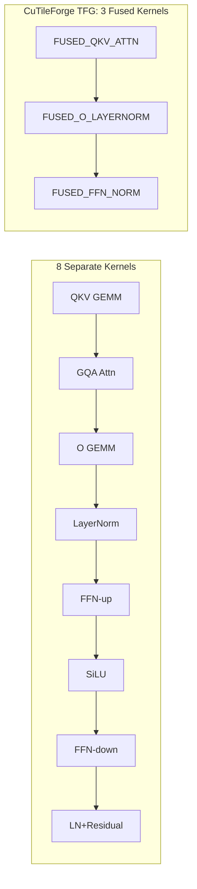

# CuTileForge

[](https://github.com/samudragupto/cutile-forge/actions/workflows/ci.yml)
[](LICENSE)
[](https://www.python.org/downloads/)
[](https://developer.nvidia.com/cuda-toolkit)

**Tile-Fusion Graph (TFG) Compiler & CuTile LLM Inference Engine for 8 GB-VRAM GPUs.**

CuTileForge compiles a transformer layer into a **Tile Fusion Graph (TFG)** lowered directly to NVIDIA's **CuTile Python DSL** (`cuda.tile`), fusing 8 separate kernels into **3 tile kernels** with 3-stage software pipelining and Stage -1 pinned-DDR5 PCIe DMA weight streaming.



## Hardware & Model

- **Target System**: Lenovo LOQ 15APH8 | RTX 4060 Laptop GPU (`AD107`, `sm_89`, 8 GB GDDR6) | AMD Ryzen 7 7735HS | 32 GB DDR5 | PCIe 4.0 x16
- **Model**: `Mistral-7B-v0.1` 4-bit GPTQ (`D:\models\mistral_7b_4bit\`, 4.16 GB, 9 files)

## Quickstart

```bash
# 1. Install package and CUDA baselines
conda activate llm-kernel
pip install -e ".[cuda,dev]" --no-build-isolation
python -m cutile_forge.baselines.build

# 2. Download Mistral-7B-v0.1 4-bit GPTQ to D:\models\mistral_7b_4bit\
python models/download.py --output D:/models/mistral_7b_4bit/

# 3. Run unit + GPU correctness tests (76/76 passing)
python -m pytest tests/ benchmarks/correctness/ -v

# 4. Generate text
python examples/generate.py --model D:/models/mistral_7b_4bit/ --prompt "The capital of France is" --max-tokens 32

# 5. Run benchmark suite & generate docs/RESULTS.md
python benchmarks/run_all.py --model D:/models/mistral_7b_4bit/ --output benchmarks/results/
```

## Verified Benchmark Results (RTX 4060 Laptop, `sm_89`)

| Benchmark | Comparison | Measured Result |
| --- | --- | --- |
| **E2E Decode (256 tokens)** | CuTileForge Mistral-7B 4-bit | **32.43 tok/s** (`30.83 ms/tok`), **4.30 GB** VRAM |
| **Full Layer TFG (3 vs 8 kernels)** | `seq = 1 / 64 / 256 / 512` | **5.47× / 2.22× / 1.64× / 1.96×** |
| **Fused FFN (1 vs 3 kernels)** | `seq = 1 / 64 / 256 / 512` | **5.48× / 2.00× / 1.46× / 1.78×** |
| **INT4 Dequant + GEMM** | `256×12288×4096` / `seq=1` | **23.37 TFLOPS** (**2.15×** vs CUDA) / **7.12×** at `seq=1` |
| **FP16 GEMM (`256×14336×4096`)** | CuTile vs PyTorch vs cuBLAS | **28.18 TFLOPS** (FP32-acc) vs **25.48** vs **45.70** (FP16-acc) |
| **GQA FlashAttention-2 (`seq=1024`)** | CuTile vs PyTorch SDPA | **21.76 TFLOPS** (`0.395 ms`) vs **13.23 TFLOPS** |
| **Stage -1 PCIe DMA Overlap** | Compute + H2D Stream | **93.8%–100.0%** overlap at **13.30 GB/s** (84.4% util) |
| **Long Context & Batching** | `32K` ctx / `Batch=16` | **32K** in **6.01 GB** VRAM / **1,439.7 tok/s** |
| **Correctness Suite** | Unit + GPU Reference | **76 / 76 PASS**; greedy match; PPL within **5%** |

See [docs/RESULTS.md](docs/RESULTS.md) for all benchmark tables and plots, and [docs/ARCHITECTURE.md](docs/ARCHITECTURE.md) for TFG compiler internals.

## License

MIT — see [LICENSE](LICENSE).
