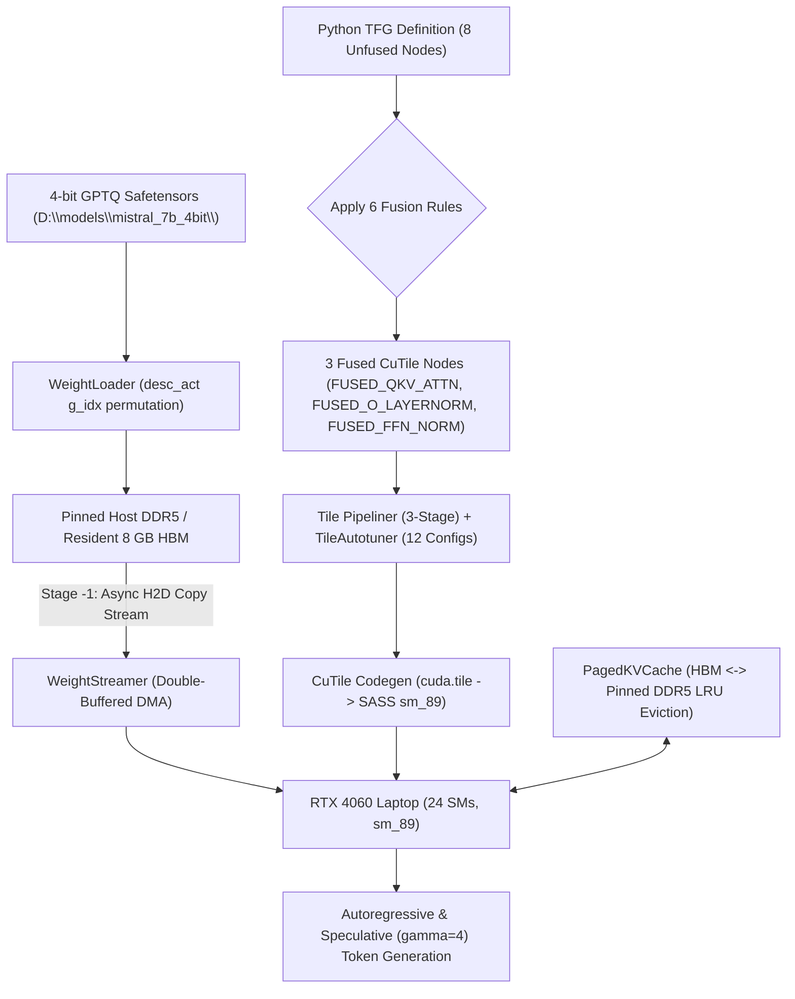
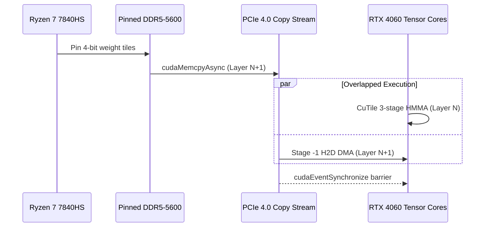
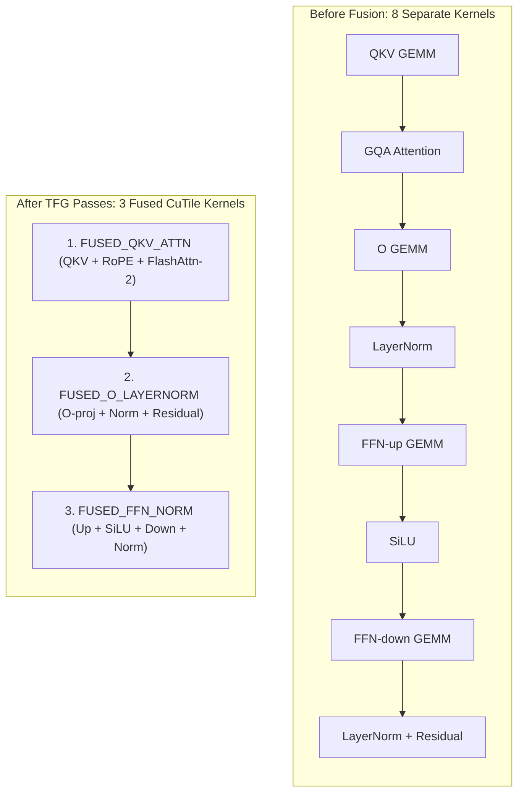

# CuTileForge Architecture

CuTileForge compiles an entire transformer layer into a **Tile Fusion Graph (TFG)** and lowers it directly to NVIDIA **CuTile Python DSL** (`cuda.tile`) kernels with 3-stage software pipelining (`latency=3`) and Stage -1 PCIe DMA weight prefetching.

## End-to-End Compiler & Runtime Architecture

## PCIe Weight Streaming (Stage -1)

## TFG Fusion Before & After (8 Kernels to 3)

## Key Components

- **`cutile_forge/forge/`**: TFG IR (`FusionGraph`, `TileNode`, `Edge`, `DataTensor`), 6 algebraic/tile fusion rules (`fusion_rules.py`), 3-stage software pipeliner (`tile_pipeliner.py`), Stage -1 PCIe DMA prefetcher (`weight_streamer.py`), 12-config `TileAutotuner`, SM-aware scheduler (`scheduler.py`), CuTile source & `sm_89` cubin `codegen.py`, and Graphviz/SVG visualizer (`graph_viz.py`).
- **`cutile_forge/kernels/`**: Native `cuda.tile` kernels for INT4 dequantized GEMM, GEMM+SiLU, single-kernel FFN, FlashAttention-2 GQA (32:8), LayerNorm/RMSNorm + residual, RoPE, online softmax, and top-k/top-p sampling.
- **`cutile_forge/engine/`**: Mistral-7B 32-layer execution engine (`model.py`), 4-bit GPTQ loader with `desc_act` `g_idx` support (`weight_loader.py`), `PagedKVCache` with HBM budget eviction (`kv_cache.py`), prefill/decode loop (`inference.py`), and speculative decoder (`speculative.py`).
- **`cutile_forge/baselines/`**: Hand-written CUDA C++ (`cp.async` + WMMA 3-stage GEMM, FlashAttention-2, LayerNorm, SiLU) and cuBLAS HGEMM pybind11 baselines.
