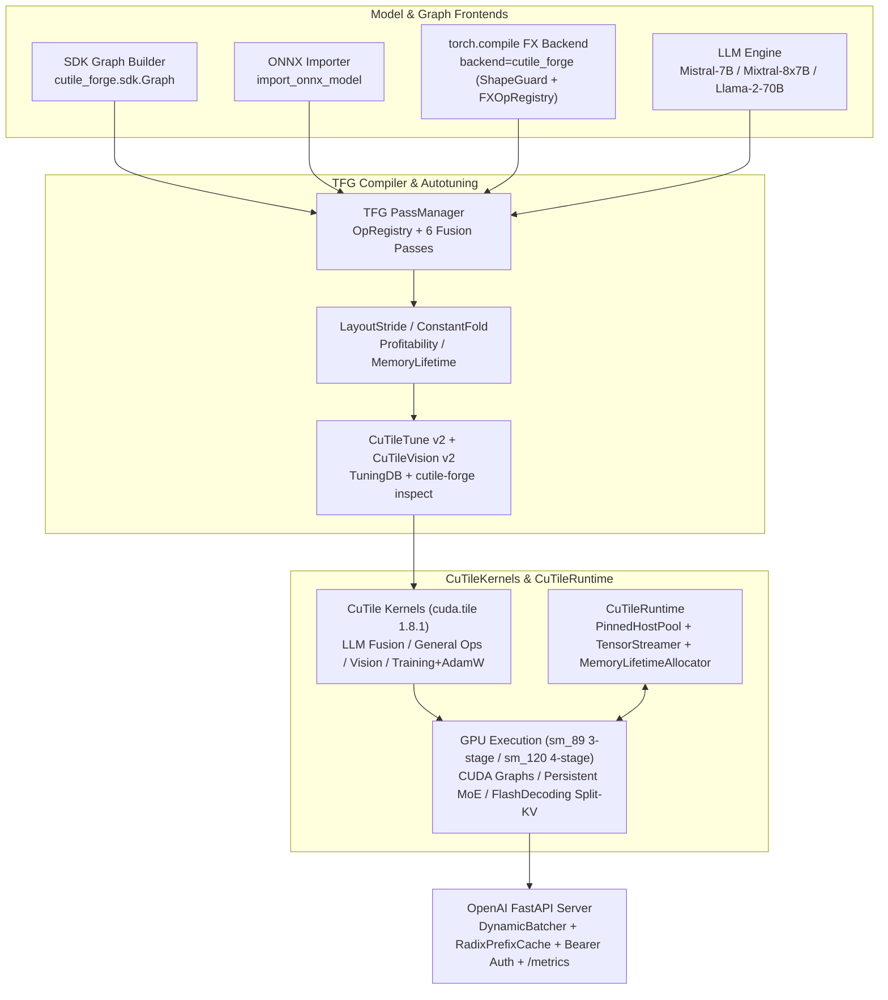
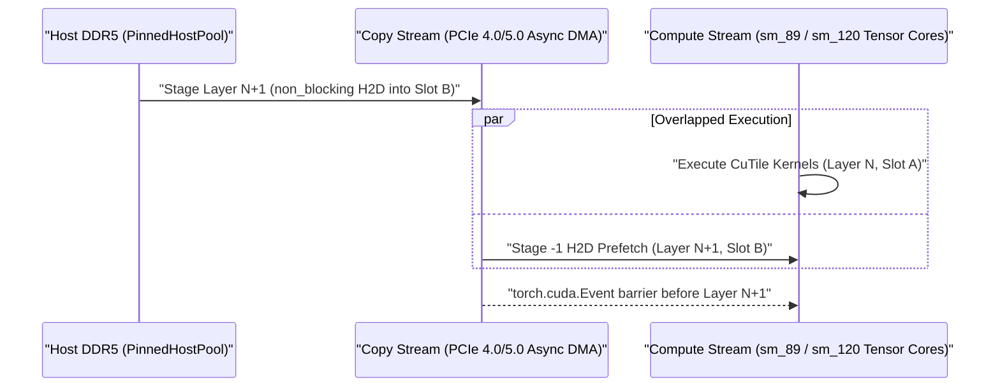
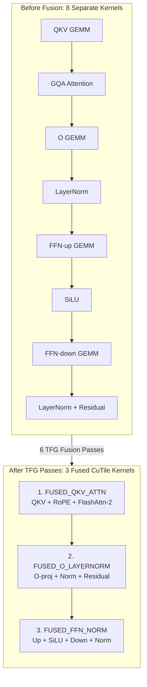

# CuTileForge Architecture (`v2.0.0`)

CuTileForge is a **general-purpose Tile-Fusion Graph (TFG) compiler, async GPU runtime, training/vision ecosystem, and 7B–70B LLM inference engine** targeting NVIDIA **CuTile Python DSL (`cuda.tile`)** across Ada (`sm_89`) and Blackwell (`sm_120`).

## End-to-End Compiler, Runtime & Serving Architecture

## PCIe Weight Streaming (Stage -1 DMA)

## TFG Fusion Before & After (`8 → 3` Transformer Layer Kernels)

## Key Components

- **`cutile_forge/sdk/` & `cutile_forge/onnx_import.py`**: Imperative `Graph` builder, `Device`, `KernelRegistry`, `compile(...)`, ONNX importer (`import_onnx_model`, `import_graph_spec`), and `cutile_forge.doctor` environment diagnostics (`cutile-forge doctor`).
- **`cutile_forge/forge/`**: Typed `FusionGraph` IR, `OpRegistry` (`op_registry.py`), `PassManager` with 6 algebraic/tile fusion passes (`fusion_rules.py`) plus `LayoutStridePass`, `ConstantFoldPass`, `ProfitabilityPass`, and `MemoryLifetimePass` (`pass_manager.py`), occupancy-aware cost model, 3/4-stage tile pipeliner, persistent cubin/FX artifact cache, and the expanded `torch.compile(backend="cutile_forge")` FX lowering backend (`fx_backend.py`) with `FXOpRegistry` and `ShapeGuard`.
- **`cutile_forge/autotune/` & `cutile_forge/vision/`**: CuTileTune v2 (`TuningDB`, `shape_fingerprint`, benchmark regression tracking, `tune_bmm`, `tune_reduction`, `tune_transpose`, `tune_activation`) and CuTileVision v2 (`inspect_compiled_tfg`, HBM lifetime/savings estimation, execution timeline, `cutile-forge inspect` CLI).
- **`cutile_forge/kernels/`**: Native `cuda.tile` kernels spanning LLM inference (INT4/NVFP4/FP8 GEMM, GEMM+SiLU, single-kernel FFN, GQA FlashAttention-2, FlashDecoding split-KV, persistent 3D-grid grouped MoE, RMSNorm/LayerNorm+residual, RoPE, top-k/top-p sampling), general tensor ops (`bmm`, `reduce_sum`, `reduce_max`, `cumsum`, `transpose`, `gather`, `conv2d`), computer vision primitives (`vision.py`: depthwise conv2d, conv2d backward, max/avg pool2d, `CuTilePatchEmbed`), and training primitives (forward/backward SiLU, GELU, Softmax, RMSNorm, LayerNorm, Linear, BMM, `torch.autograd.Function` wrappers, `cutile_grad_clip_norm`, and `cutile_multi_tensor_adamw`).
- **`cutile_forge/runtime/`**: General async runtime (`PinnedHostPool`, double/triple-buffered `TensorStreamer` with optional `adaptive_slots`, `MemoryLifetimeAllocator`, `GraphRuntime`, and `p2p_capable`).
- **`cutile_forge/engine/` & `cutile_forge/server/`**: Multi-shard `.safetensors` mmap loader (`GPTQ`, `AWQ`, `GGUF Q4_K_M`), `HybridLayerBudgeter`, `PagedKVCache` (FP16/FP8 + async swap pool), `RadixPrefixCache`, `NGramPromptLookupDrafter`, and FastAPI OpenAI server (`/health`, `/metrics`, Bearer auth, `DynamicBatcher`, SSE streaming).
- **`cutile_forge/bench/`**: CUDA event benchmark harness (`Stats`, `RichBenchRecord`, `benchmark_with_telemetry`, `check_regression_gate`), NVML/PCIe/thermal/overlap profilers, and empirical Roofline plotter.
- **`cutile_forge/distributed/` *(single-node / prototype tested)***: `detect_topology`, `p2p_copy`, and deterministic `ring_allreduce_sum` — unit-tested on CPU CI and single-GPU RTX 5090; multi-GPU NVLink scaling awaits multi-GPU hardware validation.
- **`cutile_forge/baselines/`**: Hand-written CUDA C++ (`cp.async` + WMMA) and cuBLAS pybind11 reference baselines.
