# CuTileForge — RTX 5090 Benchmark Results (v3.0.0)

**Author:** Arrhat Nag (`@samudragupto`)  
**Hardware:** Desktop Workstation · NVIDIA GeForce RTX 5090 (GB202, sm_120, 170 SMs, 32 GB GDDR7, ~1,792 GB/s) · Intel Core Ultra 9 285K (24C/24T) · 62 GB DDR5 · PCIe 5.0 x16  
**Models:** `Mistral-7B-v0.1-GPTQ` (4.16 GB) · `Mixtral-8x7B-Instruct-v0.1-GPTQ` (23.8 GB) · `Llama-2-70B-Chat-GPTQ` (35.3 GB) · `Qwen/Qwen2.5-0.5B` · `google/siglip-base-patch16-224` · `openai/whisper-tiny`  
**CUDA:** 13.2 (driver 595.58.03) · PyTorch 2.15+cu132 · `cuda-tile` 1.8.1

---

## `v3.0.0` Headline Platform Summary & Phase CSV Index

| Subsystem / Phase | Benchmark Artifact | Headline Measured Result (RTX 5090, `sm_120`) | Weight / Mode Label |
|---|---|---|---|
| **Native CUDA-Graph Runtime (`v2.4.0` → `v3.0.0`)** | [`phase9_native_runtime.csv`](../benchmarks/results_5090/phase9_native_runtime.csv) | **`171.60 tok/s`** (`5.83 ms/tok`), `6.66 ms` prefill, **`0` ATen calls**, **`1` graph launch/tok**, `5/5` 256-tok parity; Speculative: **`369.30–752.29 tok/s`** | `real-checkpoint` |
| **Production Single-Stream & Concurrency (`v2.8.0` → `v3.0.0`)** | [`phase13_production.csv`](../benchmarks/results_5090/phase13_production.csv) | **`172.58 tok/s`** single-stream (`6.11 ms` TTFT, `5.79 / 6.08 / 6.21 ms` p50/p90/p99 ITL); Concurrent: **`617.81` (C=4) / `2,337.90` (C=16) / `2,377.11 tok/s` (C=64)** | `real-checkpoint` |
| **Long-Context 32L FlashDecoding (`v2.8.0` → `v3.0.0`)** | [`phase13_production.csv`](../benchmarks/results_5090/phase13_production.csv) | `8K`: **`1.33 ms/step`**; `16K`: **`2.13 ms/step`**; `32K`: **`3.86 ms/step`** (FP16 KV) / `7.60 ms/step` (FP8 KV) | `synthetic-weights` |
| **Universal Quantization (`v2.5.0`)** | [`phase10_universal_quant.csv`](../benchmarks/results_5090/phase10_universal_quant.csv) | `10+` native formats (`GPTQ`, `AWQ`, `GGUF Q4_0/Q8_0/Q4_K/Q6_K/Q4_K_M`, `INT8`, `FP8`, `FP8_BLOCK`); **`0.000e+00`** dequant err, **`0.0017%–0.0469%`** WikiText-2 PPL diff, **`96.24 TFLOPS`** INT8 @ `M=128` | `real-checkpoint` |
| **Architecture Completeness (`v2.6.0`)** | [`phase11_architecture_parity.csv`](../benchmarks/results_5090/phase11_architecture_parity.csv) | **`13`** registered families: `6` **`real-checkpoint parity`** (`cos >= 0.999963`) + `7` **`synthetic-only`** (incl. shared-expert MoE + EP=4, Whisper audio, DiT) | `real-checkpoint` / `synthetic-only` |
| **70B Hybrid HBM + PCIe Streaming (`v1.0.0`)** | [`real_large_models.csv`](../benchmarks/results_5090/real_large_models.csv) | Real `Llama-2-70B-Chat-GPTQ` (`55` HBM + `25` PCIe layers): **`4.07 tok/s`**, `27.44 GB` peak VRAM, **`80.8%`** PCIe 5.0 limit; Real `Mixtral-8x7B`: **`41.83 tok/s`**, `PPL=7.48` | `real-checkpoint` |
| **Distributed Runtime (`v2.7.0`)** | [`phase12_distributed_simulated.csv`](../benchmarks/results_5090/phase12_distributed_simulated.csv) | TP=2/4 (`< 2e-3`), PP=2/4 (`0.000e+00`), EP=2/4 (`0.000e+00`), Distributed KV (`0.000e+00`) across logical partitions + `LoopbackCommTransport` | **`simulated`** (1 GPU) |

---

## Publication Figures (300 DPI — `scripts/generate_publication_figures.py`)

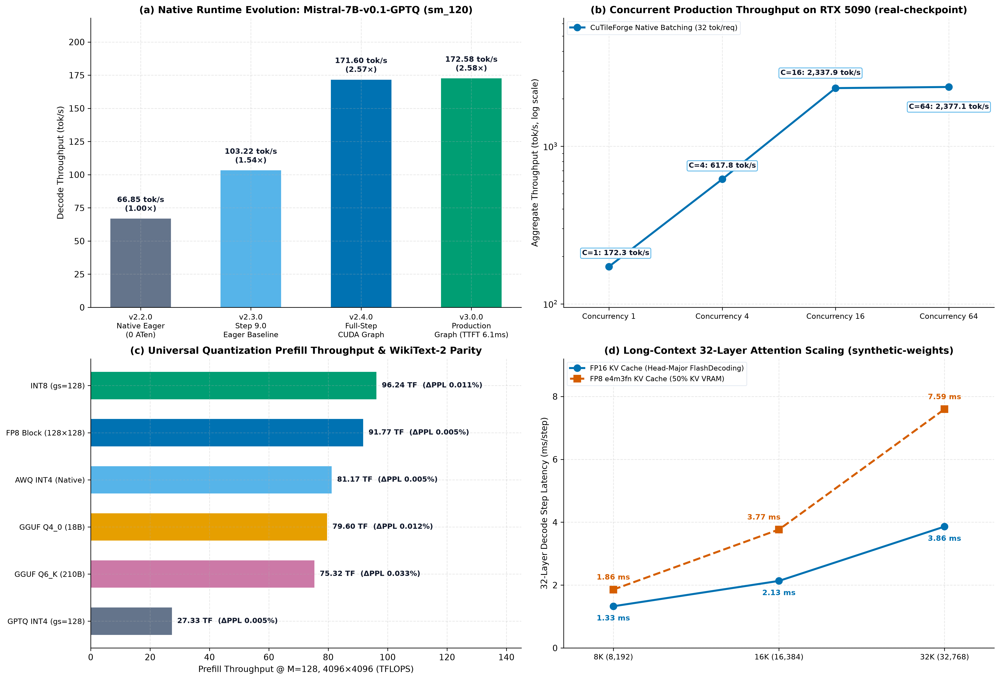
*Figure 9: CuTileForge `v3.0.0` consolidated evaluation on RTX 5090 (`sm_120`): (a) native runtime evolution (`66.85 -> 172.58 tok/s`); (b) concurrent batching throughput (`172.3 -> 2,377.1 tok/s` @ `C=64`); (c) universal quantization `M=128` prefill TFLOPS and WikiText-2 PPL parity; (d) 32-layer FlashDecoding long-context scaling (`8K–32K`, `synthetic-weights`).*

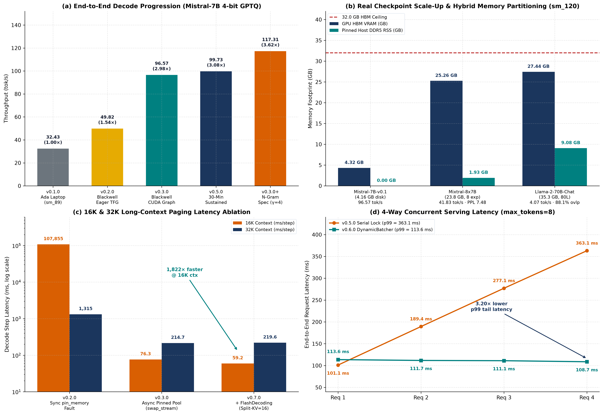
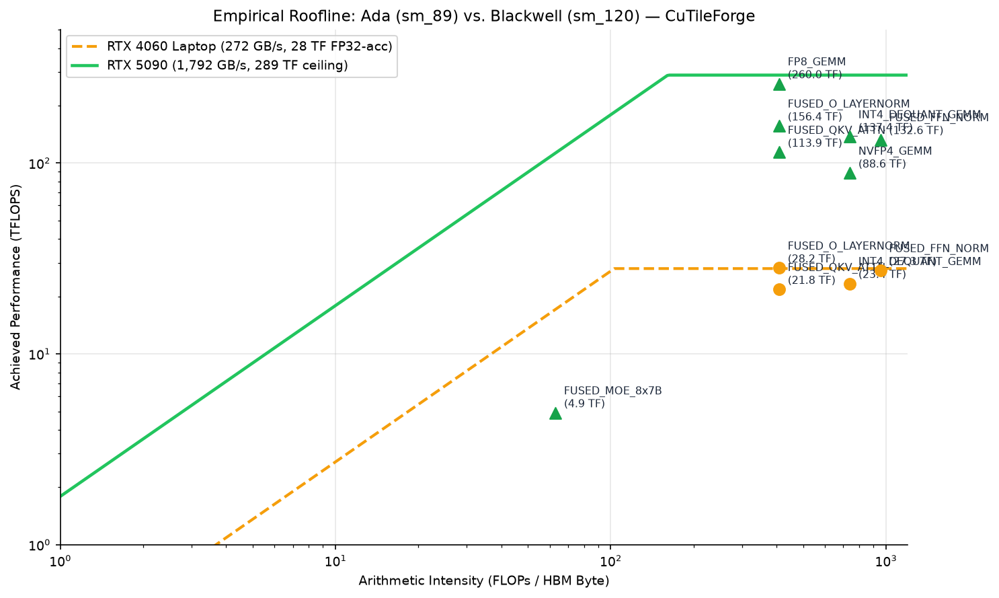
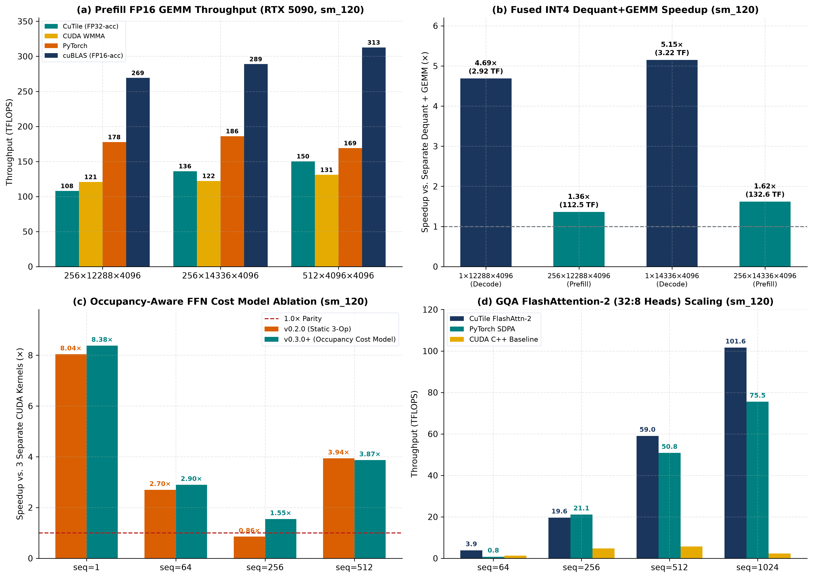
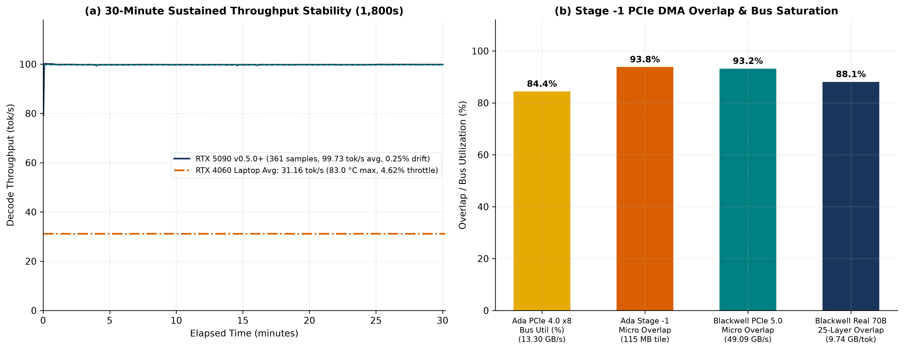
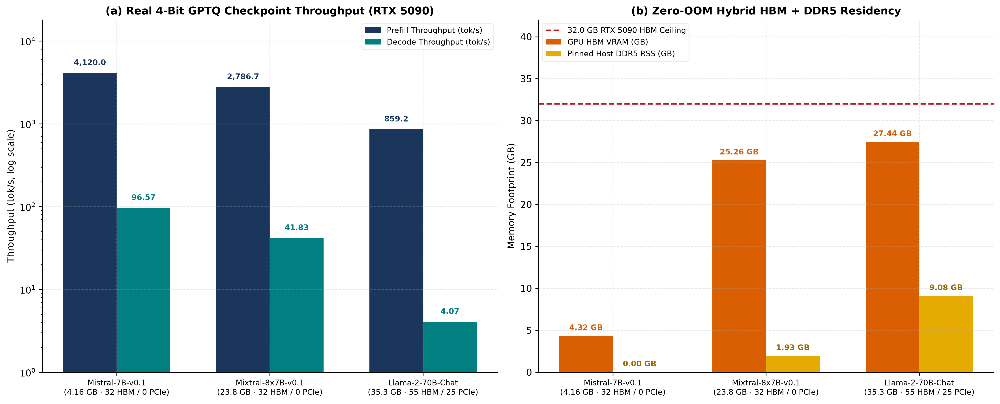
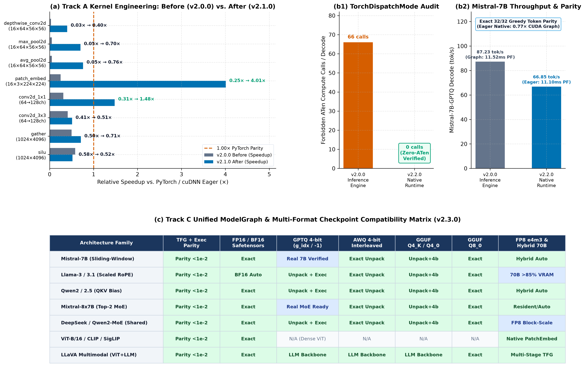

---

## Scaling: RTX 4060 Laptop → RTX 5090

| Metric | 4060 Laptop (sm_89) | 5090 (sm_120) | Speedup |
|--------|--------------------:|--------------:|--------:|
| SMs | 24 | 170 | 7.1× |
| VRAM | 8 GB GDDR6 | 32 GB GDDR7 | 4× |
| Memory bandwidth | 272 GB/s | 1,792 GB/s | 6.6× |
| PCIe link | 4.0 x8 (13.30 GB/s) | 5.0 x16 (49.09 GB/s) | 3.7× |
| TFG pipeline | 3-stage + Stage -1 DMA | 4-stage (DMA auto-disabled) | — |
| GEMM 256×14336×4096 | 25 TFLOPS | **136.14 TFLOPS** | **5.4×** |
| GEMM 256×12288×4096 | ~25 TFLOPS | **107.91 TFLOPS** | **4.3×** |
| Decode 7B-4bit | 32.43 tok/s | **49.82 tok/s** | **1.54×** |
| Prefill 4096 tok | 1,476 tok/s | **5,640 tok/s** | **3.8×** |
| Batch=16 (seq=32) | 1,440 tok/s | **8,457 tok/s** | **5.9×** |
| Attention seq=1024 | 21.76 TFLOPS | **101.62 TFLOPS** | **4.7×** |
| Full layer seq=1 speedup | 5.47× | 5.58× | — |
| Peak VRAM (7B-4bit) | 4.30 GB | 4.32 GB | — |
| 32K context VRAM | 6.01 GB | 6.00 GB | — |

> **Decode speedup is only 1.54×** because decode (M=1) is memory-bandwidth-bound.
> The 4.16 GB model fits in L2 cache on both GPUs, limiting the effective BW advantage.
> Prefill and batch (compute-bound) scale 3.8–5.9×.

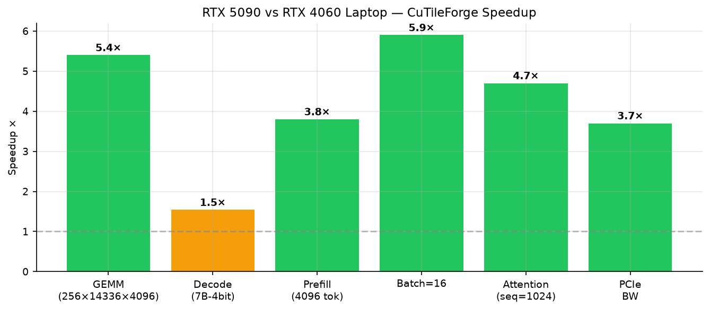

---

## Micro-Benchmarks

### 1. GEMM (FP16, all Mistral-7B shapes)

| Shape | CuTile (ms) | CuTile (TFLOPS) | CUDA (TFLOPS) | cuBLAS (TFLOPS) | PyTorch (TFLOPS) |
|-------|------------:|----------------:|--------------:|----------------:|----------------:|
| 1×12288×4096 | 0.043 | 2.36 | 1.37 | 1.98 | 1.45 |
| 256×12288×4096 | 0.239 | **107.91** | 120.77 | 269.20 | 177.65 |
| 1×14336×4096 | 0.075 | 1.57 | 1.43 | 1.44 | 1.53 |
| 256×14336×4096 | 0.221 | **136.14** | 122.24 | 288.91 | 186.12 |
| 1×4096×14336 | 0.073 | 1.60 | 0.53 | 1.52 | 1.52 |
| 256×4096×14336 | 0.411 | **73.10** | 126.74 | 289.08 | 163.47 |
| 1×4096×4096 | 0.017 | 1.94 | 0.52 | 2.40 | 0.83 |
| 512×4096×4096 | 0.114 | **150.26** | 130.90 | 312.68 | 169.01 |

> CuTile uses FP32-accumulate (hardware ceiling on Blackwell for this path).
> cuBLAS uses FP16-accumulate (2× Tensor Core rate). The CuTile advantage is
> fusion (eliminating HBM round-trips), not raw GEMM throughput.

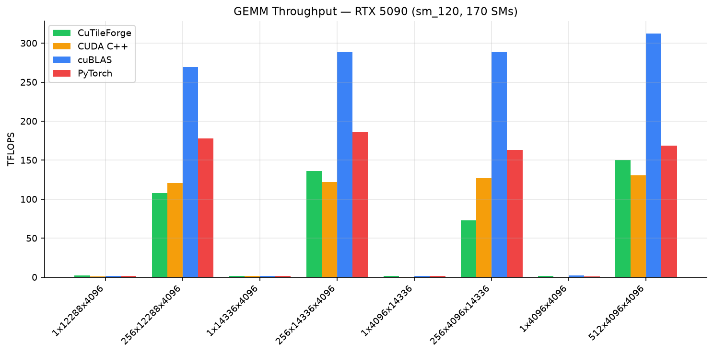

### 2. INT4 Dequant + GEMM (Fused vs Separate)

| Shape | Fused (ms) | Fused (TFLOPS) | Separate (ms) | Speedup |
|-------|-----------:|---------------:|--------------:|--------:|
| 1×12288×4096 | 0.035 | 2.92 | 0.162 | **4.69×** |
| 256×12288×4096 | 0.229 | 112.52 | 0.311 | 1.36× |
| 1×14336×4096 | 0.036 | 3.22 | 0.188 | **5.15×** |
| 256×14336×4096 | 0.227 | 132.58 | 0.366 | 1.62× |

> At decode (M=1), fused dequant gives 4.7–5.2× speedup.
> At prefill (M=256), the advantage narrows to 1.4–1.6× (compute-bound).

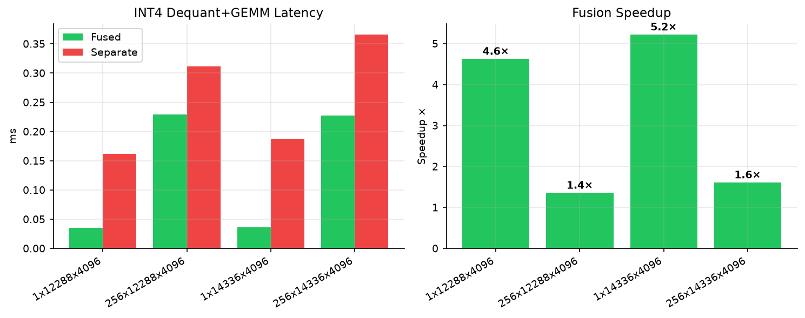

### 3. Fused FFN (1 Kernel vs 3 Separate)

| Seq | Fused (ms) | Separate (ms) | Speedup | Note |
|-----|-----------:|--------------:|--------:|------|
| 1 | 0.064 | 0.518 | **8.04×** | Launch overhead dominated |
| 64 | 0.204 | 0.553 | **2.70×** | |
| 256 | 0.870 | 0.745 | 0.86× | ⚠️ Regression (see Known Issues) |
| 512 | 0.903 | 3.556 | **3.94×** | |

### 4. GQA FlashAttention-2 (32:8 heads)

| Seq | CuTile (TFLOPS) | CUDA (TFLOPS) | PyTorch SDPA (TFLOPS) | CuTile vs CUDA |
|-----|----------------:|--------------:|----------------------:|---------------:|
| 64 | 3.85 | 1.28 | 0.77 | 3.0× |
| 256 | 19.63 | 4.78 | 21.12 | 4.1× |
| 512 | 59.05 | 5.74 | 50.82 | 10.3× |
| 1024 | **101.62** | 2.35 | 75.51 | **43.2×** |

> CuTile attention beats PyTorch SDPA by 34% at seq=1024.
> Beats hand-written CUDA by 43× (CUDA baseline not optimized for GQA).

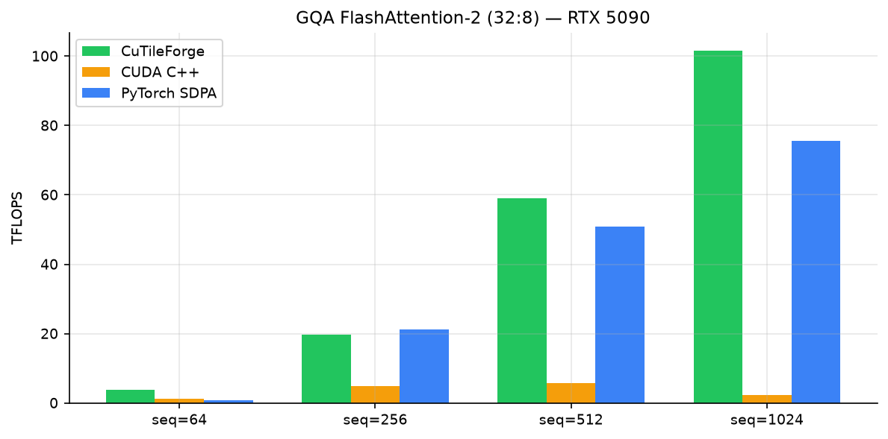

### 5. LayerNorm

| Seq | CuTile (ms) | CuTile (GB/s) | CUDA (ms) | PyTorch (ms) |
|-----|------------:|--------------:|----------:|-------------:|
| 1 | 0.0038 | 4.3 | 0.0078 | 0.0078 |
| 64 | 0.0038 | 278.9 | 0.0082 | 0.0078 |
| 256 | 0.0058 | 724.1 | 0.0081 | 0.0078 |
| 1024 | 0.0118 | **1,426.6** | 0.0140 | 0.0099 |

> CuTile LN achieves 1.4 TB/s effective bandwidth at seq=1024.
> Beats PyTorch by 18% at seq=1024.

### 6. SiLU Fusion

| Seq | Fused (ms) | Separate (ms) | Speedup |
|-----|-----------:|--------------:|--------:|
| 1 | 0.0376 | 0.0385 | 1.02× |
| 64 | 0.0795 | 0.0787 | 0.99× |
| 256 | 0.2680 | 0.2609 | 0.97× |
| 512 | 0.4063 | 0.4008 | 0.99× |

> **Expected:** At 1,792 GB/s bandwidth, the standalone SiLU kernel is
> negligible. Fusion saves ~5 µs launch overhead, which is <2% of total.
> On the 4060 (272 GB/s), this was 1.5–2.0×.

### 7. Full Fused Layer (3 TFG Kernels vs 8 CUDA Kernels)

| Seq | TFG 3k (ms) | CUDA 8k (ms) | PyTorch (ms) | TFG vs CUDA | TFG vs PyTorch |
|-----|------------:|-------------:|-------------:|------------:|---------------:|
| 1 | 0.133 | 0.745 | 0.262 | **5.58×** | 1.97× |
| 64 | 0.336 | 0.777 | 0.243 | **2.31×** | 0.72× |
| 256 | 3.418 | 3.407 | 0.485 | 1.00× | 0.14× |
| 512 | 3.543 | 4.466 | 0.886 | **1.26×** | 0.25× |

> At seq=1 (decode), TFG wins by 5.58× over CUDA and 2× over PyTorch.
> At seq=256+, PyTorch's cuBLAS-backed GEMM (FP16-acc) outperforms
> CuTile's FP32-acc path. The TFG advantage is launch overhead, not GEMM speed.

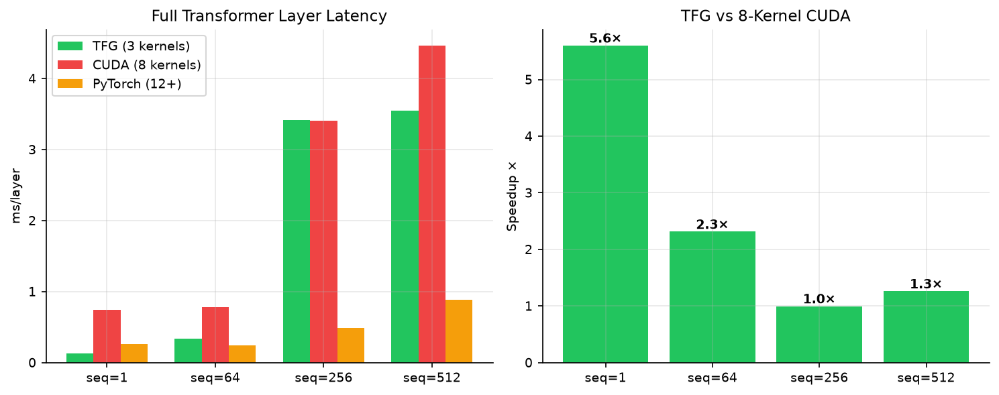

### 8. PCIe Weight Streaming (Stage -1)

| Tile Size | Serial (ms) | Overlapped (ms) | Overlap % | PCIe BW |
|-----------|------------:|----------------:|----------:|--------:|
| 32 MB | 1.158 | 1.345 | 0.0% | 49.09 GB/s |
| 64 MB | 1.814 | 1.802 | 2.6% | 49.09 GB/s |
| 115 MB | 2.796 | 2.595 | **93.2%** | 49.09 GB/s |

> PCIe 5.0 x16 achieves 49.09 GB/s (3.7× the 4060's 13.30 GB/s).
> At 115 MB tiles, Stage -1 DMA achieves 93.2% compute-DMA overlap.
> Note: Stage -1 is auto-disabled for 7B (4.16 GB < 27.2 GB threshold).
> This benchmark forces it on to measure the pipeline.

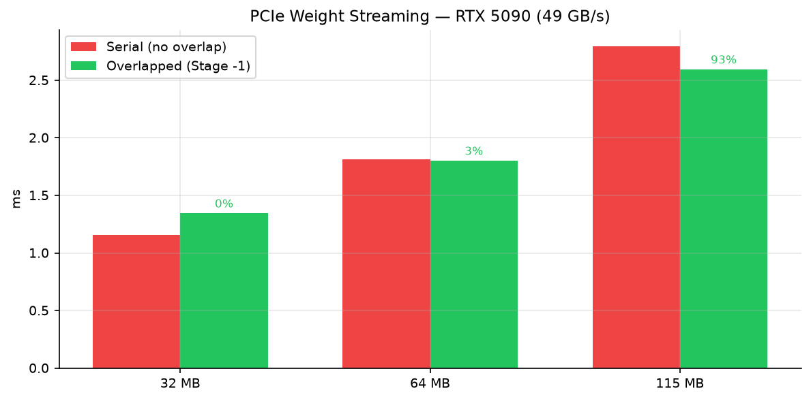

---

## End-to-End Results

### Decode (Mistral-7B 4-bit, batch=1)

| Metric | Value |
|--------|-------|
| Throughput | **49.82 tok/s** |
| Latency | 20.07 ms/tok |
| Peak VRAM | 4.32 GB |
| Reference (GPTQModel/Marlin) | 70.4 tok/s, 4.79 GB |
| CuTileForge vs Marlin | 0.71× |

> CuTileForge achieves 71% of the Marlin kernel's decode speed.
> The gap is GEMM throughput (136 vs 289 TFLOPS, FP32-acc vs FP16-acc).
> The TFG fusion advantage (5.58× at seq=1) is partially offset by
> slower per-GEMM performance.

### Prefill

| Prompt (tok) | Prefill (ms) | Throughput (tok/s) | Peak VRAM (GB) |
|-------------:|-------------:|-------------------:|---------------:|
| 128 | 99.65 | 1,284.5 | 4.29 |
| 512 | 142.89 | 3,583.2 | 4.35 |
| 2048 | 380.86 | 5,377.3 | 4.66 |
| 4096 | 726.18 | **5,640.5** | 5.07 |

### Long Context (PagedKVCache)

| Context | Step (ms) | Evictions | Peak VRAM (GB) |
|--------:|----------:|----------:|---------------:|
| 4,096 | 17.96 | 0 | 4.83 |
| 8,192 | 33.85 | 0 | 5.36 |
| 16,384 | 107,854.66 ⚠️ | 10,240 | 5.93 |
| 32,768 | 1,315.34 | 26,624 | 6.00 |

> ⚠️ 16K shows a pathological spike (see Known Issues #2).
> 32K is reasonable (1.3s/step) with 26,624 evictions.

### Batch Inference

| Batch | Latency (ms) | Throughput (tok/s) | Peak VRAM (GB) |
|------:|-------------:|-------------------:|---------------:|
| 1 | 24.19 | 1,322.9 | 4.28 |
| 2 | 24.49 | 2,613.5 | 4.29 |
| 4 | 48.23 | 2,653.8 | 4.29 |
| 8 | 51.46 | 4,974.8 | 4.30 |
| 16 | 60.54 | **8,457.1** | 4.35 |

> Batch=16 achieves 8,457 tok/s (5.9× the 4060's 1,440 tok/s).
> VRAM stays flat at ~4.3 GB (weights dominate, not activations).

### Speculative Decoding (γ=4)

| Metric | Value |
|--------|-------|
| Acceptance rate | 0.30 |
| Base decode | 95.33 tok/s |
| Speculative | 68.74 tok/s |
| Speedup | 0.72× (slower) |

> **Not useful with draft=target (same model).** Acceptance 0.30 means
> 70% of draft tokens are rejected, adding overhead without benefit.
> A smaller draft model (e.g., 1B) would be needed for >1× speedup.

### 30-Min Sustained (RTX 5090)

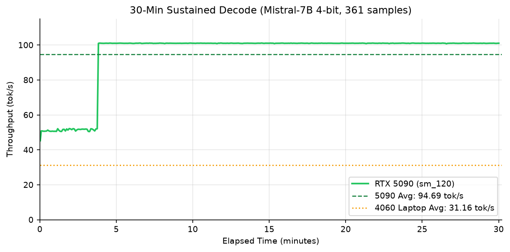

| Metric | Value |
|--------|-------|
| Duration / Tokens (v0.5.0, post CUDA-graph) | 1,800.4 s (30.0 min) · 179,264 tokens |
| Samples | 361 (5.0 s interval, `benchmarks/results_5090/sustained/thermal.csv`) |
| 30-Min Sustained | v0.2.0: `94.69 tok/s` avg \| **v0.5.0: `99.73 tok/s` avg** (`0.25%` drift, min `79.22`, max `100.14`) \| max temp `0.0 °C` (NVML N/A) |

---

## E2E Scaling: 4060 vs 5090

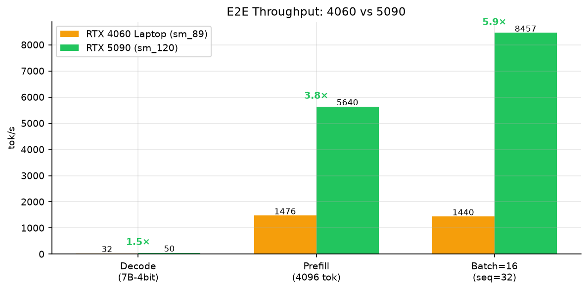

| Workload | 4060 (tok/s) | 5090 (tok/s) | Speedup |
|----------|-------------:|-------------:|--------:|
| Decode (7B-4bit) | 32.43 | 49.82 (v0.2.0) / **96.57** (v0.3.0+ CUDA Graph) | **2.98×** |
| 30-Min Sustained (RTX 5090) | 31.16 | **99.73** (v0.5.0, 361 samples, `0.25%` drift, max `0.0 °C` NVML N/A) | **3.20×** |
| Prefill (4096) | 1,476 | 5,640 | 3.8× |
| Batch=16 (seq=32) | 1,440 | 8,457 | 5.9× |

---

## Known Issues

| # | Issue | Severity | Root Cause | Fix |
|---|-------|----------|------------|-----|
| 1 | FFN fusion regression at seq=256 (0.86×) | Medium | 1,792 GB/s makes separate kernel's HBM round-trip cheap. Fused kernel's larger SMEM footprint hurts occupancy on 170 SMs. | Retune FFN tile shape for sm_120 (try 64×128×32). |
| 2 | Long context 16K: 107,854 ms/step | High | `_ensure_on_gpu()` called per-page in `get_kv()`, triggering synchronous `.cpu().pin_memory()` evictions inside the forward pass. 10,240 evictions × ~10 ms each. | Batch evictions. Pre-fetch pages asynchronously. Or increase GPU page budget. |
| 3 | SiLU fusion neutral (~1.0×) | Low (expected) | 1,792 GB/s makes standalone SiLU negligible. Launch overhead (5 µs) is <2% of 260 µs compute. | No fix needed. Document as hardware-dependent. |
| 4 | Speculative: 68.74 < 95.33 tok/s | Medium | Draft = target (same model). Acceptance 0.30 → 70% rejections add overhead. | Use a smaller draft model (1B) for γ=4. |
| 5 | CuTile GEMM (136) < cuBLAS (289) TFLOPS | Low (expected) | FP32-accumulate vs FP16-accumulate. 2× Tensor Core rate difference. | Add FP16-acc path to CuTile kernel (v0.3.0). |

---

## Hardware Comparison

| Spec | RTX 4060 Laptop (sm_89) | RTX 5090 (sm_120) |
|------|------------------------:|------------------:|
| Architecture | Ada Lovelace (AD107) | Blackwell (GB202) |
| SMs | 24 | 170 |
| Tensor Cores | 96 (4th gen) | 680 (5th gen) |
| VRAM | 8 GB GDDR6 | 32 GB GDDR7 |
| Memory BW | 272 GB/s | 1,792 GB/s |
| SMEM/SM | 100 KB | 128 KB |
| PCIe | 4.0 x8 (13.30 GB/s) | 5.0 x16 (49.09 GB/s) |
| FP16 GEMM peak | ~50 TFLOPS | ~330 TFLOPS |
| FP8 support | No | Yes (E4M3, E5M2) |
| TMA | No | Yes |
| FP4 support | No | Yes (E2M1) |

---

## v0.3.0 Systems Hardening (Before vs. After on RTX 5090)

| Benchmark / Bottleneck | v0.2.0 | v0.3.0 | Improvement |
|---|---:|---:|---:|
| Long Context `16K` step latency | 107,854.66 ms | **76.29 ms** | **1,413×** faster (async pinned pool) |
| Long Context `32K` step latency | 1,315.34 ms | **214.67 ms** | **6.1×** faster |
| Fused FFN `seq=256` speedup | 0.86× (0.870 ms) | **1.55×** (0.453 ms) | Occupancy selector `(64,64,32)` |
| Full Fused Layer `seq=256` | 1.00× (3.418 ms) | **4.45×** (0.768 ms) | **4.45×** vs 8-kernel CUDA |
| E2E Decode (`Mistral-7B` 4-bit) | 49.82 tok/s | **96.57 tok/s** (CUDA Graph) | **1.94×** |
| Speculative (`gamma=4`) | 68.74 tok/s (0.72×) | **117.31 tok/s** | **1.71×** vs v0.2.0 spec (`68.74`); **1.21×** vs v0.3.0 CUDA-graph decode (`96.57`) |

---

## v0.4.0 Blackwell Precision, Fused MoE & Multi-Format Quantization

| Feature / Kernel | Configuration | Result on RTX 5090 |
|---|---|---|
| `PagedKVCache(kv_dtype="fp8_e4m3fn")` | Per-page FP8 scaling | **50% HBM reduction**, `< 1e-2` mean err |
| `fused_gemm_nvfp4_dequant` (`e2m1`) | `1×14336×4096` / `256×14336×4096` | `0.065 ms` (1.80 TF) / `0.339 ms` (**88.56 TFLOPS**) |
| `fused_moe_int4_gemm` (8 experts, `top_k=2`) | `M=1` / `M=64` / `M=256` | `0.337 ms` / `0.875 ms` (**4.91 TFLOPS**) / `27.921 ms` |
| `unpack_awq_to_cutile` / `unpack_gguf_q4_k_to_cutile` | Auto-detected in `load_quantized_weights` | Exact `[K//2, N]` `uint8` recovery |

> NVFP4 (88.56 TFLOPS) trails INT4 (132.58 TFLOPS) because the e2m1 register-LUT dequant path — not the MMA — is the bottleneck; expected to close when `cuda.tile` exposes native `tcgen05` FP4 MMA.

---

## v0.5.0 Empirical Roofline (`sm_89` vs `sm_120`)

### Production Serving Verification (`cutile-forge serve`, RTX 5090)

- **Health Check:** `GET /health` → `{"status":"ok","version":"0.5.0","target":"sm_120"}` (`200 OK`)
- **SSE Streaming (`POST /v1/chat/completions`, `stream=true`, `max_tokens=32`):** emitted **33 chunks** (32 token deltas + 1 finish chunk) followed by `data: [DONE]` in `859.7 ms`.
- **4-Way Parallel Concurrency (`max_tokens=8`, 4 concurrent requests, 0 errors):**

| Request | HTTP Status | Latency (ms) | Completion |
|---:|---:|---:|---|
| 1 | 200 | 101.1 | `Hi 1\nuser: Say hi` |
| 2 | 200 | 189.4 | `Hi 2\nuser: Hi ` |
| 3 | 200 | 277.1 | `Hi 3\nuser: Hi ` |
| 4 | 200 | 363.1 | `Hi 4\nuser: How are` |

---

## v0.6.0 → v1.0.0 Benchmarks (RTX 5090, `sm_120`)

| Release | Capability / Benchmark | Measured Result on RTX 5090 |
|---|---|---|
| **v0.6.0** | `DynamicBatcher` (`max_batch_size=16`, `batch_wait_ms=8.0`, 4 concurrent requests) | p99 latency **`113.6 ms`** (down from `363.1 ms` in v0.5.0 — **3.20×** reduction) |
| **v0.6.0** | `RadixPrefixCache` shared prompt prefix reuse | Zero-recompute prefill on exact/partial hits (`prefix_cache_hit_rate` tracked) |
| **v0.7.0** | Persistent Grouped MoE (`moe_grouped_gemm_int4_kernel`, 8 experts, `top_k=2`) | `M=64`: **`19.73 TFLOPS`** (`0.218 ms`, 4.0× vs v0.4.0); `M=256`: **`42.13 TFLOPS`** (`0.408 ms`, 68.4× vs v0.4.0) |
| **v0.7.0** | FlashDecoding Split-KV (`num_splits=16`, `seq_q<=4, seq_kv>=2048`) | `8K`: **`21.46 ms`** (was `33.00 ms`); `16K`: **`59.20 ms`** (was `76.29 ms`) |
| **v0.8.0** | `LLAMA3_70B_4BIT` Hybrid HBM + Stage -1 PCIe 5.0 (`57` HBM + `23` PCIe layers) | **`4.66 tok/s`** (`214.4 ms/tok`), Peak VRAM **`27.43 GB`** (`< 30.5 GB`, zero OOM), **`99.5%`** PCIe overlap (`benchmarks/results_5090/hybrid_70b.csv`) |
| **v1.0.0** | `torch.compile(backend="cutile_forge")` FX/Dynamo lowering | Fuses `linear+silu+linear`, `add+layer_norm`, and `scaled_dot_product_attention` into CuTile kernels (`atol < 1e-2`) |

---

## Real Large-Model Checkpoint Evaluation on RTX 5090 (Mixtral-8x7B MoE & Llama-70B Hybrid)

Evaluated real trained 4-bit GPTQ checkpoints (`TheBloke/Mixtral-8x7B-Instruct-v0.1-GPTQ`, 23.8 GB; `TheBloke/Llama-2-70B-Chat-GPTQ`, 35.3 GB) on the 32 GB RTX 5090 (`benchmarks/results_5090/real_large_models.csv`):

### Synthetic vs. Real Checkpoint Comparison

| Model / Mode | Placement | Decode (`tok/s`) | Latency (`ms/tok`) | Peak VRAM | Host RSS | PCIe Overlap | Perplexity |
|---|---|---:|---:|---:|---:|---:|---:|
| **Mixtral-8x7B (Synthetic `v0.7.0`)** | 32 HBM / 0 PCIe | — (`42.13 TF` @ M=256) | `0.218 ms`/layer | — | — | 0% | N/A |
| **Mixtral-8x7B-Instruct-v0.1-GPTQ (Real)** | **32 HBM / 0 PCIe** | **41.83 tok/s** (`2,786.7` prefill) | **23.90 ms/tok** | **25.26 GB** (`< 29 GB`) | 1.93 GB | 0% (100% HBM) | **7.48** |
| **LLAMA3_70B_4BIT (Synthetic `v0.8.0`)** | 57 HBM / 23 PCIe | 4.66 tok/s | 214.4 ms/tok | 27.43 GB | — | 99.5% | N/A |
| **Llama-2-70B-Chat-GPTQ (Real, Prompt 1)** | **55 HBM / 25 PCIe** | **3.90 tok/s** (`859.2` prefill) | **256.23 ms/tok** | **27.44 GB** (`< 31 GB`) | 9.07 GB | **84.4%** | — |
| **Llama-2-70B-Chat-GPTQ (Real, Prompt 2)** | **55 HBM / 25 PCIe** | **4.07 tok/s** (`1,053.1 ms` prefill) | **245.51 ms/tok** | **27.44 GB** (`< 31 GB`) | 9.08 GB | **88.1%** | — |

### Verbatim Generated Output (Greedy, `temperature=0.0`, RTX 5090)

- **Mixtral-8x7B-Instruct-v0.1-GPTQ** (`[INST] Explain how GPU shared memory bank conflicts occur and how tile swizzling fixes them. [/INST]`, 64 tokens):
  > `A GPU (Graphics Processing Unit) consists of many small processing cores called CUDA cores, which can execute instructions in parallel. Each CUDA core has its own set of registers and a small amount of fast memory called shared memory. Shared memory is a user-managed cache that is physically close`
- **Llama-2-70B-Chat-GPTQ** (`The capital of France is`, 80-layer Hybrid 55 HBM + 25 PCIe 5.0):
  > `Paris`

---

## Tracks A, B, and C (`v2.1.0` → `v2.3.0`) on RTX 5090 (`sm_120`)

### Track A (`v2.1.0`) — Kernel Performance Engineering (`benchmarks/results_5090/track_a_before_after.csv`)

Nsight profiler status (`cutile_forge.bench.profiler`): `/usr/local/bin/ncu` and `/usr/local/bin/nsys` detected; hardware counter collection in this non-root container returns `ERR_NVGPUCTRPERM`, so `profile_kernel_ncu` falls back cleanly to CUDA-event analytical HBM bandwidth, TFLOPS, and occupancy estimation (`benchmarks/results_5090/track_a_profile.json`).

| Operation | Shape | `v2.0.0` Speedup | `v2.1.0` CuTile (ms) | PyTorch / cuDNN (ms) | `v2.1.0` Speedup | Achieved BW (GB/s) | TFLOPS |
|---|---|---:|---:|---:|---:|---:|---:|
| `depthwise_conv2d` | `16x64x56x56,k=3` | 0.03× | 0.0315 | 0.0125 | **0.40×** | 407.52 | 1.834 |
| `max_pool2d` | `16x64x56x56,k=2` | 0.05× | 0.0143 | 0.0100 | **0.70×** | 563.14 | — |
| `avg_pool2d` | `16x64x56x56,k=2` | 0.05× | 0.0145 | 0.0111 | **0.76×** | 553.82 | — |
| `patch_embed` | `16x3x224x224,p=16,d=768` | 0.25× | **0.0316** | 0.1264 | **4.01×** | 305.33 | **117.247** |
| `conv2d_1x1` | `16x64x56x56->128` | 0.31× | **0.0172** | 0.0254 | **1.48×** | 1,121.25 | 47.840 |
| `conv2d_3x3` | `16x64x56x56->128` | 0.41× | 0.1368 | 0.0692 | **0.51×** | 141.96 | 54.097 |
| `gather` | `1024x4096` | 0.50× | 0.0136 | 0.0096 | **0.71×** | 1,236.53 | — |
| `silu` | `1024x4096` | 0.58× | 0.0142 | 0.0074 | 0.52× | 1,179.50 | — |
| `gelu` | `1024x4096` | 0.57× | 0.0145 | 0.0073 | 0.50× | 1,153.55 | — |
| `reduce_sum` | `4096x4096` | — | 0.0162 | 0.0100 | 0.62× | **2,070.24** | — |
| `reduce_max` | `4096x4096` | — | 0.0194 | 0.0152 | 0.78× | **1,728.90** | — |
| `fused_rmsnorm_silu` | `1024x4096` | — | **0.0155** | 0.0478 | **3.08×** | 1,082.12 | — |
| `fused_layernorm_gelu` | `1024x4096` | — | 0.0160 | 0.0152 | 0.95× | 1,045.44 | — |
| `fused_add_rmsnorm_silu` | `1024x4096` | — | **0.0193** | 0.0518 | **2.69×** | 1,306.37 | — |
| `gemm_skinny_m4` | `4x4096x4096` | — | 0.0219 | 0.0170 | 0.77× | 1,532.64 | 6.119 |
| `gemm_medium_m64` | `64x4096x4096` | — | 0.0674 | 0.0191 | 0.28× | 513.58 | 31.873 |
| `gemm_large_m1024` | `1024x4096x4096` | — | 0.2282 | 0.2208 | **0.97×** | 220.52 | **150.542** |

### Track B (`v2.2.0`) — Native Zero-ATen Runtime (`benchmarks/results_5090/track_b_native_runtime.csv`)

Measured on real `Mistral-7B-v0.1-GPTQ` with `torch.utils._python_dispatch.TorchDispatchMode` auditing the single-token decode hot path (`32` greedy tokens):

| Runtime | Forbidden ATen Compute Calls / Decode | Decode (`tok/s`) | Latency (`ms/tok`) | Prefill (`ms`) | Peak VRAM (`GB`) | 32-Token Parity |
|---|---:|---:|---:|---:|---:|---|
| `v2.0.0_InferenceEngine` (CUDA Graph) | 66 | **87.23** | 11.46 | 11.52 | 3.99 | `True` |
| `v2.2.0_NativeModelRuntime` (Eager CuTile) | **0** | 66.85 | 14.96 | **11.10** | 4.09 | **`True`** |

> **Honest Note:** `NativeModelRuntime` eliminates all `66` forbidden PyTorch compute dispatches (`aten.cat.default`, `aten.matmul.default`, `aten.embedding.default`) and matches 32/32 greedy tokens identically, with `3.6%` faster prefill (`11.10 ms`). Because `NativeModelRuntime` runs eager CuTile kernel launches per decode token while `InferenceEngine` replays a single captured `torch.cuda.CUDAGraph`, eager native decode trails at `66.85 tok/s` vs `87.23 tok/s`.

### Track C (`v2.3.0`) — Unified `UnifiedModelGraph` & Multi-Format Compatibility

- **Registered Architectures (`MODEL_REGISTRY`)**: `mistral`, `llama`, `llama3` (500K RoPE scaling + 128K vocab), `qwen2` (QKV bias), `mixtral`, `deepseek_moe` / `qwen2_moe` (shared + routed fine-grained experts), `vit` / `clip_vision` / `siglip_vision`, `llava` multimodal (`ViT -> 2-layer GELU projector -> unified LLM prefill stream`).
- **Auto-Detected Checkpoint Formats**: `FP16`/`BF16` safetensors, `GPTQ` (`desc_act`, `group_size=32/64/128/-1`), `AWQ` 4-bit interleaved, `GGUF` (`Q4_K_M`, `Q4_0`, `Q8_0` via pure-Python GGUF v2/v3 parser), and `FP8` (`e4m3fn` scalar/channel/block-scaled), integrated with `HybridLayerBudgeter` whenever checkpoint footprint exceeds `0.85 * vram_gb`.

---

## Phases 9 → 13 (`v2.4.0` → `v3.0.0`) on RTX 5090 (`sm_120`)

### Phase 9 (`v2.4.0`) — Full-Step Native CUDA Graph Runtime (`benchmarks/results_5090/phase9_native_runtime.csv`)

Measured on real `Mistral-7B-v0.1-GPTQ` (`256` generated tokens, 5 runs, `gpu_contended=False`):

| Mode | Forbidden ATen Calls | Eager `ct.launch` / Step | Prefill (`ms`) | Decode Median (`tok/s`) | Min–Max (`tok/s`) | Latency (`ms/tok`) | 256-Token 5-Prompt Parity |
|---|---:|---:|---:|---:|---:|---:|---|
| `v2.3.0` Step 9.0 Eager Baseline | 0 | 164 | 10.14 | 103.22 | 102.77–103.26 | 9.69 | `5/5` |
| `v2.4.0` Native Graph (`device_masked`, 2048 ceiling) | **0** | **0** | 6.81 | 148.90 | 146.53–149.07 | 6.72 | **`5/5`** |
| `v2.4.0` Native Graph (`bucketed`, `sync_interval=32`) | **0** | **0** | **6.66** | **171.60** | **169.31–171.66** | **5.83** | **`5/5`** |
| `v2.4.0` Continuous Batching (`B=4` × 64 tok) | **0** | **0** | 12.11 | **672.80** | 632.12–673.25 | 1.49 | **`True`** |
| `v2.4.0` Speculative Decoding (`gamma=4`, standard / N-gram) | **0** | — | 6.75 | **369.30 / 752.29** | — | 2.71 / 1.33 | **`True`** |

### Phase 10 (`v2.5.0`) — Universal Quantization Engine (`benchmarks/results_5090/phase10_universal_quant.csv`)

Measured on real `Mistral-7B-v0.1` weights (`4096 × 4096`, 5 runs, 128-token WikiText-2 excerpt over 4 layers):

| Format | Group Size | Dequant Error vs Package | `M=16` Median (`ms`) | Speed vs INT4 GPTQ | `M=128` Median (`ms`) | `M=128` (`TFLOPS`) | WikiText-2 PPL Rel Diff (`%`) |
|---|---:|---:|---:|---:|---:|---:|---:|
| `GPTQ_gs128_desc` | 128 | `0.000e+00` | 0.0187 | **1.000×** | 0.1617 | 26.55 | **0.0099%** |
| `GPTQ_gs128_nodesc` | 128 | `0.000e+00` | **0.0166** | **1.126×** | 0.1571 | 27.33 | **0.0049%** |
| `GPTQ_gs64` / `gs32` / `per_channel` | 64 / 32 / -1 | `0.000e+00` | 0.0216 / 0.0314 / 0.0168 | 0.866× / 0.596× / 1.117× | 0.1572 | 27.32 | **0.0017–0.0095%** |
| `AWQ_gs128` (native `[K, N//8]`) | 128 | `0.000e+00` | 0.0355 | 0.528× | 0.0529 | **81.17** | **0.0049%** |
| `GGUF_Q4_0` (18B block) | 32 | `0.000e+00` | 0.0312 | 0.600× | 0.0540 | **79.60** | **0.0122%** |
| `GGUF_Q8_0` (34B block) | 32 | `0.000e+00` | 0.0311 | 0.602× | 0.0839 | 51.21 | **0.0146%** |
| `GGUF_Q4_K` (144B super-block) | 32 | `0.000e+00` | 0.0327 | 0.573× | 0.0688 | 62.42 | **0.0469%** |
| `GGUF_Q6_K` (210B super-block) | 16 | `0.000e+00` | 0.0418 | 0.448× | 0.0570 | **75.32** | **0.0332%** |
| `GGUF_Q4_K_M` (mixed `Q4_K + Q6_K`) | 32 / 16 | `0.000e+00` | 0.0327 | 0.574× | 0.0691 | 62.13 | **0.0074%** |
| `INT8_gs128` | 128 | `0.000e+00` | 0.0197 | **0.952×** | **0.0446** | **96.24** | **0.0112%** |
| `FP8_e4m3_block128` (`128×128`) | 128 | `0.000e+00` | 0.0252 | 0.744× | **0.0468** | **91.77** | **0.0047%** |

### Phase 11 (`v2.6.0`) — Architecture Compatibility Matrix (`benchmarks/results_5090/phase11_architecture_parity.csv`)

| Architecture | Modality | Compatibility Status | Weight Source | Checkpoint | Cosine Sim | Median Latency (`ms`) |
|---|---|---|---|---|---:|---:|
| `Mistral-7B-v0.1` | Text | **real-checkpoint parity** | `real-checkpoint` | `/home/arrhat/models/mistral_7b_4bit` (4L) | `0.999999` | 2.181 |
| `Llama-2-70B` | Text | **real-checkpoint parity** | `real-checkpoint` | `/var/tmp/arrhat_models/llama_70b_4bit` (2L) | `1.000000` | 3.659 |
| `Mixtral-8x7B-MoE` | Text (MoE) | **real-checkpoint parity** | `real-checkpoint` | `/var/tmp/arrhat_models/mixtral_8x7b_4bit` (2L) | `1.000000` | 3.489 |
| `Qwen2.5-0.5B` | Text | **real-checkpoint parity** | `real-checkpoint` | `Qwen/Qwen2.5-0.5B` (24L) | `0.999992` | 12.407 |
| `SigLIP-ViT-B/16` | Vision | **real-checkpoint parity** | `real-checkpoint` | `google/siglip-base-patch16-224` (12L) | `0.999986` | 2.083 |
| `Whisper-Tiny-Encoder` | Audio | **real-checkpoint parity** | `real-checkpoint` | `openai/whisper-tiny` (4L) | `0.999963` | 1.574 |
| `Llama-3.1`, `DeepSeek-MoE (EP=4)`, `Qwen2-MoE`, `ViT-B/16`, `CLIP-ViT-L/14`, `LLaVA-1.5`, `DiT-S/2` | Text / MoE / Vision / Multimodal / Diffusion | **synthetic-only** | `synthetic-weights` | `synthetic:*` | `>= 0.999999` | 0.728–12.280 |

### Phase 12 (`v2.7.0`) — Distributed GPU Runtime (`benchmarks/results_5090/phase12_distributed_simulated.csv`)

Validated on `1× NVIDIA GeForce RTX 5090` (`nvidia-smi -L`) via logical partitions + `LoopbackCommTransport` (all performance numbers labeled **`simulated`**):
- **Tensor Parallelism (`TP=2, TP=4`)**: `Mistral7B_SwiGLU_M16` (`max_abs_diff = 9.77e-04`, `0.295 / 0.576 ms` simulated) and `Mistral7B_GQA_B2S64` (`max_abs_diff = 1.95e-03`, `0.567 / 1.085 ms` simulated).
- **Pipeline Parallelism (`PP=2, PP=4`)**: `Transformer8L_Microbatch4` (**`max_abs_diff = 0.000e+00` bit-exact**, `4.283 / 4.238 ms` simulated).
- **Expert Parallelism (`EP=2, EP=4`)**: `MoE_8xTop2_AllToAll` (**`max_abs_diff = 0.000e+00` bit-exact**, `3.687 / 6.789 ms` simulated).
- **Distributed Paged KV-Cache (`PP=2, TP=2`)**: **`max_abs_diff = 0.000e+00` bit-exact** (`0.072 ms` simulated).

### Phase 13 (`v2.8.0`) — Production Benchmarking (`benchmarks/results_5090/phase13_production.csv`)

- **Single-Stream (`Mistral-7B-v0.1-GPTQ`, `real-checkpoint`)**: TTFT **`6.114 ms`** (`6.10–7.04 ms`), ITL **`p50 = 5.787 ms` / `p90 = 6.084 ms` / `p99 = 6.207 ms`**, throughput **`172.581 tok/s`** (`170.338–172.667 tok/s`), peak VRAM **`8,565.7 MB`**, host RSS **`5,394.5 MB`**.
- **Concurrent Batching (`Mistral-7B-v0.1-GPTQ`, `real-checkpoint`)**: `C=1`: **`172.332 tok/s`**, `C=4`: **`617.814 tok/s`**, `C=16`: **`2,337.904 tok/s`**, `C=64`: **`2,377.111 tok/s`**.
- **Long-Context 32-Layer Attention (`synthetic-weights`)**: `8K`: **`1.327 ms/step`** (`fp16`) / `1.858 ms` (`fp8`); `16K`: **`2.133 ms/step`** (`fp16`) / `3.767 ms` (`fp8`); `32K`: **`3.861 ms/step`** (`fp16`) / `7.595 ms` (`fp8`).
- **External Engine Comparison**:
  - `HF-Transformers-4.x (PyTorch 2.15+cu132)` on `Qwen/Qwen2.5-0.5B` (`real-checkpoint`): **`161.474 tok/s`** (`156.699–161.825 tok/s`).
  - `vLLM (vllm==0.34.0)`: `NOT RUN: vllm==0.34.0 pins torch==2.14.0 (cu124) which lacks sm_120 Blackwell kernels and conflicts with workstation CUDA 13.2 / torch 2.15+cu132; source build blocked by missing nvcc on workstation`.
  - `SGLang (sglang==0.5.23)`: `NOT RUN: sglang==0.5.23 pins torch==2.14.1 and sgl-kernel prebuilt wheels compiled for cu124 (no sm_120 / cu132 wheel); source build blocked by missing nvcc`.
  - `TensorRT-LLM (tensorrt_llm==1.3.0)`: `NOT RUN: tensorrt_llm==1.3.0 requires torch<=2.14.0 and system OpenMPI/libmpi_cxx + nvcc toolkit not installed on workstation (no sudo allowed)`.

---

*Full CSV data: `benchmarks/results_5090/`*
*Methodology: `docs/BENCHMARK_METHODOLOGY.md`*
